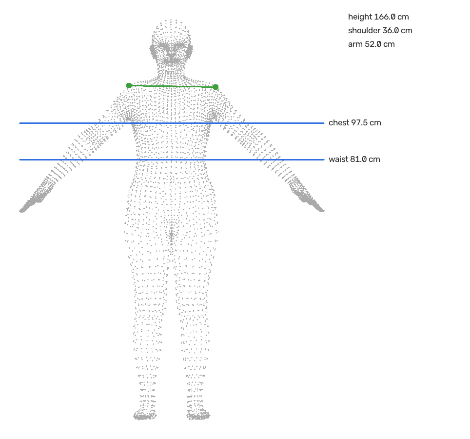
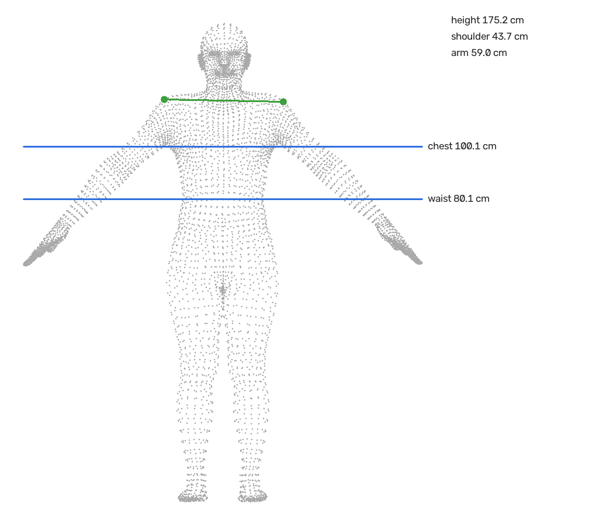
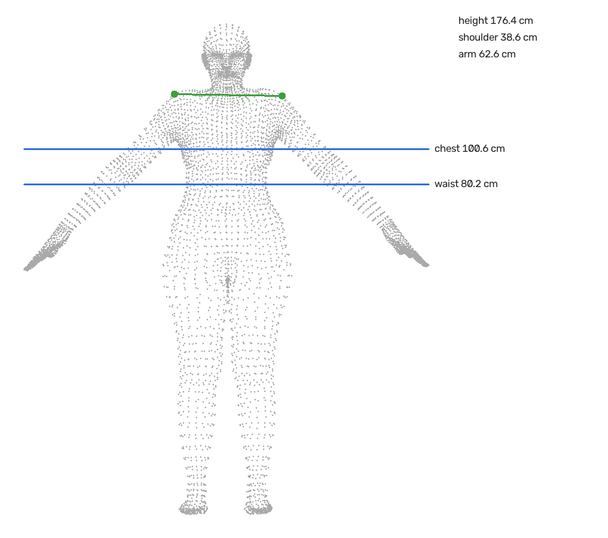
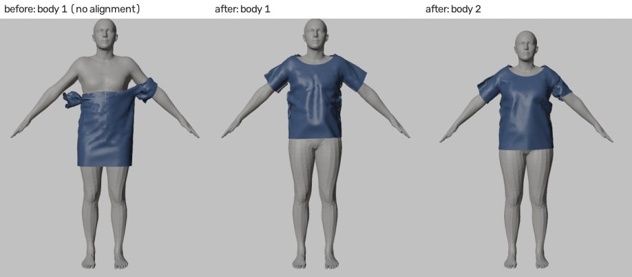

# SMPL 몸 생성 어댑터 (D3)

작성 2026-11-12 · 관련 이슈 #7 · 상태: 코드·가짜 몸 모델 테스트·**실제 SMPL v1.1.0 중성 모델 실행 완료**

사용자가 넣은 신체 치수 5개(키·가슴둘레·허리둘레·어깨너비·팔길이)에 맞는 SMPL 몸을 만든다. 만든 몸을 D2의 measure_v1로 다시 재서 허용 오차 안이면 A자세 몸 메시를 착장(C4)에 넘기고, 넘으면 `BODY_FIT_NOT_CONVERGED`로 영상 경로를 멈춘다. 핏 리포트는 이 단계와 상관없이 그대로 나온다.

## 1. 구성

| 위치 | 하는 일 |
|---|---|
| `fitting/body/fit.py` | 형상 계수·크기 최적화와 판정. 몸 모델을 모르고 `measure(betas, scale)` 함수만 받는다. 외부 SDK·어댑터를 import하지 않는다 |
| `fitting/adapters/smpl/builder.py` | `BodyBuilder` 포트 구현(`SmplBodyBuilder`). SMPL 몸을 A자세로 만들고 재는 `SmplPosedBody`, 메시 저장, 기록, 실패 처리 |
| `fitting/adapters/smpl/factory.py` | B4 팩토리 `make_body_builder(settings)`. `SMPL_MODEL_DIR`에서 중성 모델을 찾아 읽는다 |
| `config/adapters/smpl_body.yaml` | 몸만 실제 SMPL, 나머지 영상 단계는 가짜로 돌리는 설정 |
| `tools/build_body.py` | 서버 없이 같은 어댑터로 몸 하나를 만들어 OBJ·기록·확인 그림을 남기는 명령 |

- `fitting/body/measure.py`의 `measure_body`에 `round_cm` 선택 인자를 더했다. 기본은 지금처럼 0.1 cm 반올림이다. 최적화 중 기울기를 구할 때만 반올림하지 않은 값을 쓴다.
- 환경변수는 B4 설정과 같은 `SMPL_MODEL_DIR`(모델 **폴더**) 하나로 통일했다. D2 테스트가 쓰던 `SMPL_MODEL_PATH`(파일)는 없앴다. 폴더 안에서 이름에 `neutral`이 들어간 `.pkl`·`.npz`를 고른다.

## 2. 방법

명세서 5장 추천안(R05)과 `docs/decisions.md` "1주차 기준 [제안]" 5절을 따른다.

| 항목 | 값 |
|---|---|
| 몸 모델 | SMPL 중성 모델(입력에 성별이 없다) |
| 조정하는 값 | 형상 계수(betas) 앞 10개(각 ±3) + 전체 크기(0.75~1.25) |
| 측정 자세 | A자세 45°, measure_v1 (D2와 같다) |
| 목적값 | Σ((다시 잰 값 − 입력) / 허용 오차)² + 0.02·Σβ² (뒤 항은 형상 사전분포) |
| 최적화 | `scipy.optimize.least_squares`(trf, 경계 있음, 기울기는 차분) |
| 한도 | 시작점 3개 × 각 200회(기울기 계산을 포함한 전체 측정 횟수), 작업 시간 한도 = `PortRequest.timeout_seconds` |
| 조기 종료 | 한 시작점이 통과하면 남은 시작점은 돌리지 않는다 |
| 시작점 | 1번: 형상 계수 0. 2·3번: 형상 계수를 정규분포(표준편차 1, ±2에서 자름, seed 0)로 뽑음. 크기 시작값은 모두 `입력 키 / 평균 몸 키` |
| 고르는 점 | 시작점마다 목적값이 가장 작은 점. 그 점이 허용 오차를 넘었는데 중간에 다섯 치수를 모두 통과한 점이 있었으면 그중 목적값이 가장 작은 점(사전분포 항 때문에 통과하는 점의 목적값이 더 클 수 있다, 리뷰 반영) |
| 판정 | 고른 값으로 몸을 다시 만들어 0.1 cm 단위로 다시 재고, 다섯 치수가 모두 허용 오차 이하이고 메시 값이 유한할 때만 성공 |

허용 오차(cm, 이하 통과): 키 1.0, 가슴둘레 2.0, 허리둘레 2.0, 어깨너비 1.0, 팔길이 1.5.

- 단면 둘레(가슴·허리)는 미분식이 없다. 그래서 명세서 5장의 "단면 추출 때문에 미분이 끊기는 항목은 수치 최적화로 보완"을 따라 전부 차분 기울기로 푼다. PyTorch는 쓰지 않는다.
- 입력을 고치거나 가장 가까운 몸을 성공으로 내지 않는다. 실패하면 목적값이 가장 작았던 결과를 기록에만 남긴다.

### Powell에서 least_squares로 바꾼 이유

처음에는 #22 실험처럼 Powell(반올림한 측정값)로 구현했다. 실제 SMPL로 두 방법을 비교했다(같은 목적값·한도).

| 입력 | Powell | least_squares |
|---|---|---|
| 신체 1 (175/100/80/40/56) | 200회를 다 쓰고 통과, 최대 오차 1.4 cm(팔 −1.4) | 91회에 통과, 다섯 치수 오차 0.0 |
| 신체 2 (166/97.5/81/36/52) | 200회를 다 쓰고 통과, 최대 오차 0.5 cm | 109회에 통과, 다섯 치수 오차 0.0 |
| 팀 예시 (175/100/80/44/60) | 시작점 3개 모두 실패(가장 좋은 결과 팔 −3.8 cm) | 122회에 통과, 최대 오차 1.0 cm(팔 −1.0) |

Powell은 변수 11개를 한 방향씩 찾느라 200회 안에 수렴하지 못했다. 신체 1은 허용 오차 경계(1.5)에 걸쳐 통과했다. least_squares는 측정값이 형상 계수에 거의 선형이라 몇 번의 기울기 계산으로 수렴한다.

## 3. 결과 (SMPL v1.1.0 중성, `python -m tools.build_body`)

| 입력 (cm) | 결과 | 다시 잰 값 | 오차 | 측정 횟수 | 시간 | 크기 | 형상 계수 최대 \|β\| |
|---|---|---|---|---|---|---|---|
| 신체 1 175 / 100 / 80 / 40 / 56 | 통과 | 175.0 / 100.0 / 80.0 / 40.0 / 56.0 | 0.0 / 0.0 / 0.0 / 0.0 / 0.0 | 91 | 12~17초 | 1.040 | 1.19 |
| 신체 2 166 / 97.5 / 81 / 36 / 52 | 통과 | 166.0 / 97.5 / 81.0 / 36.0 / 52.0 | 0.0 / 0.0 / 0.0 / 0.0 / 0.0 | 109 | 14~18초 | 0.999 | 0.65 |
| 팀 예시 175 / 100 / 80 / 44 / 60 | 통과 | 175.2 / 100.1 / 80.1 / 43.7 / 59.0 | +0.2 / +0.1 / +0.1 / −0.3 / −1.0 | 122 | 19~20초 | 1.054 | **3.00 (10개 중 6개가 한계)** |
| 작은 몸 160 / 88 / 70 / 37 / 51 | 통과 | 160.0 / 88.1 / 69.9 / 37.0 / 50.9 | 0.0 / +0.1 / −0.1 / 0.0 / −0.1 | 114 | 20초 | 0.938 | |
| 큰 몸 185 / 108 / 92 / 45 / 60 | 통과 | 185.0 / 108.1 / 92.0 / 45.0 / 59.9 | 0.0 / +0.1 / 0.0 / 0.0 / −0.1 | 109 | 19초 | 1.043 | |
| 팔이 긴 몸 175 / 100 / 80 / 40 / 70 | **실패** | 176.4 / 100.6 / 80.2 / 38.6 / 62.6 | **+1.4** / +0.6 / +0.2 / **−1.4** / **−7.4** | 406 | 62초 | 1.015 | |

- 측정 횟수는 평균 몸 1회를 포함하고 마지막 재측정 1회는 뺀 값이다. 시간은 노트북(CPU) 기준이고, 다른 작업과 같이 돌린 실행은 더 걸렸다(1회 측정 약 0.15초).
- 신체 1·2는 모두 첫 시작점에서 수렴했고 형상 계수가 작다(|β| ≤ 1.2).

 

파란 선은 가슴·허리 측정 높이이고, 초록 점과 선은 어깨 끝점과 어깨너비다.

### 팀 예시 입력 (#22 1절과 달라진 점)

#22 1절은 Powell 실험으로 "175/100/80/44/60은 3개 모두 실패(팔 −3.8 cm)"라고 적었고, 그래서 기준 신체 1을 40/56으로 정했다. least_squares로는 팀 예시 입력도 허용 오차 안에 들어온다. 다만 형상 계수 10개 중 6개가 한계(±3)에 닿았다. 어깨와 팔을 평균보다 크게 만들려고 체형을 많이 비튼 몸이다(그림 3).



- 기준 신체 1(40/56)은 형상 계수가 작고 오차 0.0으로 만들어지므로 바꿀 이유는 없다.
- 형상 계수가 한계에 닿는 몸을 "비정상 변형"으로 보고 실패시킬지(명세서 5장 "스케일과 비정상 변형 여부 검사")는 팀이 정한다. 지금은 경계(±3, 크기 0.75~1.25)만 막는다.

### 실패 사례

키 175 cm에 팔길이 70 cm는 SMPL 형상 범위로 만들 수 없다. 시작점 3개를 모두 썼고(각각 수렴해서 멈춤, 합계 406회), 목적값이 가장 작은 결과도 팔이 −7.4 cm였다. 팔을 늘리려다 키(+1.4)와 어깨(−1.4)까지 허용 오차를 넘었다.

- 포트는 `PortFailure(BODY_FIT_NOT_CONVERGED)`를 던지고 메시를 만들지 않는다. 화면에는 "입력한 치수로 3D 몸을 허용 오차 안에 만들지 못했습니다(넘은 치수: 키, 어깨너비, 팔길이). 핏 리포트는 그대로 볼 수 있습니다."가 간다.
- `body_fit.json`에는 실패 이유(`failed_fields`)와 시작점 3개의 결과가 남는다. 입력값은 고치지 않고 그대로 기록한다.



## 4. 산출물과 기록

**몸 메시** `artifacts_dir/{job_id}_body_mesh.obj`
- 측정에 쓴 A자세(45°) 몸이다. 단위는 미터, y가 위, z가 앞, x가 몸의 왼쪽이다(SMPL·D2 OBJ와 같다). 정점 6890개, 면 13776개.
- **발바닥(정점 y 최솟값)이 y = 0이 되도록 위아래로만 옮겨 저장한다.** 착장(C4)의 GarmentCode 패널이 바닥 0인 몸 기준 위치에 놓이고, C4 어댑터는 몸을 옮기지 않기 때문이다(리뷰 반영). SMPL 출력은 원점이 골반 근처라 발바닥이 y < 0(신체 1은 −1.18 m)에 있었다.
- 옮긴 양은 기록의 `translation_m`이다. 평행 이동이라 치수는 그대로다(테스트로 확인).
- 같은 작업 ID로 다시 돌리다 실패하면, 남아 있던 예전 몸 메시를 지운다(기록 `removed_stale_mesh`).

**기록** `work_dir/{job_id}/body_fit.json` (성공·실패 모두)

| 키 | 내용 |
|---|---|
| `passed`, `artifact_id`, `failure` | 결과. 실패면 `failure.failed_fields`(허용 오차를 넘은 치수)와 `mesh_finite` |
| `input_cm`, `fitted_cm`, `error_cm`, `tolerance_cm`, `max_abs_error_cm` | 입력값·다시 잰 값·오차(다시 잰 값 − 입력)·허용 오차 |
| `betas`, `scale` | 고른 형상 계수·크기(반올림하지 않아서 같은 몸을 다시 만들 수 있다) |
| `betas_at_bound` | 형상 계수 중 경계(±3)에 닿은 개수. "비정상 변형" 기준을 정할 때 쓴다 |
| `translation_m` | 모델 출력 → OBJ로 옮긴 양(발바닥을 y = 0으로) |
| `landmarks` | 가슴·허리 측정 높이(m), 어깨 끝점 좌표(m). OBJ 좌표(옮긴 뒤)다 |
| `optimization` | 설정(한도·허용 오차·방법), 평균 몸 치수, 시작점별 결과(시작값·결과·측정 횟수·멈춘 이유), 전체 측정 횟수·시간 |
| `body_model`, `tool_versions` | 모델 파일 이름, 자세, 정점 수, numpy·scipy 버전, `body_fit_v1` |

**포트 결과** (`PortResult`)
- 산출물: `[{job_id}_body_mesh]`
- 지표: B1 계약 키 `fitted_height_cm`·`fitted_chest_cm`·`fitted_waist_cm`·`fitted_shoulder_cm`·`fitted_arm_length_cm`·`max_abs_error_cm`, 그리고 `fit_evaluations`(마지막 재측정 포함 측정 횟수)·`fit_seconds`
- 실패: `PortFailure(BODY_FIT_NOT_CONVERGED, stage=BODY_FIT, retryable=false)`. `internal_details_ref`는 `{job_id}/body_fit.json`(work_dir 기준)이다.
  - 허용 오차 초과: "입력한 치수로 3D 몸을 허용 오차 안에 만들지 못했습니다(넘은 치수: 팔길이). 핏 리포트는 그대로 볼 수 있습니다."
  - 시간 한도 초과: "3D 몸을 만드는 데 시간 한도를 넘었습니다. 잠시 뒤 다시 시도해 주세요. 핏 리포트는 그대로 볼 수 있습니다." (리뷰 반영: 몸이 안 맞는다는 안내와 나눔)

## 5. 실행 방법

SMPL 모델은 각자 [공식 사이트](https://smpl.is.tue.mpg.de)에서 받는다(`docs/spikes/smpl-body-measure.md` 4절). 저장소에 올리지 않는다.

```bash
pip install -e ".[dev,body]"
python -m pytest tests/body tests/adapters/test_smpl_builder.py   # 모델 파일 불필요
SMPL_MODEL_DIR=models/smpl python -m pytest -m smpl                # 실제 모델 (D2 5개 + D3 2개)

# 몸 하나 만들기: artifacts/body_fit/<이름>/ 에 OBJ·body_fit.json·debug_front.png
SMPL_MODEL_DIR=models/smpl python -m tools.build_body --case body1
SMPL_MODEL_DIR=models/smpl python -m tools.build_body --body 170,95,85,41,55 --name my_body

# 피팅 흐름 전체에서 몸만 실제로
SMPL_MODEL_DIR=models/smpl python -m tools.run_fitting_once --adapters smpl_body
SMPL_MODEL_DIR=models/smpl FIT_ADAPTERS=smpl_body uvicorn server.app:app --port 8000
```

- `tools.build_body` 종료 코드: 0 통과, 3 허용 오차 초과, 1 설정 오류(모델 폴더 없음 등)
- 모델이 없는 PC에서 `smpl_body`를 고르면 서버·실행 스크립트가 시작하지 않고 `SMPL_MODEL_DIR`을 정하라고 알려 준다(B4 규칙: 가짜로 대신하지 않는다).
- `config/adapters/default.yaml`의 `body`는 아직 `fake`다. 팀원 PC에 SMPL 모델이 준비되면 그 줄을 `"fitting.adapters.smpl.factory:make_body_builder"`로 바꾼다.

## 6. 한계와 다음

- **성별:** 입력에 성별이 없어 중성 모델만 쓴다. 신체 2(여성 평균 치수)도 중성 모델로 오차 0.0에 맞았다.
- **비정상 변형:** 지금은 형상 계수 ±3·크기 0.75~1.25 경계만 막는다. 팀 예시처럼 여러 계수가 한계에 닿는 몸을 실패로 볼지 정해야 한다(3절). 정하기 쉽게 기록에 `betas_at_bound`(한계에 닿은 개수)를 남긴다.
- **시간:** 통과하는 몸은 12~20초, 실패하는 몸은 시작점 3개를 다 써서 더 오래 걸린다(팔이 긴 몸 62초). 작업 시간 한도(기본 600초)를 넘으면 그때까지 가장 좋은 결과로 판정하고, 통과하지 못했으면 시간 한도 안내로 실패한다.
- **몸 비율:** 착장 패널은 GarmentCode `mean_all`(키 172 cm) 기준 위치에 놓인다. 그래서 처음에는 기준 신체 1(어깨 끝 약 5 cm 높음)에서 옷이 어깨에 걸리지 못하고 흘러내렸다. 2026-11-25에 C4 export가 패널을 입력 몸의 어깨에 맞춰 옮기게 고쳐 기준 신체 1·2 모두 착장이 통과했다(7절). 어깨 44 cm 몸은 옷 어깨가 좁아 아직 실패한다(7절 '어깨가 넓은 몸').
- **C4로 넘길 것:** 기준 신체 2명의 OBJ(`tools.build_body --case body1`, `--case body2`). 공유 드라이브로 넘긴다(`artifacts/`는 커밋하지 않는다).

## 7. SMPL 몸 착장 확인 (2026-11-25)

기준 신체 1·2의 SMPL 몸(4절 `tools.build_body` 결과)에 시연 티셔츠 1(`tee_regular_m_navy_v1`)을 C4 착장으로 입혔다(`drape_v1`, 분석 생략).



*왼쪽부터 고치기 전 신체 1, 고친 뒤 신체 1, 고친 뒤 신체 2(착장 미리보기 `front.png`).*

| 몸 | 어깨 끝 높이 차(좌 / 우, `mean_all` 대비) | 옷을 옮긴 거리(위아래) | 늘어남(기준 1.5 이하) | 봉제 틈(기준 10 mm 이하) | 결과 |
|---|---|---|---|---|---|
| 신체 1, 고치기 전 | +5.1 / +4.6 cm | 0 | 4.46 | 24.1 mm | 실패(옷이 엉덩이 쪽으로 흘러내림) |
| 신체 1 | +5.1 / +4.6 cm | +6.1 cm | 1.481 | 6.2 mm | 통과 |
| 신체 2 | −2.7 / −3.1 cm | −1.7 cm | 1.345 | 7.7 mm | 통과 |

- **원인:** GarmentCode는 패턴을 만든 몸(`mean_all`) 둘레에 패널을 놓는다. 신체 1은 어깨 끝이 약 5 cm 높아 어깨 솔기가 몸 안을 지나야 했고, 봉제가 닫히지 못했다.
- **고친 방법:** 패널 모양은 그대로 두고 패널마다 평행 이동만 한다(`fitting/adapters/garmentcode/placement.py`). 모든 패널은 어깨 끝 높이 차(좌우 중 큰 쪽) + 봉제 여유 1 cm만큼, 소매는 그쪽 어깨 끝의 옆 위치 차만큼 옮긴다.
- **어깨 끝 찾기 (`shoulder_tips_v2`):** 키의 70 % 위·88 % 아래, 몸 중심에서 10 cm 밖의 정점 가운데 `z + 0.65·|x|`가 가장 큰 점이다. 기준 신체 1·2에서 오른쪽은 D3 기준점(정점 6470)과 같은 정점이고, 왼쪽은 정점 3011과 앞에서 본 위치로 1.6 cm 차이다.
  - **88 % 위 경계(머리 빼기):** 어깨 44·팔 60 cm 몸(키 175, 가슴 100, 허리 80, 웹의 예시 치수)은 머리가 옆으로 10.0 cm까지 나왔다. 위 경계가 없던 v1은 키의 93 % 높이 머리 옆을 왼쪽 어깨 끝으로 잡아 옮길 거리를 21.3 cm로 계산했고, 상한 20 cm에 걸려 export가 멈췄다(`GARMENT_NOT_READY`).
  - 실제 몸 4개(신체 1·2, 이 몸, `mean_all`)에서 옆 10 cm 밖 정점은 어깨 쪽이 모두 키의 86 % 아래, 머리 쪽이 90 % 위였다. 그 사이인 88 %를 경계로 두었다.
  - 고친 뒤 이 몸은 export를 통과했다(어깨 끝 차 좌 6.0·우 5.6 cm, 위아래 7.0 cm). 신체 1·2와 `mean_all`의 어깨 끝은 그대로다. 다만 이 몸의 Blender 착장은 늘어남 1.784(기준 1.5)·봉제 틈 14.8 mm(기준 10 mm)로 `DRAPE_INVALID`였다(안정·관통은 통과). 원인은 어깨 너비였다(아래 '어깨가 넓은 몸').
- **봉제 여유 1 cm:** 신체 1에서 옮기는 거리만 바꿔 시험했다. 4.85 cm(좌우 평균)는 봉제 틈 10.2 mm, 5.1 cm(큰 쪽)는 늘어남 1.62로 실패했고, 5.85 cm·6.85 cm는 통과했다(1.47·7.3 mm, 1.46·7.7 mm). 실패는 모두 어깨 끝 근처였다. SMPL 어깨가 `mean_all`보다 평평해 봉제하는 동안 솔기가 어깨에 걸리는 것으로 보인다.
- **같은 몸이면 그대로:** `mean_all`에 입히면 옮기는 거리가 0이라 이전 결과와 같다.
- **남은 것:** 어깨가 넓은 몸은 착장에서 실패한다(아래). 몸통 앞뒤 깊이는 옮기지 않으므로(지금 세 몸은 앞뒤 깊이가 1~2 cm 안), 배·가슴이 많이 큰 몸은 따로 확인해야 한다. 렌더·실사화는 세 PR(#44·#45·#46)을 로컬에서 합친 화면 서버로 신체 1을 끝까지 돌려 확인했다(2026-11-27, 검증 PASS).

```powershell
# 저장소 루트에서, GarmentCode용 Python으로(출력 폴더는 --out-root)
C:\dev\venvs\garmentcode\Scripts\python.exe -m fitting.adapters.blender.run_drape --spec data\prepared\tee_regular_m_navy_v1\specification.json --body <신체 1 OBJ> --config config\drape\drape_v1.json --name body1 --out-root C:\dev\_runs\smpl_drape --skip-analyze
```

**어깨가 넓은 몸** (2026-11-27, 화면 서버, 실사화 동의 없음·비용 없음)

웹 예시 치수 몸이 왜 실패하는지 보려고 어깨와 팔을 하나씩 키운 몸을 돌렸다. 옷 어깨 끝은 앞판 진동 솔기의 맨 위 점이다.

| 몸 (키/가슴/허리/어깨/팔) | 몸 어깨 끝(좌 / 우, 몸 중심에서) | 옷 어깨 끝보다 밖으로 | 늘어남 | 봉제 틈(용접 전) | 결과 |
|---|---|---|---|---|---|
| 신체 1 (175/100/80/40/56) | 19.0 / 19.8 cm | 1.7 / 2.4 cm | 1.481 | 6.2 mm | 통과 |
| 팔만 60 (175/100/80/40/60) | 19.0 / 19.6 cm | 1.7 / 2.3 cm | 1.491 | 6.5 mm | 통과 |
| 어깨만 44 (175/100/80/44/56) | 20.8 / 22.0 cm | 3.5 / 4.6 cm | 1.542 | 16.9 mm | 실패 |
| 웹 예시 (175/100/80/44/60) | 20.8 / 21.6 cm | 3.5 / 4.2 cm | 1.784 | 14.8 mm | 실패 |

- **원인은 어깨 너비:** 팔만 늘린 몸은 신체 1과 거의 같은 값으로 통과했고, 어깨만 넓힌 몸은 실패했다. 팔까지 길면 늘어남이 더 커진다(1.542 → 1.784). 위아래로 옮긴 거리는 팔만 60 몸이 7.8 cm로 가장 컸지만 통과했다.
- **옷 어깨가 좁다:** 옷 어깨 끝은 어느 몸에서나 몸 중심에서 17.3 cm다. 실제 옷 어깨는 46 cm인데, GarmentCode가 어깨를 조정하지 못해 차이만 기록하기로 한 부분이다(decisions.md '패턴 (C4, 견본 최적화 잔여 오차)', 견본 어깨 34.5 cm). 어깨 44 cm 몸은 어깨 끝이 옷 어깨 끝보다 3.5~4.6 cm 밖에 있다. 두 몸 모두 앞판 어깨 모서리가 어깨 위로 3~5 cm 끌려 올라간 곳이 가장 많이 늘어났고, 겨드랑이 둘레 솔기(진동·옆솔기·소매 밑)가 닫히지 못했다.
- **배치로는 풀리지 않았다:** 웹 예시 몸에서 봉제 여유(0·1·2·3 cm)와 소매 옆 이동(0·0.5·1배)을 바꾼 6가지가 모두 실패했다(늘어남 1.66~1.90, 봉제 틈 14.8~21.8 mm, 저장소 밖 스크립트). 소매를 덜 옮기면 늘어남은 줄지만 봉제 틈이 커졌다. 이런 몸을 입히려면 옷 어깨를 실제 너비에 가깝게 만드는 방법(decisions.md의 C2 어깨 표현 방법)이 먼저 정해져야 해 보인다.
- **지금 동작:** 어깨 44 cm 몸은 핏 리포트까지 나오고, 시각 피팅은 착장에서 멈춘다(작업 상태 `PARTIAL_SUCCEEDED`, `DRAPE_INVALID`).
