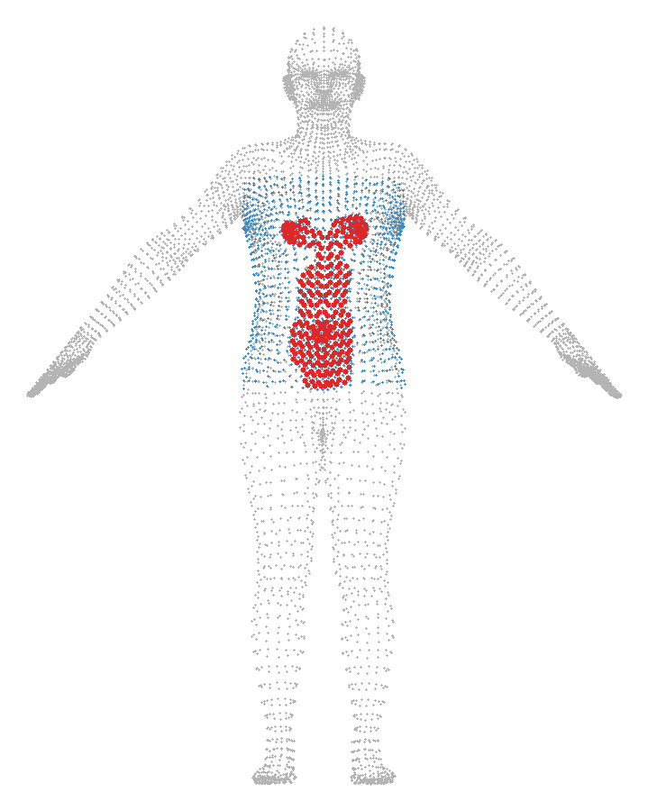

# 착장 점검 (D4)

작성 2026-11-12 · 관련 이슈 #8 · 상태: 코드·합성 메시 테스트·D3 몸으로 확인 완료, **C의 실제 착장 결과로는 아직 확인 못 함**(C4 전)

착장 결과(옷 메시)가 몸을 파고들었는지 재고, 기준으로 판정하고, 결과를 JSON으로 남긴다. 명세서 6장 착장 검사의 "충돌" 항목이다. 판정이 통과가 아니면 `DRAPE_INVALID`다.

## 1. 구성

| 위치 | 하는 일 |
|---|---|
| `fitting/verify/drape_check.py` | 판정 로직. 면 넓이·부호 거리로 관통 지표를 내고 기준과 비교한다. numpy만 쓰고 외부 SDK·어댑터를 import하지 않는다 |
| `fitting/adapters/meshcheck/geometry.py` | OBJ 읽기, 닫힘 검사, 옷 면 중심 → 몸 표면 부호 거리(Blender 없이 numpy·scipy) |
| `fitting/adapters/meshcheck/check.py` | 점검 실행 `check_drape(몸, 옷, 기준)`, 기준 읽기, C2 실행 폴더 읽기, 기록 쓰기 |
| `tools/check_drape.py` | OBJ 두 개(또는 C2 실행 폴더)로 점검하고 기록·확인 그림을 남기는 명령 |

**C4에서 쓰는 법**: 착장이 끝난 뒤 `check_drape(MeshInput(몸), MeshInput(착장된 옷), 기준)`을 부른다.
- 통과가 아니면 `PortFailure(DRAPE_INVALID)`로 실패한다.
- `result.metrics()`(`drape_check_status`, `penetration_area_ratio`, `max_penetration_mm`)는 포트 지표에 넣는다.
- `result.to_record()`는 작업 기록에 넣는다.

## 2. 기준과 판정

기준값은 새로 정하지 않고 C2 착장 설정(`config/drape/drape_v1.json`의 `thresholds`)을 읽는다. 명세서 6장 초기값이다.

| 기준 | 값 |
|---|---|
| `penetration_depth_m` | 0.003 (몸 안으로 3 mm보다 깊은 면만 관통으로 센다) |
| `penetration_area_ratio_max` | 0.01 (관통 면적이 옷 전체 넓이의 1 % 이하면 통과) |

| 판정 | 조건 | 오류 코드 |
|---|---|---|
| PASS | 관통 면적 비율 ≤ 1 %, 옷 좌표가 모두 유한 | 없음 |
| FAIL | 관통 면적 비율 > 1 %, 또는 옷 좌표에 NaN·inf | `DRAPE_INVALID` |
| UNVERIFIABLE | 몸 메시가 닫혀 있지 않거나 부호 거리를 못 구한 면이 있음(명세서 6장 "검증 불가") | `DRAPE_INVALID`(통과로 숨기지 않는다) |

- 관통 면적 비율은 C2 `fitting.adapters.blender.metrics.penetration`과 같은 정의다. 테스트에서 같은 입력에 같은 값이 나오는지 확인한다.
- 안정·신장·봉제선 검사는 시뮬레이션 기록(패턴 원래 길이, 프레임별 이동량)이 필요해 C의 `metrics.evaluate`가 그대로 한다. 이 점검은 최종 메시만 있으면 된다.

## 3. 부호 거리 (Blender 없이)

C2는 부호 거리를 Blender BVH로 구했다. 그래서 Blender가 없는 PC·CI에서는 다시 잴 수 없었다. 이 점검은 numpy·scipy만 쓴다.

1. 몸 정점으로 kd-tree를 만들고, 옷 면 중심마다 가까운 몸 정점 8개를 찾는다.
2. 그 정점들에 붙은 삼각형 위의 가장 가까운 점을 정확히 계산한다(Ericson 방법).
3. 부호는 가장 가까운 점에서 보간한 정점 법선 방향으로 정한다(바깥 +).

| 확인 | 결과 |
|---|---|
| 반지름 10 cm 구(면 5120개)와 점 2만 개 | 해석해와 최대 0.11 mm 차이(구를 삼각형으로 근사한 차이). 부호가 다른 점은 모두 표면 0.08 mm 안 |
| 잘게 나눈 정육면체 | 면·모서리 거리 정확(테스트) |
| 무작위 삼각형 50개 | 가장 가까운 점이 촘촘히 뽑은 점보다 항상 가깝다(테스트) |
| 속도 | SMPL 몸(면 13,776개)에 옷 면 13,776개를 재는 데 0.67초 |

## 4. D3 몸으로 확인 (SMPL 신체 1)

C4 전이라 실제 착장 결과가 없다. 그래서 D3의 신체 1 몸(175/100/80/40/56)으로 합성 "옷"을 만들어 확인했다. 몸통(키의 52~80 % 높이, 팔 제외) 표면을 정점 법선 방향으로 밀어낸 열린 메시다(정점 1141개, 면 2165개).

| 합성 옷 | 판정 | 관통(>3 mm) 면적 | 가장 깊은 곳 | 몸 밖 거리 중앙값 |
|---|---|---|---|---|
| 몸통을 1 cm 띄움 | PASS | 0 % | 0 mm | 9.9 mm |
| 앞판 15 %가 8 mm 파고듦 | **FAIL** | 12.0 % | 8.0 mm | 9.9 mm |
| 가슴 한 곳만 8 mm 파고듦 | PASS | 0.31 % (기준 1 % 이하) | 8.0 mm | 9.9 mm |
| 참고: 몸 전체를 5 mm 띄움(면 13,776개) | PASS | 0.10 % | 5.0 mm | 4.9 mm |

- 마지막 줄은 겨드랑이·손가락처럼 오목한 곳에서 밀어낸 면이 옆 부위로 들어간 것이다. 실제 기하에서 생기는 관통이라 면적이 작으면 통과로 둔다.
- 몸 메시(SMPL)는 닫혀 있다고 나왔다(모든 변이 두 면에 쓰임).



## 5. 기록과 실행

```bash
python -m tools.check_drape --body body.obj --garment garment_draped.obj
python -m tools.check_drape --c2-run <C2 착장 실행 폴더>      # Blender로 잰 C2 결과와 나란히 보여 줌
python -m tools.check_drape --body body.obj --garment g.obj --config config/drape/drape_v0.json
```

결과는 `artifacts/drape_check/<시각>/`에 남는다(커밋 금지).
- `drape_check.json`: 판정, 오류 코드, 이유, 관통 지표, 기준(설정 이름·버전·sha256), 가장 깊은 곳 5개, 입력 크기, 걸린 시간
- `debug_front.png`: 정면 투영(몸 회색, 옷 파랑, 3 mm보다 깊은 관통 빨강)

종료 코드: 0 통과, 3 기준 초과, 4 검증 불가, 1 입력 오류.

## 6. 남은 것

- **C의 실제 착장 결과로 확인:** C2 실행 폴더가 있으면 `--c2-run`으로 Blender 결과와 비교한다. 지금 이 PC에는 Blender와 C2 실행 결과가 없다.
- **C4 연결:** C4 착장 어댑터가 `check_drape`를 부르게 한다. 어느 몸 메시(D3 산출물)와 비교할지는 C4가 정한다.
- **몸이 열린 메시인 경우:** 지금은 검증 불가로 실패시킨다. SMPL 몸은 닫혀 있어서 해당하지 않는다.
