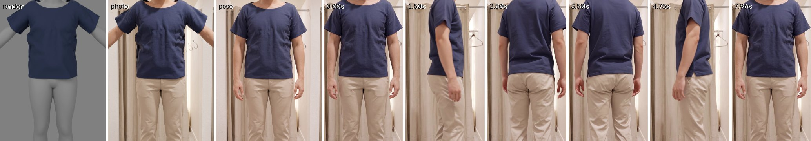
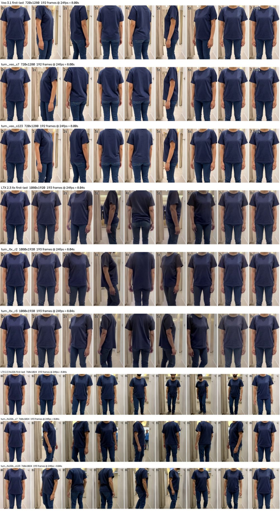
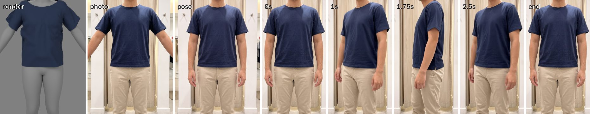
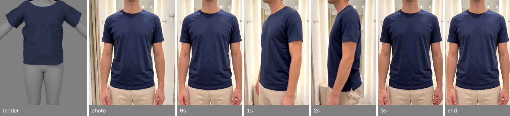
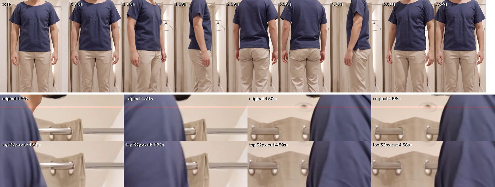
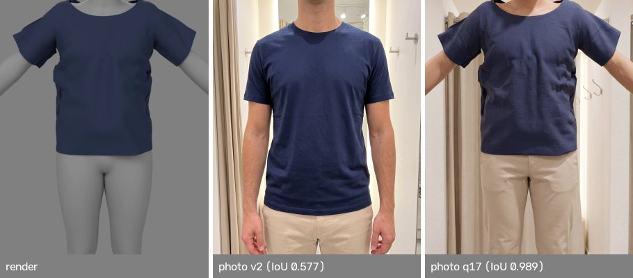

# 피팅룸 실사화: 렌더를 핏 참고로 쓴 회전 영상

작성 2026-11-25 · 고침 2026-11-26(4초 1/4 바퀴 왕복)·2026-11-27(8초 한 바퀴 + 맨 위 자르기) · 관련 이슈 #10 #11 #12 · 결정 `docs/decisions.md` 2026-11-25·2026-11-26·2026-11-27

## 상태

- 코드, 가짜 fal·가짜 Blender 테스트, 드라이런은 끝났다.
- 지금 기본 흐름(2026-11-27, `realize_fitroom_v4`·`fitroom_prompt_v4`)은 사진(v3 문장) → 자세 → 8초 한 바퀴(턱·수염 금지 문장) → 회전 영상 맨 위 32px 자르기다. 작업 1건 $1.10이다.
- 단계마다 실제 결과로 확인했다(기준 신체 1의 A자세 렌더). 사진(q17)은 핏 확인 IoU 0.989, 자세 사진(q18)은 소매 아래 몸통 IoU 0.956이었다. 회전(q23)은 한 방향으로 한 바퀴 돌아 뒤집힘이 없었고 피팅룸 검사 PASS였다. 옆모습에서 화면 맨 위에 걸친 수염 끝(15px 안)은 맨 위 32px 자르기로 사라졌다(2.8절).
- q23 결과를 가짜 fal로 고친 어댑터에 넣어 다시 돌리면(비용 없음) 같은 문장으로 같은 영상을 만들었다. 어댑터로 처음부터 한 번에 돌린 실제 호출은 아직 없다.
- 2026-11-26에는 회전이 4초 1/4 바퀴 왕복이었다(작업 1건 $0.70). 이 회전은 문장과 반대 방향으로 돌거나 옆모습에서 반대쪽으로 뒤집혀(q16·q18~q20) 한 바퀴로 되돌렸다. Veo 한 바퀴는 지금까지 뒤집힌 적이 없다(q5·q6·q8·q22·q23).
- 실험의 사진은 착장에서 팔을 수직 32°까지 내린 렌더로 만들었다. 이 착장 변경(D3·C4·C5)은 별도 PR이고, 그 PR에서 기준 신체 1·2는 팔 내린 상태가 C4 기준을 넘어 A자세 렌더가 됐다(5절). 그래서 지금은 A자세 렌더로 사진을 만들고, 자세 사진이 팔을 끝까지 내린다.

## 목표

목표는 영상이 "매장 피팅룸에서 실제 사람이 그 티셔츠를 입어 본" 것처럼 보이게 하는 것이다.

- **구도:** 목 아래만 찍는다. 얼굴·머리는 화면 밖이다(턱 아래에서 자름). 옆모습에서 턱 끝·수염이 화면 맨 위에 걸치면 맨 위 32px을 잘라 없앤다.
- **체형:** 영상 속 사람의 체형은 렌더 몸을 따른다.
- **움직임:** 숨쉬기와 제자리 한 바퀴뿐이다. 앞 → 옆 → 뒤 → 반대쪽 옆 → 앞으로 8초 동안 돌고 정면에서 끝난다. 처음부터 끝까지 팔을 내린 자세다. 2026-11-26에는 4초 1/4 바퀴 왕복이었다(되돌린 이유는 1.1·2.8절).

착장과 렌더는 다시 돌리지 않는다. 바꾸는 것은 실사화 단계뿐이다.

## 코드와 설정

| 위치 | 하는 일 |
|---|---|
| `fitting/adapters/fal_fitroom/` | `FitRoomRealizer`(`Realizer` 포트, `realize_fitroom_v4`), 문장(`prompts.py`), 단계별 호출 값(`steps.py`), 회전 영상 맨 위 자르기(`encode.py`, Blender로 H.264를 쓰는 `blender_encode.py`), 팩토리 |
| `tools/realize_fitroom.py` | 서버 없이 렌더 클립 하나로 실사화 실행(기본 3단계와 맨 위 자르기. `--no-pose-step`이면 자세를 빼고 2단계, `--top-crop 0`이면 자르지 않음). 기본은 드라이런, `--yes`일 때만 실제 호출 |
| `fitting/verify/fitroom_check.py` · `fitting/adapters/media/fitroom_measure.py` | 피팅룸 검사: 판정(순수 로직)과 측정(OpenCV) |
| `config/adapters/visual_fitroom.yaml` | 영상 경로 5단계 중 실사화만 피팅룸 어댑터로 바꾼 설정 |
| `config/validate/fitroom_check_v1.json` | 영상 검사 기준값과 핏 확인 사진 맞춤 범위(1.1.0) |

## 1. 흐름



*지금 흐름이다. 왼쪽부터 기준 신체 1 렌더(C5, A자세), 사진(v3 문장 q17, 핏 확인 프레임), 자세 사진(q18), 회전 영상 0·1.5·2.5·3.5·4.75초와 마지막 프레임이다. 회전 영상은 q23 결과를 고친 어댑터에 넣어 맨 위를 자른 것이다(1.5·4.75초가 옆모습, 2.5·3.5초가 뒷모습). 4초 1/4 바퀴 왕복 때의 결과(q18, 반대 방향으로 돌고 옆모습이 뒤집힘)는 `realize-fitroom/6-v3-flow.jpg`, 예전 8초 한 바퀴 결과(q8)는 `realize-fitroom/1-steps.jpg`에 있다.*

| 단계 | 하는 일 | 모델 (fal) | 출력 파일 | 1건 비용 · 시간(실측) |
|---|---|---|---|---|
| 사진 | 렌더 첫 프레임을 매장 피팅룸의 실제 사람 사진으로 바꾼다. 체형·자세·구도·티셔츠 핏(색·기장·가슴과 허리 여유·어깨선·소매)은 그대로 둔다. 이 사진이 핏 확인 프레임이다 | `fal-ai/nano-banana-pro/edit` (3:4, 2K, PNG) | `{job}_realize_fit_frame.png` | $0.15 · 약 40~53초(q13 39초, q7 53초) |
| 자세 (기본 켬) | 사진에서 팔만 끝까지 내린다. A자세 렌더면 팔이 벌어져 있고, 팔 내린 렌더(수직 32°)면 조금만 내리면 된다 | `fal-ai/nano-banana-pro/edit` | `{job}_realize_pose.png` | $0.15 · 약 36초(q15) |
| 회전 | 시작·끝 프레임을 모두 자세 사진(자세를 끄면 사진)으로 고정한다. 숨쉬기와 제자리 한 바퀴만 하는 8초 영상을 만든다 | `fal-ai/veo3.1/fast/first-last-frame-to-video` (Veo 3.1 Fast, 8초, 720p, 소리 끔, 시드 42) | 작업 폴더 `turn.mp4`(받은 그대로) | $0.80 · 약 52초(q23 51.8초) |
| 맨 위 자르기 (기본 32px) | 회전 영상 맨 위 32px을 잘라 내고 같은 배율(1.026배)로 키워 720×1280을 지킨다. 옆모습에서 화면 맨 위에 걸치는 수염 끝을 없앤다 | 없음(로컬. OpenCV로 자르고 Blender 내장 FFmpeg로 H.264) | `{job}_video.mp4` (720×1280, 9:16) | $0 · 약 25초(q23 결과로 잼, Blender 17초) |
| 합계(기본) | | | | **$1.10 · 약 2분 40초~3분**(단계별 실측을 더한 값. 자세를 끄면 $0.95) |

비용·출력에 대한 메모:

- **계약 출력:** 지금처럼 `{job}_video.mp4` 하나다(`REALIZE_OUTPUTS`).
- **중간 사진:** 사진과 자세 사진은 계약 밖 산출물이다. C5 옷 마스크와 같은 방식으로 이름 규칙으로 찾는다. 검증 어댑터가 사진을 핏 확인 프레임으로 쓴다(3절). 받은 그대로의 회전 영상은 작업 폴더의 `turn.mp4`로 남는다.
- **가격:** 2026-11-25 fal 모델 페이지 기준이다(`steps.PRICE_CHECKED_ON`). 모두 정해진 값이라 예상 비용과 실제 비용이 같다.
- **회전 모델 고르기:** 기본은 Veo 3.1 Fast다(초당 $0.10, 8초 $0.80). `turn_model="standard"`(명령은 `--turn-model standard`)로 표준판(초당 $0.20, 8초 $1.60)을 쓸 수 있다. 입력 형식은 같다.
- **회전 길이:** 기본 8초(한 바퀴)다. `turn_duration_s`(명령은 `--duration`)로 4·6초를 고를 수 있지만, 지금 문장(한 바퀴)으로는 8초만 시험했다. 4초 한 바퀴는 뒷모습에서 정면으로 장면이 끊겼다(q9).
- **맨 위 자르기:** `top_crop_px`(명령은 `--top-crop`, 기본 32, 0이면 끔). 프레임을 OpenCV로 자르고 Blender 내장 FFmpeg로 H.264를 다시 쓴다(`encode.py`·`blender_encode.py`, 렌더 클립과 같은 방식). pip OpenCV는 OpenH264 DLL이 없으면 H.264를 쓰지 못하고 mp4v만 쓰는데, 브라우저가 mp4v를 틀지 못한다.
  - Blender 경로는 `BLENDER_PATH`(없으면 `BLENDER_EXE`)다. 자르기를 켰는데 Blender가 없으면 fal을 부르기 전에 멈춘다.
  - 중간 프레임(무압축 BMP, 8초에 약 0.5 GB)은 시스템 임시 폴더에 쓰고 바로 지운다. PNG(압축 1)로 작업 폴더에 쓰던 처음 판은 84초 걸렸다.
  - 자르기가 실패해도 받은 회전 결과는 남는다. 다시 부르면 회전을 다시 제출하지 않고 자르기만 다시 한다(1.3절).
- **비용 상한:** 업로드 전에 단계별 예상 비용 합을 보고, `max_cost_usd`(기본 $3.0)를 넘으면 멈춘다.
- **시간:** fal 대기열이 없을 때 기준이다. 실사화 시간 제한 900초(`config/pipeline_v0.yaml`)는 자세 사진·표준판·대기열을 위한 여유다.

### 1.1 왜 이 단계들인가

- **render-to-real만으로는 안 된다(q0·q1).** 이 모델은 강도를 올려도 입력 렌더의 구조와 움직임을 그대로 따른다. 그래서 회색 마네킹과 정지 영상이 남는다.
- **처음의 사진 → 영상은 핏이 흔들렸다(q2).** 옛 사진 문장은 렌더의 박스형 핏을 "그럴듯한 레귤러 핏"으로 다듬었고, 짙은 청바지 때문에 검증도 하지 못했다.
- **그래서 한동안 "핏 옮기기"를 넣었다(q3~q7).** 렌더 클립과 사진을 LTX render-to-real에 넣고 마지막 프레임을 썼다. 렌더 구조를 따라가 렌더 핏이 사람에게 입혀졌다.
- **핏 옮기기를 뺐다(q7·q8).**
  - 사진 문장에 핏 지시를 넣고 바지를 옷과 대비되게 바꾼 뒤로는 사진이 렌더 핏을 더 잘 지켰다. q7에서 사진 IoU는 0.973, 핏 옮기기 프레임은 0.948이었다.
  - 사진을 바로 회전 영상에 쓴 q8도 피팅룸 검사 PASS였다.
  - 빼면 실사화가 약 4분 16초에서 약 2분 6초로 줄고, 비용도 $1.02에서 $0.95로 준다.
- **자세 사진을 기본으로 켠다.** 처음엔 핏 옮기기 프레임에서 손이 밑단을 잡아 팔을 내려야 해서 필수였고, 시간을 줄이려고 옵션으로 돌렸다(q7). 그 뒤 기본 흐름이 팔을 벌린 채 시작·끝나서(q7·q8) 다시 기본으로 켰다.
- **회전을 4초 1/4 바퀴 왕복으로 바꿨다(q9~q16, 2026-11-26).**
  - 비용을 줄이려고 회전을 4초로 줄이자, 한 바퀴 문장은 뒷모습에서 정면으로 화면이 튀었다(q9).
  - 앞 → 옆 → 앞은 4초 안에 자연스러웠다(q11). 다만 되돌아오는 방향을 적지 않으면 반대쪽 옆모습으로 튀었다(q13). 방향을 적은 문장(q16)에서는 같은 길로 되돌아왔다. 다만 도는 방향은 문장과 반대(몸의 오른쪽)였다(2.8절).
  - 회전 비용은 $0.80 → $0.40, 실사화는 $1.10 → $0.70이 됐다. 대신 뒷모습은 보여 주지 않았다.
- **회전을 다시 8초 한 바퀴로 되돌렸다(q18~q23, 2026-11-27).**
  - 4초 1/4 바퀴 왕복은 실제 흐름(A자세 렌더 → v3 사진 → 자세)에서 문장과 반대 방향으로 돌거나 옆모습에서 반대쪽으로 뒤집혔다(q18). 회전 문장을 두 번 바꿔도 같았다(q19·q20).
  - 한 바퀴는 뒤집힌 적이 없다. q18 자세 사진에 한 바퀴 문장을 붙인 q23도 한 방향으로 돌았고 박스형 핏을 지켰다.
  - 회전 비용은 $0.40 → $0.80, 실사화는 $0.70 → $1.10이 됐다. 뒷모습과 반대쪽 옆모습도 다시 보인다.
- **회전 영상 맨 위를 자른다(q23).** 턱 금지 문장을 넣어도 옆모습에서 수염 끝이 화면 맨 위에 걸쳤다(가장 깊게 15px). 맨 위 32px을 잘라 같은 배율로 키우면 보이지 않는다. 대신 사람이 2.6 % 커지고 위로 조금 올라간다.
- **사진과 팔 내리기를 나눈다.** 사진 한 번에 실사화와 팔 내리기를 함께 시키면 박스형 핏이 정돈된 핏으로 바뀌었다(q11, 사진 IoU 0.595, 구도를 맞춰도 0.795). 렌더 자세 그대로 사진을 만든 뒤 자세 사진에서 팔만 내리면 핏이 지켜졌다(q15, 편집 전후 몸통 IoU 0.984).
- **회전은 정면 끝을 보장한다.** 시작·끝을 같은 사진으로 고정하므로 정면에서 끝난다. 정면 끝은 검증(3절)에 필요하다.

### 1.2 문장 (`fitroom_prompt_v4`, `fitting/adapters/fal_fitroom/prompts.py`)

공통 규칙:

- 목 아래 구도로 찍는다. 얼굴과 머리는 화면 밖이다.
- 카메라는 고정한다.
- 회전은 턱·입·수염·얼굴이 옆모습에서도 화면에 들어오지 않는다고 적는다(v4).
- 옷 설명은 D5와 같은 `garment_description`(색·원단·의류군·핏)을 쓴다.

단계별 문장:

- **사진 (v3):** 재질·피부·배경·조명만 바꾸고 형상은 그대로 둔다(움직이기·확대·다시 자르기·자세·모양 바꾸기 금지).
  - 구도: 깃·어깨·소매단·밑단이 화면에서 렌더와 같은 자리에 있고, 밑단 아래로 보이는 허벅지 길이도 같다. 확대·축소하지 않는다.
  - 자세: 팔을 렌더처럼 벌린 A자세 그대로 두고 내리지 않는다.
  - 옷: 박스형 몸판, 기장·밑단 위치, 가슴·허리 여유, 어깨 솔기 위치, 팔에서 떨어진 넓은 짧은 소매를 그대로 둔다. 정돈된 레귤러 핏으로 다듬지 않는다.
  - 옷 설명에는 핏 이름(`with a regular fit`)을 넣지 않는다(`photo_garment`). 자세·회전 문장은 지금처럼 핏 이름이 있는 설명을 쓴다.
  - 장면은 밝은 매장 피팅룸(커튼·옷걸이)이다.
  - v2는 "렌더와 같은 체형·자세·구도·핏"을 짧게 적었다. 신체 1 렌더에서 사진 모델이 팔을 내리고 확대하고 핏을 다듬어(IoU 0.577) v3로 바꿨다(2.8절).
- **자세:** 두 팔만 자연스럽게 내리고 나머지는 그대로 둔다.
- **회전 (v4):**
  - 제자리에서 처음부터 끝까지 고른 속도로 정확히 한 바퀴(360°) 돈다: 정면 → 한쪽 옆모습 → 뒷모습 → 반대쪽 옆모습 → 정면. 도는 방향은 적지 않는다.
  - 구도 문장은 "목 아래부터. 턱·입·수염·얼굴은 옆모습을 포함해 도는 내내 화면에 들어오지 않고, 머리는 늘 화면 위 끝 위에 있다"이다(q19에서 턱을 없앤 문장).
  - 마지막 프레임은 첫 프레임처럼 정면이다.
  - 움직임은 숨쉬기만이다(손짓 없음, 손은 옆에 두고 옷을 만지지 않음, 카메라 쪽으로 오가지 않음).
  - 부정 문장은 face, head, hair, chin, zoom in, walking, touching the shirt, hand gestures, turning back and forth 등에 beard, mouth, lips, jaw, stubble을 더했다.
  - 예전 8초 한 바퀴 문장(v1, 커밋 34abf08)에서 구도 문장과 부정 문장만 바꿨다. v3(4초)은 1/4 바퀴 왕복이었다. 몸의 왼쪽으로 90° 돌아 오른쪽 옆모습을 보인 뒤 같은 길로 돌아오라고 적었지만, 문장과 반대 방향으로 돌거나 옆모습에서 뒤집혔다(q16·q18~q20).

예전 핏 옮기기는 D5 문장의 피팅룸 판(`realize_prompt_v3`, 팔을 내리고 숨쉬기만)을 썼다. 지금은 `tools.realize_clip --style fitting_room`에서만 쓴다.

**바지 대비 규칙:** 렌더는 맨다리 마네킹이라 바지를 문장으로 정해야 한다.

- 후보는 밝은 베이지 면바지(`#d8c8a8`)와 짙은 차콜 바지(`#33333a`) 두 가지다.
- 옷 색(`color_hex`, 없으면 색 키 대표값)과 CIEDE2000 거리가 더 먼 쪽을 고른다.
- 이 규칙을 둔 이유는 q2에서 네이비 티에 짙은 청바지를 입혔더니 검증이 옷 영역을 가르지 못했기 때문이다(3.1절).

### 1.3 재시도·재조회·실패

D4 규칙(`docs/realize.md` 3절)을 단계마다 쓴다.

- **제출은 한 번만 한다.**
  - 보내지 않은 것이 확실할 때(연결 실패, 429, 503)만 다시 보낸다.
  - 제출할 때 fal_client 내부 재시도는 D4의 `FalQueueClient`로 끈다.
- **기록과 다시 부르기:**
  - 단계마다 요청 ID·결과·비용·시간을 `work/{job}/realize/realize.json`에 남긴다. 요청·응답 원문은 단계별 `*_request.json`·`*_response.json`에 남는다.
  - 시간 초과 뒤 서비스가 같은 작업으로 다시 부르면, 끝난 단계는 건너뛴다. 진행 중인 단계만 같은 요청 ID로 다시 조회한다(비용이 두 번 나가지 않게).
  - 모든 단계가 대기 한도(`timeout_seconds`) 하나를 나눠 쓴다.
- **오류 코드:**

  | 상황 | 오류 코드 |
  |---|---|
  | 접수 여부를 모른다 | `EXTERNAL_SUBMIT_UNKNOWN`. 다시 제출하지 않는다(`allow_resubmit`·`--resubmit`일 때만) |
  | 예상 비용 합이 상한을 넘는다 | `BUDGET_LIMIT`. 업로드 전에 멈춘다 |
  | 대기 한도를 넘었다 | `REALIZE_TIMEOUT`. `retryable=true`이고 요청 ID를 함께 남긴다 |
  | fal이 생성 실패를 알렸거나 결과가 검은 영상이다 | `REALIZE_FAILED` |
  | 맨 위 자르기(Blender 인코딩)가 실패했다 | `REALIZE_FAILED`. 회전 결과는 남기고, 다시 부르면 자르기만 다시 한다 |

- **검은 영상 검사:** LTX 이미지→영상이 오류 없이 전부 검은 10초 영상을 돌려준 적이 있다(q4, 비용 청구). 그래서 회전 영상이 검은 화면이면 실패로 처리하고 계약 출력을 만들지 않는다.
- **맨 위 자르기:** 자르기에 쓸 Blender가 없으면 업로드·제출 전에 멈춘다(`EXTERNAL_SUBMIT_UNKNOWN`, `retryable=false`. 준비 단계 실패와 같은 코드). Blender 인코딩이 실패하거나 다시 쓴 영상의 프레임 수·크기가 원본과 다르면 `REALIZE_FAILED`(`retryable=false`)로 알리고, 회전 단계는 `completed`로 남긴다. 같은 작업으로 다시 부르면 회전을 다시 제출하지 않고 받은 결과로 자르기만 다시 한다. Blender 기록은 작업 폴더의 `crop_encode.log`다.

## 2. 실험 기록 (2026-11-24~26)

실험 조건:

- **입력:** q0~q12는 같은 렌더 `fit_00ea60bf12a8`이다. 시연 티셔츠 1(`tee_regular_m_navy_v1`)의 768×1024, 121프레임 정지 클립이다. q13~q16은 같은 티셔츠를 기준 신체 1(SMPL)에 입히고 팔을 수직 32°까지 내린 렌더다(2.7절).
- **몸:** q0~q12는 SMPL 몸 문제(5절) 때문에 GarmentCode 개발용 몸 `mean_all`(키 172 cm)로 착장했다.
- **호출 방법:** 실험 스크립트가 저장소 밖에서 fal을 직접 불렀다.
- **결과물:** `artifacts/realize/q*/`에 있다(커밋하지 않음).
- **단계 번호:** 실험 기록의 ①~④는 그때 흐름의 번호다(① 사진, ② 핏 옮기기, ③ 자세, ④ 회전). 지금 흐름에는 ②가 없다.

| 회차 | 시험 | 결과 | 비용 |
|---|---|---|---|
| q0 | 지금의 실사화(D4·D5): render-to-real `light`, `realize_prompt_v1`(회색 스튜디오), 화면에서 실행 | 주름만 사실적으로 바뀌었고 몸은 회색 마네킹 그대로였다. 출력이 704×896이라 D6이 화면비 차이(4.8 %)로 검증을 막았다 → 3.2절 수정 | $0.1854 |
| q1 | render-to-real `strong-v2` + 피팅룸 문장 `realize_prompt_v2` | 옷 보존은 매우 좋았다(IoU 0.985~0.993, 색 차이 약 1.0, 폭 변화 2 % 이내). 하지만 3.5~4.1초에 배경만 피팅룸으로 바뀌었고, 몸은 끝까지 회색 마네킹이었다. 움직임은 없고 좌우에 검은 띠가 약 16 px 남았다 | $0.1854 |
| q2 | 두 단계: Nano Banana Pro로 사진 2장 → Veo 3.1 이미지→영상 6초 / Kling 4.0 이미지→영상 5초 | 둘 다 얼굴 없이 자연스러운 피팅 동작이 나왔다. Veo가 더 차분하고 옆모습까지 보여 줬고, Kling은 손이 흐려지는 구간이 있었다. 문제는 사진 단계가 렌더의 박스형 핏을 정돈된 핏으로 바꾼 것이다. 또 짙은 청바지가 네이비 티와 비슷해 옷 영역을 가르지 못했다 | $0.30 + $1.20 + $0.79 |
| q3 | LTX-2.3 이미지→영상 / LTX render-to-real + q2 사진을 첫 프레임(`image_url`)으로 | 이미지→영상은 Veo처럼 자연스러웠지만 9분 걸렸다(1216×1632, 30단계). render-to-real + 첫 프레임은 사람·피팅룸 모습에 **렌더 핏이 입혀졌다**(박스형, 넓은 소매). 렌더를 가장 잘 따랐지만 1~2초 뒤 손을 허리에 대고 멈췄다 | $0.58 + $0.1854 |
| q4 | ② 마지막 프레임에서 팔을 내린 사진 → LTX-2.3 이미지→영상으로 회전 | 팔 내린 사진(2장)은 핏이 유지됐다. 회전은 해상도마다 달랐다: 1216×1632 10초는 오류 없이 전부 검은 영상이었다(청구된 것으로 봄). 768×1024 10초는 약 270도에서 끝났다. 12초는 앞 6.25초가 정확히 한 바퀴였지만 뒤에 한 번 더 돌았다. LTX는 "몇 초에 한 바퀴"를 지키지 못하고 끝 프레임도 정할 수 없었다 | $0.30 + $1.15 + $0.46 + $0.55 |
| q5 | 같은 시작·끝 정면 사진(q4 팔 내린 사진), 같은 문장, 8초로 모델 3종 × 3편(시드 42·7·123) | 아래 표 → **Veo 3.1을 골랐다** | $7.44 |
| q6 | q5와 같은 조건(시드 42)으로 Veo 3.1 **Fast** 1편 | 회전 순서와 초마다의 각도가 표준판과 거의 같았다. 첫·끝 프레임 차이 2.0(표준판 2.7), 옷 밝기 범위 4.1(표준판 5.0), 얼굴 안 보임, 몸통 선명도 63(표준판 65). 정면 가슴 주름은 표준판이 아주 조금 더 또렷했다. 생성 78초 → **④ 기본을 Fast로 바꿨다** | $0.80 |
| q7 | 이 어댑터로 실제 1회(5분 계획: ③ 끔, ② 49프레임·`realize_prompt_v3`, ④ Veo 3.1 Fast) | 2.5절. 피팅룸 검사 PASS(핏 IoU 0.948), 실사화 4분 16초. 팔은 렌더처럼 벌어진 채 시작·끝 | $1.0246 |
| q8 | ② 없이 q7의 ① 사진을 바로 ④ Veo 3.1 Fast에 넣음(어댑터와 같은 회전 설정) | 2.6절. 피팅룸 검사 PASS(사진 IoU 0.973, 첫·끝 1.3, 밝기 1.6). 회전 생성 58초. 1초와 뒷모습에서 손이 밑단·허리에 닿음 → **②를 뺐다** | $0.80 |
| q9 | q8과 같은 사진·문장·시드로 길이만 4초 | 2.7절. 2.92초에 뒷모습에서 정면으로 장면이 끊김(화면 튐 4.3배) | $0.40 |
| q10 | 앞 사진(시작)과 뒷모습 사진(끝)으로 4초 반 바퀴 | 2.7절. 튐 없음(2.4배). 뒷모습 사진 구도가 렌더와 달라 뒷모습 핏 FAIL(IoU 0.714) | $0.55 |
| q11 | 사진 단계에서 팔까지 내린 사진으로 4초 앞 → 옆 → 앞 | 2.7절. 동작은 가장 자연스러웠지만 핏이 정돈된 핏으로 바뀜(사진 IoU 0.595, 맞춰도 0.795) | $0.55 |
| q12 | q7 사진(A자세)으로 4초, "처음에 팔을 내리고 끝에만 벌림" | 2.7절. 정면으로 돌아오며 팔을 올려, 어디서 잘라도 팔 내린 정면이 없음 | $0.40 |
| q13 | 기준 신체 1(SMPL)에 착장하고 팔을 수직 32°까지 내린 렌더 → 사진 → 4초 앞 → 옆 → 앞 | 2.7절. 사진 핏이 착장대로(구도를 맞추면 IoU 0.906). 1.83초에 반대쪽 옆모습으로 튐(4.0배) | $0.55 |
| q14 | 착장에서 팔을 수직 20°까지, 앞으로 내밀며 내림 | 2.7절. 팔이 소매를 뚫음(늘어남 3.11) → 32°가 한계 | $0 |
| q15 | q13 사진에서 팔만 내린 자세 사진 → 4초 앞 → 옆 → 앞 | 2.7절. 핏 유지(편집 전후 몸통 IoU 0.984), 처음부터 팔 내림, 튐 2.0배, 첫·끝 4.5 | $0.55 |
| q16 | q15 자세 사진 + 방향을 적은 1/4 바퀴 왕복 문장 | 2.7절. 같은 길로 되돌아옴(도는 방향은 문장과 반대: 몸의 오른쪽으로 돌아 왼쪽 옆모습), 튐 2.1배, 첫·끝 5.0, 밝기 0.9 → **지금 흐름** | $0.40 |
| q17 | 신체 1 렌더(A자세)로 사진 단계만, 보강한 사진 문장 | 2.8절. 구도·A자세·박스형 핏을 지킴: 핏 확인 IoU 0.989, 면적 1.004배, 가슴·밑단 0.3 %, 기장 0 %(맞춤 1.00배·이동 0) | $0.15 |
| q18 | q17 사진에서 이어 자세 → 4초 1/4 바퀴 왕복(어댑터와 같은 문장·설정) | 2.8절. 자세 사진: 소매 아래 몸통 IoU 0.956, 밑단 −0.8 %, 기장 +0.3 %. 영상: 검사는 PASS(첫·끝 2.7, 튐 1.4배)지만 눈으로 보면 반대 방향으로 돌고 2초쯤 옆모습이 뒤집힘, 턱·수염이 보임 → **사진 문장 v3만 채택** | $0.55 |
| q19 | q18 자세 사진 + 회전 문장 보강(화면 기준 방향, 뒤집힘·턱 금지), 시드 그대로 | 2.8절. 검사 PASS(첫·끝 3.0, 튐 1.5배)지만 이번에도 몸의 오른쪽으로 돌았고 1.71→1.75초에 옆모습이 뒤집힘. 턱·수염은 안 보임 | $0.40 |
| q20 | q18 자세 사진 + 모델이 돈 방향(몸의 오른쪽, 화면 왼쪽)으로 적고 되돌아오기는 "같은 동작을 거꾸로" | 2.8절. 검사 PASS(첫·끝 4.0, 튐 1.7배)지만 이번엔 몸의 왼쪽(화면 오른쪽)으로 돌았고 2.2초쯤 옆모습이 뒤집힘 | $0.40 |
| q21 | q18·q19·q20 영상의 앞쪽(정면 → 거의 옆모습)만 쓰고 거꾸로 이어 붙임 | 2.8절. 세 편 모두 같은 길로 돌아오고 뒤집힘 없음, 검사 PASS(첫·끝 0.5~0.6, 튐 1.3~1.5배). 길이 2.7~3.4초. q18판은 턱·수염이 그대로 | $0 |
| q22 | q6 흐름(34abf08 어댑터: 사진 → 핏 옮기기 121프레임 → 자세 → 8초 한 바퀴)을 신체 1 렌더로 처음부터 끝까지 | 2.8절. 영상은 한 방향으로 한 바퀴(뒤집힘 없음, 첫·끝 3.3, 튐 2.1배). 핏 확인(핏 옮기기 프레임)은 FAIL: 손을 허리에 댄 프레임이라 가슴 +25.6 %, IoU 0.883. 영상 속 셔츠는 정돈된 핏 | $1.2854 |
| q23 | q18 자세 사진 + 예전 8초 한 바퀴 문장(34abf08)에 턱·입·수염 금지를 더함, 시드 42 | 2.8절. 한 방향으로 한 바퀴(정면 → 1.5초 화면 오른쪽을 보는 옆모습 → 뒷모습 → 4.75초 화면 왼쪽을 보는 옆모습 → 6초 정면), 뒤집힘 없음. 검사 PASS(핏 확인 IoU 0.989, 첫·끝 1.3, 튐 1.8배, 옷 밝기 5.5). 옆모습 두 곳에서 수염 끝이 화면 위 15px 안에 걸침(q18은 45px) → 맨 위 32px을 잘라 없앰(비용 없음, 검사 PASS) | $0.80 |

q5 결과는 다음과 같다. 숫자는 검증과 같은 측정(`fitroom_measure.measure_video`)으로 쟀다.

| | Veo 3.1 first-last-frame | LTX-2.3 image-to-video (끝 프레임) | LTX-2.3 22B image-to-video (끝 프레임, 고정 카메라) |
|---|---|---|---|
| fal 모델 | `fal-ai/veo3.1/first-last-frame-to-video` | `fal-ai/ltx-2.3/image-to-video` | `fal-ai/ltx-2.3-22b/image-to-video` |
| 앞 → 옆 → 뒤 → 반대쪽 옆 → 앞 | 3/3 | 3/3 (회전이 가운데 약 4초에 몰림, 뒷모습 흐림) | 0/3 (걷기, 엉킨 회전) |
| 첫·끝 프레임 차이 (작을수록 정면에서 끝남) | **1.0~2.7** | 5.4~6.5 | 11.5~19.2 |
| 옷 밝기 범위 L\* (작을수록 안정) | **2.7~5.0** | 6.4~8.9 (3편 모두 중간에 옷이 어두워짐) | 5.4~6.2 |
| 얼굴 | 3/3 안 보임 | 3/3 안 보임 | 3/3 남성 얼굴이 나오고, 배경에 다른 사람 |
| 결과 고르기 | 시드를 바꿔도 거의 같음 | 매번 조금씩 다름 | 매번 크게 다름 |
| 해상도 | 720×1280 | 1080×1920 | 768×1024 |
| 생성 시간 | 약 1~1.5분 | 약 1분 | 약 1~3분 |
| 1편 비용 | $1.60 | $0.64 | $0.24 |



*위에서부터 Veo 3.1 3편, LTX-2.3 3편, LTX-2.3 22B 3편이고, 1초 간격으로 놓았다.*

**Veo 3.1을 고른 이유**

1. **요청한 동작을 매번 정확히 했다.** 3편 모두 한 바퀴를 고르게 돌고, 처음과 거의 같은 정면에서 끝났다.
2. **옷 색이 안정적이었다.** 핏·색을 보여 주는 영상이라 이것이 가장 중요하다.
3. **얼굴 규칙을 지켰다.**
4. **결과를 예측할 수 있다.**

LTX-2.3은 비용이 약 40 %이고 해상도가 높다. 하지만 3편 모두 중간에 옷이 어두워져, 사용자가 색을 잘못 볼 수 있다.

**④ 기본을 Veo 3.1 Fast로 둔 이유(q6):** 같은 조건에서 영상 검사 숫자가 표준판과 같거나 나았고, 가격은 절반이다. 작업 1건 비용이 약 $2.1에서 약 $1.3으로 준다(그 뒤 ②를 빼고 ③ 자세 사진을 기본으로 켜서 $1.10, 회전을 4초로 줄여 지금은 $0.70). Fast는 q6에 이어 q7·q8에서도 영상 검사를 통과했다(첫·끝 1.6·1.3, 밝기 2.3·1.6).

LTX-2.3 Fast(8초 $0.48)는 시험하지 않았다. LTX-2.3 Pro가 같은 조건 3편 모두 검사에서 떨어졌고(정면 끝, 밝기 흔들림), Veo Fast와의 차이가 $0.32뿐이라서다.

**실험 비용:** fal 비용은 q1~q8에 약 $15.7, q9~q16에 $3.40, q17~q20에 $1.50, q22에 $1.29, q23에 $0.80이 들었다(q21과 q23의 맨 위 자르기는 비용 없음)(q9~q16은 응답 기록 11건: 사진·자세 4장 × $0.15, 4초 영상 7편 × $0.40). 어댑터 실제 1회(2.8절) $0.70과 q0(화면에서 돌린 실사화) $0.1854는 따로다.

### 2.5 이 어댑터로 한 실제 1회 호출 (q7, 2026-11-25)

같은 렌더로 그때의 기본 3단계(① 사진 → ② 핏 옮기기 → ④ 회전)를 실제로 돌렸다.

```bash
python -m tools.realize_fitroom --input artifacts/files/fit_00ea60bf12a8_render_clip.mp4 --name fr_5min --yes
python -m tools.check_visual --run artifacts/realize/fr_5min --mask artifacts/files/fit_00ea60bf12a8_render_mask.png
```

| 단계 | 생성 시간 | 비용 |
|---|---|---|
| ① 사진 | 35.8초 | $0.15 |
| ② 핏 옮기기(49프레임) | 108.6초 | $0.0746 |
| ④ 회전(Veo 3.1 Fast) | 58.9초 | $0.80 |
| 업로드·내려받기·확인 그림 | 약 53초 | — |
| **합계** | **256초(4분 16초)** | **$1.0246** |

- **검증:** 피팅룸 검사 PASS. **핏 검사까지 통과한 첫 실제 결과다.**
  - 핏 옮기기 프레임: IoU 0.948, 가슴 1.5 %·밑단 3.6 %, 색 차이 3.67, 면적 1.03배
  - 영상: 첫·끝 차이 1.6, 옷 밝기 범위 2.3, 옷 못 찾은 시점 0
- **바지 대비 규칙:** 밝은 베이지 면바지가 나와 옷 영역을 제대로 갈랐다. 3.1절의 짙은 청바지 문제가 사라졌다.
- **v3 문장:** 손이 셔츠를 잡지 않았다.
  - 다만 ②가 렌더의 A자세를 따라 팔이 비스듬히 벌어진 채 끝났다. 그래서 영상도 팔을 벌린 자세로 시작하고 끝난다(도는 동안에는 팔을 내림).
  - 그래서 지금은 ③(자세 사진)을 기본으로 켠다(+$0.15·약 40초).
- **② 프레임 수:** 49프레임으로 줄여도 생성이 108.6초 걸렸다(121프레임 실험은 118~170초). 시간은 프레임 수보다 고정으로 드는 몫이 크다. 비용은 $0.1854에서 $0.0746으로 줄었다.
- **① 사진만으로 잰 핏:** 같은 검사에 ① 사진을 넣으면 IoU 0.973, 가슴·밑단 0 %, 색 차이 3.12로 ②보다 렌더에 더 가까웠다.
  - 지금 사진 문장(핏 지시 + 대비 바지)으로는 ①이 렌더 핏을 지킨 것이다. q2(옛 문장, 짙은 청바지)와 다른 결과다.
  - 그래서 ②를 빼는 시험을 했다(2.6절).

### 2.6 ② 없이 ① 사진을 바로 회전 영상에 쓴 시험 (q8, 2026-11-25)

q7의 ① 사진을 그대로 시작·끝 프레임으로 넣고, 어댑터와 같은 회전 문장·설정(Veo 3.1 Fast, 8초, 720p, 소리 끔, 시드 42)으로 만들었다. 같은 사진을 써서 ②를 뺀 효과만 비교했다.

| | ②를 거침 (q7) | ② 없이 사진 바로 (q8) |
|---|---|---|
| 피팅룸 검사 | PASS | PASS |
| 핏 (렌더와 비교) | IoU 0.948, 색 차이 3.67 (② 프레임) | IoU 0.973, 색 차이 3.12 (사진) |
| 영상 첫·끝 차이 / 밝기 범위 | 1.6 / 2.3 | 1.3 / 1.6 |
| 회전 순서 | 앞 → 옆 → 뒤 → 옆 → 앞 | 같음 |
| 실사화 시간 | 4분 16초 (실측) | 약 2분 6초 (사진 53초(q7) + 회전 73초(q8)) |
| 비용 | $1.0246 | $0.95 |
| 손·팔 | 도는 동안 팔을 편하게 내림 | 1초에 손이 밑단에 닿고, 뒷모습(3~4초)에서 손을 허리에 댐 |
| 시작·끝 자세 | 팔을 벌림 | 팔을 벌림 (같음) |

- **결정:** 검사 수치는 사진 쪽이 더 좋았고 시간은 절반이라 ②를 뺐다(2026-11-25).
- **손동작:** "숨쉬기만, 손짓 없음" 규칙은 ②를 거친 영상보다 덜 지켰다. 회전 부정 문장에는 이미 touching the shirt·hand gestures가 있다. hands on hips 같은 낱말을 더하는 것은 시험하지 않아 넣지 않았다(6절).
- **표본:** 두 방식 모두 시드 1개, 1편씩이다.

### 2.7 회전 4초로 줄이기와 처음부터 팔 내리기 (q9~q16, 2026-11-25~26)

목표는 두 가지였다. 회전 비용을 줄이는 것($0.80 → $0.40)과, 영상이 팔을 벌린 채 시작·끝나지 않게 하는 것이다. 회전은 모두 Veo 3.1 Fast·4초·720p·소리 끔·시드 42다. 숫자는 검사 1.1.0과 같은 측정이다(화면 튐 · 첫·끝 · 옷 밝기).

| 회차 | 시작·끝 사진 | 동작 문장 | 결과 | 화면 튐 · 첫·끝 · 밝기 |
|---|---|---|---|---|
| q9 | q7 사진(A자세) | 한 바퀴(v1) | 4초 안에 끝을 맞추려고 2.92초에 뒷모습에서 정면으로 장면이 끊김. 반대쪽 옆모습은 안 나옴 | 4.3 · 2.0 · 1.9 |
| q10 | q7 사진 → 뒷모습 사진 | 앞 → 옆 → 뒤 | 튐 없음. 뒷모습 사진(뒷모습 렌더와 앞 사진 2장을 넣어 만듦)이 멀리 찍혀 뒷모습 핏 FAIL(IoU 0.714) | 2.4 · — · 3.8 |
| q11 | 사진 단계에서 팔까지 내린 사진 | 앞 → 옆 → 앞 | 동작은 가장 자연스러움(손이 옷에 닿지 않음). 핏이 정돈된 핏으로 바뀜 | 3.0 · 1.8 · 1.8 |
| q12 | q7 사진(A자세) | 앞 → 옆 → 앞, 처음에 팔을 내리고 끝에만 벌림 | 정면으로 돌아오며 팔을 올려, 어디서 잘라도 팔 내린 정면이 없음 | 1.8 · — · — |
| q13 | 팔 32° 렌더로 만든 사진 | 앞 → 옆 → 앞 | 사진 핏은 착장대로. 1.83초에 반대쪽 옆모습으로 튐. 팔이 벌어진 채 시작·끝 | 4.0 · 2.7 · 1.6 |
| q15 | q13 사진에서 팔만 내린 자세 사진 | 앞 → 옆 → 앞 | 처음부터 팔 내림, 튐 없음. 되돌아오는 방향이 들어갈 때의 반대가 아니었음 | 2.0 · 4.5 · 1.0 |
| q16 | q15 자세 사진 | 1/4 바퀴 왕복, 방향을 적음(v2) | 1.5~2.25초 옆모습(화면 왼쪽을 봄: 문장과 반대로 몸의 오른쪽으로 돌았다), 2.5초에 들어갈 때와 같은 각도로 되돌아와 2.75초부터 정면 | 2.1 · 5.0 · 0.9 |



*팔 32° 렌더(q13) · 사진(q13) · 자세 사진(q15) · 회전(q16) 0·1·1.75·2.5초 · 마지막 프레임.*

**알게 된 것**

- **4초 한 바퀴는 안 된다(q9).** 첫·끝을 같은 정면 사진으로 고정하면, 모델이 4초 안에 끝을 맞추려고 장면을 잘라 붙였다. 1초 간격 검사로는 이 끊김을 놓쳐서, 연속 프레임 변화로 보는 화면 튐 검사를 더했다(3절).
- **뒷모습을 보이려면 사진이 한 장 더 든다(q10).** 끝 프레임을 뒷모습 사진으로 두면 튐 없이 반 바퀴를 돌았다. 하지만 뒷모습 사진도 렌더와 같은 구도로 만들어야 하고(이미지 2장을 넣었더니 구도가 흐트러짐), 작업 1건에 사진이 한 장 더 든다($0.70, 팔을 내리면 $1.00).
- **사진 한 번에 팔까지 내리면 핏이 바뀐다(q11).** 렌더의 박스형 몸판과 넓은 소매가 정돈된 레귤러 핏과 좁은 소매가 됐다. 구도를 맞춰도 IoU 0.795, 기장 +5.1 %다.
- **문장으로 끝에만 팔을 벌리게 할 수 없다(q12).** 돌아오는 동작과 팔을 올리는 동작이 겹쳤다. 앞 2초를 거꾸로 이어 붙이면 팔 내린 정면으로 끝나지만, 손·옷 흔들림이 거꾸로 움직이고 영상이 3.1초로 짧아져 쓰지 않았다.
- **착장에서 팔은 수직 32°까지만 내려간다(q13·q14).** 기준 신체 1을 SMPL로 다시 만들고 같은 체형으로 팔만 내린 몸을 만들었다. A자세 착장(110프레임)이 끝난 뒤 몸을 팔 내린 자세로 바꾸며 천 시뮬레이션을 이었다.

  | 팔 각도 (수직에서) | 늘어남 최대 (C4 기준 1.5) | 몸 안으로 들어감 |
  |---|---|---|
  | 25° | 3.07 | 최대 3.6 cm (겨드랑이에서 천이 끼임) |
  | 20°, 앞으로 내밀며 (q14) | 3.11 | 4.3 cm (팔이 소매를 뚫음) |
  | 32°, 48프레임에 내림 | 2.05 | 없음 |
  | 32°, 96프레임에 내림 | 1.82 | 없음 |

  32°에서도 겨드랑이 한 곳이 늘어남 기준을 넘는다(상위 1 % 늘어남은 1.22). 이 착장의 렌더는 박스형 몸판이 유지되고 소매가 팔을 따라 내려왔다.
- **팔 내린 렌더로 만든 사진은 핏이 착장대로였다(q13).** 렌더 목둘레 위쪽이 화면 위에서 잘려 있어 사진 모델이 약 10 % 멀리서 찍은 것처럼 만들었다(IoU 0.804). 크기·위치를 맞추면 0.906이라, 검사에 사진 맞춤을 더했다(3절). q11은 맞춰도 0.795라 핏 자체가 바뀐 것이다.
- **팔은 자세 사진에서 마저 내린다(q15).** q13 사진에 지금 자세 문장을 그대로 썼다. 편집 전후를 비교하면 몸통 IoU 0.984, 밑단 폭 0 %, 기장 +0.2 %, 몸통 줄별 폭 −3.4~0 %였다. 몸판은 그대로이고 소매만 팔을 따라 내려왔다.
- **되돌아오는 방향을 적어야 한다(q13·q15 → q16).** "옆까지 돌았다가 돌아온다"만 적으면 되돌아오는 방향이 정해지지 않았다. q13은 반대쪽 옆모습으로 튀었고, q15는 들어갈 때와 반대 방향으로 되돌아오지 않았다. q16 문장은 몸의 왼쪽으로 90° 돌아 오른쪽 옆모습을 보인 뒤 오른쪽으로 같은 길을 되짚으라고 적고, 같은 방향으로 계속 돌기·뒷모습·반대쪽 옆모습을 부정 문장에 넣었다. 그랬더니 들어갈 때 거친 각도를 거꾸로 지나 정면으로 돌아왔다. 다만 도는 방향은 문장과 반대(몸의 오른쪽으로 돌아 왼쪽 옆모습)였다. 2026-11-26에 0.25초 간격·프레임마다 다시 보고 알았다(2.8절).
- **첫·끝 차이가 커졌다(q15 4.5, q16 5.0).** 첫·끝 프레임을 나란히 보면 자세는 같고, 돌고 난 뒤 셔츠 주름·그늘만 달랐다. 1.0.0 기준(4.0)은 8초 한 바퀴 영상으로 정한 값이라 6.0으로 바꿨다(3절).

**지금 흐름의 시간·비용** (q13·q15·q16 등에서 단계마다 잰 값을 더했다. 이어서 돌린 적은 없다):

| 단계 | 시간 | 비용 |
|---|---|---|
| 몸 (D3) | 약 20초 | $0 |
| 착장 (C4): 준비 + A자세 + 팔을 32°까지 내림(96프레임) | 약 2분 10초 (팔 내리기 약 1분: 착장 PR 실측, A자세의 0.9~1.0배) | $0 |
| 렌더 (C5) | 약 50초 | $0 |
| 실사화: 사진 · 자세 · 회전 | 39초 · 36초 · 49초 | $0.15 · $0.15 · $0.40 |
| 검증 | 약 15초 | $0 |
| **합계** | **약 5분 40초** (팔 내리기를 하지 않으면 약 4분 40초) | **$0.70** |

- **표본:** 단계마다 1편씩이고, 기준 신체 1과 시연 티셔츠 1뿐이다.
- **결과물:** `artifacts/realize/q9_turn_4s/`~`q16_quarter_turn/`(커밋하지 않음). 착장의 팔 내리기는 시험 스크립트로 했다(아직 저장소 코드에 없음).

### 2.8 이 어댑터로 한 실제 1회 호출 (2026-11-26)

착장 PR의 실제 실행에서 나온 기준 신체 1의 렌더(A자세, 팔 내리기는 C4 기준을 넘어 되돌림)로 지금 기본 흐름을 돌렸다.

```bash
python -m tools.realize_fitroom --input <신체 1 render_clip.mp4> --name fr_quarter_body1 --yes
python -m tools.check_visual --run artifacts/realize/fr_quarter_body1 --mask <신체 1 render_mask.png>
```

| 단계 | 생성 시간 | 비용 |
|---|---|---|
| 사진 | 27.5초 | $0.15 |
| 자세 | 32.2초 | $0.15 |
| 회전 (4초) | 43.4초 | $0.40 |
| **합계** (업로드·내려받기·확인 그림 포함) | **약 2분 11초** | **$0.70** |



*왼쪽부터 렌더(신체 1, A자세), 사진(핏 확인 사진), 회전 영상 0·1·2·3초와 마지막 프레임. 사진에서 이미 팔이 내려가 있고 옷이 크게 찍혔다.*

- **영상:** 정면 → 2초쯤 오른쪽 옆모습 → 같은 길로 정면이고, 처음부터 끝까지 팔을 내렸다. 첫·끝 차이 3.9, 옷 밝기 범위 3.3, 화면 튐 2.5배(끊김 없음), 옷을 못 찾은 시점 0이다.
- **핏 확인 사진: UNVERIFIABLE.** 사진 모델이 렌더의 구도·자세·핏을 지키지 않았다.
  - 팔을 내렸고, 약 1.3배 확대했다(옷 면적 1.60배, 기장 +43 %, 가슴 +70 %).
  - 박스형 몸판과 넓은 소매를 정돈된 레귤러 핏으로 바꿨다.
  - 크기·위치를 맞춰도(1.15배 상한) IoU 0.623이다.
- **판정:** 틀린 PASS가 아니라 UNVERIFIABLE로 남았다. 이 영상으로는 "착장 핏이 영상에 그대로 나왔다"고 말할 수 없다.
- **사진 단계는 렌더마다 달랐다.** 같은 사진 문장으로 q7(개발용 몸 렌더)은 렌더를 지켰고(IoU 0.973), q13(팔 32° 렌더)은 약 10 % 멀리 찍었고, 이번(신체 1 A자세 렌더)은 팔을 내리고 확대하고 핏을 다듬었다(5절).
- **사진 문장을 보강한 시험 (q17, $0.15):** 같은 렌더로 사진만 다시 만들었다(생성 30.5초).
  - 문장: 재질·피부·배경·조명만 바꾸고 형상은 그대로라고 맨 앞에 적었다. 깃·어깨·소매단·밑단이 화면에서 같은 자리에 있게 하고(확대·축소 금지), 팔은 렌더처럼 벌린 A자세 그대로, 박스형 몸판과 넓은 짧은 소매도 그대로 두라고(정돈된 레귤러 핏으로 다듬지 말라고) 적었다.
  - 옷 설명에서 핏 이름("with a regular fit")을 뺐다. 정돈된 핏으로 끌 수 있어서다.
  - 결과: 핏 확인 PASS. IoU 0.989, 면적 1.004배, 가슴·밑단 폭 0.3 %, 기장 0 %, 색 차이 3.22이고, 크기·위치를 맞출 필요도 없었다(1.00배·이동 0). 지금까지 사진 중 렌더에 가장 가깝다.
  - 이 문장을 어댑터 사진 문장으로 넣었다(`fitroom_prompt_v3`, 글자까지 같다).
- **v3 사진에서 이어 자세·회전 (q18, $0.55):** q17 사진을 어댑터와 같은 자세·회전 단계(같은 문장·인자, 시드 42)에 넣었다. 생성은 자세 27.2초·회전 41.8초, 업로드·내려받기를 포함해 84초였다.
  - **자세 사진:** 팔을 끝까지 내렸고, 소매는 팔을 따라 내려왔다. 사진과 겹치면 소매 아래 몸통 줄(겨드랑이 아래 ~ 밑단 위)의 IoU 0.956, 줄별 폭 −9.4~+9.8 %, 밑단 폭 −0.8 %, 기장 +0.3 %다. 팔에서 떨어졌던 옆선이 팔을 내리며 조금 바뀌었다. 팔 32° 사진에서 내린 q15(IoU 0.984, 줄별 −3.4~0 %)보다 많이 움직였다.
  - **영상:** 박스형 몸판과 넓은 소매는 처음부터 끝까지 보인다. 피팅룸 검사도 PASS다(핏 확인 사진 IoU 0.989, 첫·끝 2.7, 옷 밝기 3.3, 화면 튐 1.4배). 하지만 0.25초 간격과 프레임마다 다시 보니 동작이 틀렸다.
    - **방향:** 1.25~2.0초에 화면 왼쪽을 보는 옆모습이다. 몸의 오른쪽으로 돌아 왼쪽 옆모습을 보인 것으로, 문장(몸의 왼쪽으로 돌아 오른쪽 옆모습)과 반대다.
    - **옆모습 뒤집힘:** 2.0~2.1초(f49 → f51)에 화면 왼쪽을 보던 옆모습이 화면 오른쪽을 보는 옆모습으로 바뀌고, 그쪽에서 정면으로 돌아왔다. 실제 사람은 뒤를 지나지 않고는 할 수 없는 움직임이다. q13의 반대쪽 튐과 같은 종류지만 2~3프레임에 걸쳐 바뀌어, 한 프레임 변화로 보는 화면 튐 검사(1.4배)는 잡지 못했다.
    - **턱:** 1.25~2.0초에 턱과 수염이 화면 맨 위에 보인다. v3 사진이 렌더 구도(위 경계가 목 위)를 그대로 지켜, 고개를 돌리자 턱이 화면에 들어왔다.
    - **목둘레:** 렌더는 깃 뒤쪽이 화면 위에서 잘려 있어, 사진·영상의 목둘레가 크루넥보다 넓게 파인 모양으로 보인다.
    - 같은 회전 문장·시드로 q16(팔 32° 사진에서 시작)은 같은 길로 되돌아왔다(도는 방향은 q16도 문장과 반대). 회전은 시작 사진에 따라 결과가 달라진다.
  - **시간:** 사진(q17 38.6초) + 자세·회전 84초로 실사화는 약 2분 3초다.
- **회전 문장을 보강한 시험 (q19, $0.40):** q18 자세 사진으로 회전만 다시 만들었다(시드·길이 그대로, 생성 43.6초).
  - 문장: 방향을 몸 기준과 화면 기준으로 함께 적고(옆모습에서 몸 앞이 화면 오른쪽, 오른쪽 어깨가 카메라 쪽), 되돌아올 때도 화면 기준으로 적고, 한 번의 매끄러운 회전이며 튀거나 뒤집히지 않는다고 적고, 턱·입·수염·얼굴이 옆모습에서도 화면에 들어오지 않는다고 적었다. 부정 문장에 화면 왼쪽 보기·왼쪽 옆모습·mirror flip·mirrored body·morphing·급한 방향 바꿈·수염·입·입술·턱을 더했다.
  - 검사: PASS(첫·끝 3.0, 옷 밝기 3.3, 화면 튐 1.5배).
  - 눈으로 보면: 턱·수염은 보이지 않았다. 하지만 이번에도 몸의 오른쪽으로 돌아 화면 왼쪽을 보는 옆모습이 됐고(0.75~1.71초), 1.71→1.75초(f41 → f42)에 화면 오른쪽을 보는 옆모습으로 뒤집힌 뒤 그쪽에서 정면으로 돌아왔다. 화면 튐 검사가 가장 크게 잰 곳이 바로 이 프레임(1.75초)이었지만 1.5배라 기준(3.5배)을 넘지 않았다.
- **세 영상을 같은 방법으로 다시 보니:** q16·q18·q19 모두 처음에 몸의 오른쪽으로 돌았다(문장은 몸의 왼쪽). q16은 같은 길로 되돌아왔고, q18·q19는 옆모습에서 뒤집혔다.
- **모델이 돈 방향에 맞춘 문장 (q20, $0.40):** 몸의 오른쪽(화면 왼쪽)으로 돌아 왼쪽 옆모습을 보이고, 되돌아오는 것은 방향 이름 없이 "같은 동작을 거꾸로, 같은 각도를 반대 순서로"라고 적었다(뒤집힘·턱 금지는 q19와 같음, 시드·시작 사진 그대로, 생성 36.3초).
  - 검사: PASS(첫·끝 4.0, 옷 밝기 3.3, 화면 튐 1.7배).
  - 눈으로 보면: 이번에는 몸의 왼쪽(화면 오른쪽)으로 돌아 1.25~2.17초에 화면 오른쪽을 보는 옆모습이 됐다. 이번에도 문장과 반대다. 그리고 2.2~2.3초(f52 → f56)에 화면 왼쪽을 보는 비스듬한 모습으로 뒤집힌 뒤 그쪽에서 정면으로 돌아왔다. 1.6~1.8초에 턱 끝이 화면 맨 위에 살짝 보인다(수염은 안 보임).
- **거꾸로 이어 붙이기 (q21, 비용 없음):** q18·q19·q20 영상에서 정면 → 거의 옆모습까지만 쓰고, 같은 프레임을 거꾸로 이어 붙였다(Blender로 H.264).
  - 자르는 곳: 가슴 높이 옷 폭(첫 프레임 몸통 색으로 찾음)이 정면 폭의 35 % 아래로 처음 내려오는 프레임이다. 세 편 모두 옆모습(폭이 가장 좁은 곳) 근처에서 뒤집혀서, 그보다 조금 앞에서 잘랐다(q18 1.67초·q19 1.58초·q20 1.33초, 뒤집힘은 각각 2.0·1.71·2.2초).
  - 결과: 세 편 모두 같은 길로 돌아오고 뒤집힘이 없다. 첫 프레임과 끝 프레임이 같아 첫·끝 차이 0.5~0.6, 피팅룸 검사 PASS(옷 밝기 1.7~2.6, 화면 튐 1.3~1.5배).
  - 대신: 영상이 2.7~3.4초로 짧아지고, 완전한 옆모습(90°)보다 조금 덜 돈다(폭 기준 약 70°). 돌아오는 동안 손·옷 움직임이 거꾸로 재생된다. 원래 영상의 문제는 남아, q18판에는 턱·수염이 그대로 보인다(q19·q20판은 턱 금지 문장 덕분에 안 보임).
- **q6 흐름을 처음부터 끝까지 (q22, $1.2854):** 핏 옮기기가 있던 때의 어댑터(커밋 34abf08: 사진 → 핏 옮기기 LTX render-to-real 121프레임·`realize_prompt_v2` → 자세 → Veo 3.1 Fast 8초 한 바퀴)를 임시 작업 폴더에 꺼내 신체 1 렌더로 돌렸다.
  - 시간: 생성은 사진 29.9초·핏 옮기기 160.4초·자세 30.1초·회전 118.2초, 업로드·내려받기를 포함한 실사화는 약 6분 26초다.
  - 영상(0.25초 간격으로 확인): 정면 → 1.25초 왼쪽 옆모습(화면 왼쪽을 봄) → 2.0~3.5초 뒷모습 → 4.25~5.0초 오른쪽 옆모습 → 6초부터 정면이다. 한 방향으로 끝까지 돌아 뒤집힘·끊김이 없다(화면 튐 2.1배, 첫·끝 3.3, 옷 밝기 2.8). 1.25초에 턱 끝·수염이 화면 맨 위에 조금 보인다.
  - 핏: 피팅룸 검사 FAIL이다. 핏 확인 사진인 핏 옮기기 프레임이 손을 허리에 대고 밑단을 잡은 자세(그때 문장 v2의 밑단 당기기)라, 가슴 폭 +25.6 %, IoU 0.883(크기 1.05배·이동 맞춘 뒤)이다. 영상 속 셔츠도 렌더의 박스형 몸판·넓은 소매보다 정돈된 레귤러 핏으로 보인다.
  - 정리: 한 바퀴 회전은 q6처럼 안정적이지만, 핏은 v3 사진 흐름(q17·q18)보다 렌더에서 멀다.
- **v3 자세 사진에 8초 한 바퀴를 붙이기 (q23, $0.80):** q18 자세 사진을 시작·끝 프레임으로 두고, q6 흐름 어댑터(커밋 34abf08)의 8초 한 바퀴 문장을 거의 그대로 썼다(Veo 3.1 Fast, 8초, 720p, 소리 끔, 시드 42).
  - 문장: 구도 문장의 "목 아래, 머리와 얼굴은 늘 화면 밖"을 "목 아래. 턱·입·수염·얼굴은 옆모습을 포함해 도는 내내 화면에 들어오지 않고, 머리는 늘 화면 위 끝 위에 있다"로 바꿨다(q19에서 턱을 없앤 문장). 부정 문장에 beard·mouth·lips·jaw·stubble을 더했다. 도는 방향은 예전 문장처럼 적지 않았다.
  - 시간: 생성 51.8초, 업로드·내려받기를 포함해 59.9초다(같은 8초 Fast로 q6은 78초, q22는 118.2초).
  - 영상(0.25초 간격, 옆모습·뒷모습 구간은 프레임마다 확인): 정면 → 몸의 왼쪽으로 돌아 1.5초에 화면 오른쪽을 보는 옆모습 → 2.6~3.5초 뒷모습(약 1초 멈춤) → 4.75초에 화면 왼쪽을 보는 옆모습 → 6초에 정면이고, 그 뒤 8초까지 정면에 서 있다. 한 방향으로 돌아 뒤집힘·끊김이 없고, 손은 끝까지 옆에 있었다. 박스형 몸판과 넓은 소매가 처음부터 끝까지 보인다.
  - 검사: PASS. 핏 확인 사진(q17) IoU 0.989, 첫·끝 1.3, 화면 튐 1.8배(1.46초), 옷 밝기 5.5(기준 6.0에 가깝다), 옷 못 찾은 시점 0이다.
  - 수염: 턱 전체는 나오지 않았지만, 옆모습 두 곳(1.33~1.88초, 4.29~4.58초)에서 수염 끝이 화면 맨 위에 걸쳤다. 맨 위 줄에 닿는 어둡고 푸른 기 없는 화소 덩어리(Lab L\* < 32, b\* > −6)로 재면 가장 깊은 곳이 15px(1.71초)이다. 같은 방법으로 q18은 45px였다.
  - 맨 위 자르기(비용 없음): 맨 위 32px을 잘라 내고 같은 배율(1.026배)로 키워 720×1280을 지켰다(좌우 9px씩 잘림, H.264는 Blender로 씀). 0.125초 간격 맨 위 띠와 옆모습 프레임 확대에서 수염이 보이지 않았고, 검사도 PASS(첫·끝 1.5, 옷 밝기 5.6, 화면 튐 1.8배)였다. 사람은 2.6 % 커지고 위로 조금 올라간다.
  - 정리: v3 사진·자세 사진의 핏을 지키면서 한 바퀴를 뒤집힘 없이 돌았다. 대신 회전이 8초라 작업 1건이 $1.10이다(4초 흐름 $0.70). 표본은 1편이다.
  - **어댑터에 넣음 (2026-11-27):** 회전 문장(`fitroom_prompt_v4`, q23 문장과 글자까지 같다), 기본 길이 8초, 맨 위 32px 자르기(`realize_fitroom_v4`)를 기본으로 했다. q23의 사진·자세 사진·영상을 가짜 fal로 고친 어댑터에 넣어 돌리니(비용 없음) 회전 요청 문장이 q23과 같았고, 자른 영상은 스크립트로 자른 영상과 프레임이 같았다(차이 0, H.264, 피팅룸 검사 PASS). 자르기 단계는 약 25초(Blender 17.1초)였다.



*q23. 윗줄은 자세 사진(시작·끝 프레임)과 맨 위 32px을 자른 영상의 0·1·1.5·2.5·3.5·4.75·6초와 마지막 프레임이다. 아랫줄은 옆모습 프레임의 맨 위(목 둘레)를 원본(빨간 선이 자르는 곳)과 자른 판으로 나란히 놓았다.*

- **네 영상에서 보인 것(추정):** 모델은 문장의 "몸의 왼쪽·오른쪽"을 보는 사람 쪽 왼쪽·오른쪽으로 읽고 돈 것으로 보인다(q16·q18·q19는 "몸의 왼쪽" → 화면 왼쪽, q20은 "몸의 오른쪽" → 화면 오른쪽). 그런 다음 옆모습에서 문장의 화면 기준·몸의 옆 설명에 맞추려고 뒤집는 것으로 보인다. q16만 뒤집지 않았다.
  - **판단:** 사진 문장 v3는 핏 문제를 고쳐 채택했다. 회전 동작 문제는 사진 문장과 별개라 따로 고쳐야 한다(6절).
  - **남은 것:** v3 사진은 렌더 1장으로만 봤다. 다른 옷·몸 렌더에서도 지키는지, 어댑터를 처음부터 한 번에 돌려 같은 결과가 나오는지는 확인하지 않았다.



*왼쪽부터 신체 1 렌더, 지금 문장으로 만든 사진(팔을 내리고 확대), 보강한 문장으로 만든 사진(q17).*
- **결과물:** `artifacts/realize/fr_quarter_body1/`, `q17_photo_prompt/`~`q23_fullturn_v3/`(커밋하지 않음).

## 3. 검증 (`fitroom_check_v1`, 설정 1.1.0)

회전 영상에는 D6의 11프레임 규칙을 그대로 쓸 수 없다.

- 11프레임 규칙은 렌더와 실사를 같은 자리에서 겹쳐 본다. 그런데 회전 영상에서는 사람이 돈다.
- 영상 길이(8초)도 렌더 클립(약 5초)과 달라서, 그대로 넣으면 길이 차이로 검증 불가가 된다.

그래서 검증 어댑터는 `{job}_realize_fit_frame.png`가 있으면 피팅룸 검사를 한다. 중간 사진이 없으면(옛 실사화 결과) 지금처럼 11프레임 규칙이다.

**핏 확인 사진 검사:** 렌더 첫 프레임과 렌더 옷 마스크를 실사화 사진(`{job}_realize_fit_frame.png`)과 비교한다. 사진은 렌더와 같은 구도·체형·핏으로 만들라고 지시한 실사 사진이다.

- 옷 영역은 D6과 같은 방법으로 찾는다.
- 판정은 명세서 7장 프레임 기준이다: 면적 0.5~1.5배, IoU ≥ 0.85, 가슴·밑단 폭 ±5 %, CIEDE2000 ≤ 8.
- **사진 맞춤 (1.1.0):** 사진 모델이 구도를 조금 멀리 잡는 일이 있다(q13: 렌더 목둘레 위쪽이 잘리자 약 10 % 멀리 찍음). 그래서 찾은 옷 영역이 렌더 마스크와 가장 많이 겹치는 크기(가운데 기준 0.9~1.15배, 0.01 간격)와 위치(가로·세로 8 % 안)를 1/4 크기에서 찾는다. 그 값으로 사진을 옮긴 뒤 옷 영역을 다시 찾아 잰다. 맞춘 값은 기록(`segmentation.alignment`)에 남는다.
  - 렌더 구도를 지킨 사진(q7)은 1.00배·이동 0이 그대로 나왔다. 핏 자체가 바뀐 사진(q11)은 맞춰도 IoU 0.795라 FAIL로 남는다.
  - 크기와 위치만 바꾸고 가로·세로 비율은 그대로라, 명세서의 "마스크를 억지로 늘리지 않는다"를 지킨다.

**영상 검사:** 1초 간격 프레임과 마지막 프레임을 본다. 화면 튐만 모든 프레임을 차례로 본다. 1.0.0 기준은 q5의 9편(8초 한 바퀴)에서 골랐다. 1.1.0에서 4초 1/4 바퀴 왕복(q9~q16)에 맞춰 첫·끝 기준을 바꾸고 화면 튐을 더했다. 이 둘은 근거 영상이 적은 [제안] 값이다. 8초 한 바퀴로 되돌린 v4에서도 기준은 그대로 둔다(q23: 첫·끝 1.3, 화면 튐 1.8배, 옷 밝기 5.5. 맨 위를 자른 영상은 1.5·1.8·5.6).

| 검사 | 기준 | 근거 |
|---|---|---|
| 검은 화면 | 모든 시점이 평균 < 8이고 표준편차 < 4이면 실패 | q4의 검은 영상(평균 0, 표준편차 0) |
| 정면에서 끝남 | 첫·끝 프레임을 96×128로 줄인 평균 차이 ≤ 6.0 (1.0.0은 4.0) | 4초 1/4 바퀴·앞 → 옆 → 앞: 1.8(q11)·2.7(q13)·4.5(q15)·5.0(q16). 8초 한 바퀴: Veo 1.0~2.7, LTX 5.4~6.5, 22B 11.5~19.2 |
| 옷 색을 찾음 | 시점마다 첫 프레임 몸통 색과 거리 25 안의 픽셀이 화면의 1 % 이상 | 9편 모두 모든 시점에서 찾음(비율 최소 0.094, Veo·LTX 0.21 이상) |
| 옷 밝기 흔들림 | 그 픽셀의 L\* 중앙값 최대 − 최소 ≤ 6.0 | Veo 2.7~5.0, LTX 6.4~8.9, 22B 5.4~6.2. 4초 영상은 0.9~1.9, q23(8초 한 바퀴)은 5.5로 기준에 가깝다 |
| 화면 튐 (1.1.0) | 모든 프레임을 96×128로 줄여 잰 연속 프레임 평균 차이의 최대 ÷ 중앙값 ≤ 3.5. 중앙값은 2.0 아래로 보지 않는다 | 정상 1.6~3.0(q7 2.8, q8 2.3, q10 2.4, q11 3.0, q12 1.6~1.8, q15 2.0, q16 2.1), 장면이 끊긴 영상 4.3(q9)·4.0(q13). 실제 영상의 중앙값은 3.1~4.4 |

- **첫·끝 6.0의 주의점:** 8초 한 바퀴 실험에서 정면으로 돌아오지 못한 LTX 영상(5.4~6.5) 일부가 6.0 안에 든다. 4초 흐름(2026-11-26)은 같은 자세로 돌아와도 주름·그늘 차이로 4.5~5.0이 나왔고, 8초 한 바퀴(q23)는 1.3이었다.
- **화면 튐의 중앙값 하한 2.0:** 거의 멈춘 영상은 연속 프레임 차이가 0.1 안팎이라, 압축 키프레임마다 생기는 작은 변화(약 0.9)가 중앙값의 10배가 된다. 합성 시험 영상에서 이 문제가 났다.

- **거리 계산:** L\* 차이에 2.55를 곱한 Lab 거리다. OpenCV 8비트 Lab 거리와 같다. 밝기 차이를 무겁게 봐서 그림자나 다른 옷이 덜 섞인다.
- **"옷 색을 찾음"을 둔 이유:** 이 검사가 없으면 옷 색이 크게 바뀐 시점이 밝기 측정에서 조용히 빠져 버린다. 예를 들어 옷이 빨갛게 변하면 밝기 흔들림으로 잡히지 않는다.

**판정:**

| 판정 | 조건 |
|---|---|
| FAIL | 위 검사 중 하나라도 넘는다 |
| UNVERIFIABLE | 실패는 없지만 핏 확인 사진을 잴 수 없다(면적이 0.5~1.5배 밖 등) |
| PASS | 그 밖. 기록에 사람 확인 표시(`human_review_required: true`)를 남긴다 |

**출력·지표·기록:**

- **대표 프레임:** `{job}_frame.png`는 영상 첫 프레임(정면)이고, 대응 렌더 프레임은 렌더 첫 프레임이다.
- **지표:** `quality_status`, 핏 확인 사진의 `color_delta_e`·`silhouette_iou`·`width_change_ratio`, `end_frame_gap`, `garment_lightness_range`, `frame_jump_ratio`.
  - 숫자는 화면의 `quality_metrics`로 간다.
  - 결과 화면은 지금처럼 색 차이와 실루엣 겹침만 보여 준다.
- **기록:**
  - `validate.json`(`state: checked_fitroom`)
  - `fitroom_sheet.png`(렌더 · 핏 확인 사진 · 영상 1초 간격)
  - `masks/fit_frame.png`

### 3.1 실제 결과로 확인한 것 (비용 없음)

q5 9편을 그대로 넣고, 핏 확인 프레임으로 q3·q4의 render-to-real 마지막 프레임(그때의 ②)을 넣어 검사했다.

```bash
python -m tools.check_visual --render artifacts/files/fit_00ea60bf12a8_render_clip.mp4 \
  --mask artifacts/files/fit_00ea60bf12a8_render_mask.png \
  --fit-frame artifacts/realize/q4_turn/r2r_last_frame_3x4.png \
  --real artifacts/realize/q5_compare/turn_veo_video.mp4
```

**영상 검사:**

- Veo 3편은 네 검사를 모두 통과했다.
- LTX 3편은 끝 프레임 차이와 밝기 흔들림으로 실패했다.
- 22B 3편은 끝 프레임 차이로 실패했다. 1편은 밝기 흔들림도 넘었다.

**핏 확인 검사:** 9편 모두 **잴 수 없음(UNVERIFIABLE)**이었다.

- **원인:** 이 실험의 ② 프레임은 짙은 청바지라, 청바지가 네이비 티와 한 영역으로 잡혔다. 그래서 옷 면적이 렌더의 1.62배가 됐다(기준 0.5~1.5배).
- **청바지를 빼고 재면:** 찾은 영역을 렌더 밑단 아래에서 잘라 내니 IoU 0.861, 면적 1.08배, 색 차이 2.35로 기준 안이었다.
  - 다만 IoU 여유가 작다. ②의 소매가 렌더보다 아래로 처진 것이 원인이다.
  - render-to-real 영상은 2초쯤부터 렌더 구조로 수렴해 IoU 0.72 → 0.86이 됐다. 그래서 ②는 마지막 프레임을 썼다.
- **결론:** 1.2절의 바지 대비 규칙은 이 문제 때문에 넣었다. 대비되는 바지로 만든 q7·q8에서는 PASS였다(② 프레임 IoU 0.948, 사진 IoU 0.973).
  - 대비 규칙이 듣지 않으면 판정은 틀린 PASS가 아니라 UNVERIFIABLE로 남는다.

### 3.2 D6 화면비 수정

fal render-to-real은 768×1024를 704×896으로 낸다. 화면비가 4.8 % 다르다.

- **fal이 한 일:** 옷 위치를 재 보니 늘린 것이 아니었다. 세로에 맞춰 같은 비율로 줄이고 좌우를 16 px씩 덧붙였다.
- **고친 방법:** 실사 프레임을 늘리지 않는다. 같은 비율로 키워 렌더 크기를 덮은 뒤 가운데를 자른다(`visual_measure.cover`).
  - 명세서의 "마스크를 억지로 늘리지 않는다"를 지키는 방법이다.
  - 화면비 차이 상한은 1 %에서 10 %로 바꿨다(`config/validate/visual_check_v1.json`의 `max_aspect_gap`).
  - 접촉 시트도 같은 방법으로 맞춘다.
  - 피팅룸 검사의 핏 확인 사진(3:4, 2K)도 같은 방법으로 렌더 크기에 맞춘다.

### 3.3 검사 1.1.0으로 다시 본 실제 영상 (비용 없음)

| 영상 | 핏 확인 사진 | 맞춤 (크기 · 이동 px) | 사진 IoU (맞추기 전 → 후) | 첫·끝 | 화면 튐 | 옷 밝기 | 판정 |
|---|---|---|---|---|---|---|---|
| q8 (8초 한 바퀴) | q7 사진 | 1.00 · 0, 0 | 0.973 → 0.973 | 1.3 | 2.3 | 1.6 | PASS |
| q9 (4초 한 바퀴) | q7 사진 | 1.00 · 0, 0 | 0.973 → 0.973 | 2.0 | **4.3** (2.92초) | 1.9 | FAIL (화면 튐) |
| q11 (사진에서 팔까지 내림) | q11 사진 | 1.01 · −4, −80 | 0.595 → **0.795** | 1.8 | 3.0 | 1.8 | FAIL (핏) |
| q13 (팔 32° 렌더, 방향 안 적음) | q13 사진 | 1.09 · −8, −12 | 0.804 → 0.906 | 2.7 | **4.0** (1.83초) | 1.6 | FAIL (화면 튐) |
| q15 (자세 사진, 방향 안 적음) | q13 사진 | 1.09 · −8, −12 | 0.804 → 0.906 | 4.5 | 2.0 | 1.0 | PASS |
| q16 (자세 사진, 1/4 바퀴 왕복) | q13 사진 | 1.09 · −8, −12 | 0.804 → 0.906 | 5.0 | 2.1 | 0.9 | PASS (같은 길로 돌아옴, 도는 방향은 문장과 반대) |
| 어댑터 1회 (사진 v2, 신체 1 렌더) | 그때 사진 | 1.15 · −20, −20 | 0.485 → 0.577 | 3.9 | 2.5 | 3.3 | UNVERIFIABLE (사진) |
| q18 (사진 v3 → 자세 → 회전) | q17 사진 | 1.00 · 0, 0 | 0.989 → 0.989 | 2.7 | 1.4 | 3.3 | PASS (눈으로 보면 실패: 반대 방향·옆모습 뒤집힘·턱) |
| q19 (회전 문장 보강) | q17 사진 | 1.00 · 0, 0 | 0.989 → 0.989 | 3.0 | 1.5 | 3.3 | PASS (눈으로 보면 실패: 반대 방향·옆모습 뒤집힘) |
| q20 (모델 방향에 맞춘 문장) | q17 사진 | 1.00 · 0, 0 | 0.989 → 0.989 | 4.0 | 1.7 | 3.3 | PASS (눈으로 보면 실패: 반대 방향·옆모습 뒤집힘) |
| q22 (q6 흐름, 8초 한 바퀴) | 핏 옮기기 프레임 | 1.05 · −4, 8 | 0.858 → 0.883 | 3.3 | 2.1 | 2.8 | FAIL (핏: 가슴 +25.6 %). 영상은 뒤집힘 없음 |
| q23 (v3 자세 사진 → 8초 한 바퀴, 턱·수염 금지) | q17 사진 | 1.00 · 0, 0 | 0.989 → 0.989 | 1.3 | 1.8 | 5.5 | PASS (뒤집힘 없음. 수염 끝이 옆모습에서 위 15px 안에 걸침) |
| q23 맨 위 32px 자름 | q17 사진 | 1.00 · 0, 0 | 0.989 → 0.989 | 1.5 | 1.8 | 5.6 | PASS (수염 안 보임) |
| 어댑터 v4로 다시 돌림 (q23 결과, 가짜 fal) | q17 사진 | 1.00 · 0, 0 | 0.989 → 0.989 | 1.5 | 1.8 | 5.6 | PASS (스크립트로 자른 영상과 프레임이 같음) |

- **1.0.0과 비교:** 1.0.0으로 보면 q9는 PASS였다(끊김을 못 봄). q13·q15·q16은 사진 구도 차이(IoU 0.804)로 핏 FAIL이었고, q15·q16은 첫·끝(4.0 초과)으로도 FAIL이었다. 1.1.0 판정은 영상을 눈으로 본 결과와 같다.
- **핏 확인 사진:** 실제 흐름처럼 q15·q16도 q13 사진(팔 32° 렌더로 만든 것)으로 쟀다. 영상은 자세 사진에서 시작하므로, 자세 사진의 핏은 q15에서 따로 비교했다(2.7절).

```bash
python -m tools.check_visual --render artifacts/realize/q13_arms_down_render/render58/render_clip.mp4 \
  --mask artifacts/realize/q13_arms_down_render/render58/garment_mask.png \
  --fit-frame artifacts/realize/q13_arms_down_render/photo.png \
  --real artifacts/realize/q16_quarter_turn/quarter_turn_4s.mp4
```

## 4. 실행

```bash
# 드라이런: 단계별 모델·문장·예상 비용만 본다(fal을 부르지 않음, FAL_KEY 불필요)
python -m tools.realize_fitroom --input artifacts/files/<job>_render_clip.mp4 --name fr1
# 실제 호출($1.10). FAL_KEY·BLENDER_PATH는 환경변수나 .env에서 읽는다. 결과는 artifacts/realize/fr1/
python -m tools.realize_fitroom --name fr1 --yes
# 자세 사진 없이(팔을 벌린 시작·끝, $0.95)
python -m tools.realize_fitroom --name fr3 --input artifacts/files/<job>_render_clip.mp4 --no-pose-step --yes
# 회전을 Veo 3.1 표준판으로($1.90)
python -m tools.realize_fitroom --name fr2 --input artifacts/files/<job>_render_clip.mp4 --turn-model standard --yes
# 맨 위를 자르지 않고(Blender가 없어도 되지만 옆모습에서 수염 끝이 보일 수 있다)
python -m tools.realize_fitroom --name fr4 --input artifacts/files/<job>_render_clip.mp4 --top-crop 0 --yes
# 끊긴 작업 이어 받기: 같은 --name으로 다시 실행하면 끝난 단계는 건너뛴다.
# 접수 여부를 모르는 요청 뒤에는 멈추고, --resubmit일 때만 다시 보낸다(비용 발생)
# 이미 있는 결과로 검증만 한다(비용 없음)
python -m tools.check_visual --run artifacts/realize/fr1 --mask artifacts/files/<job>_render_mask.png
# 영상 경로 5단계 전부(Blender·GarmentCode·SMPL 모델·FAL_KEY 필요, fal $1.10)
python -m tools.run_fitting_once --adapters visual_fitroom --consent --yes
```

`realize_fitroom` 결과 폴더에는 다음이 남는다.

- 입력 사본과 단계별 출력
- `work/<이름>/realize/` 아래의 `plan.json`·단계별 요청과 응답·`realize.json`, 받은 그대로의 회전 영상 `turn.mp4`, 맨 위 자르기 기록 `crop_encode.log`
- `strip.png`: 렌더 · 사진 · (자세) · 영상 1초 간격을 나란히 놓은 확인 그림

## 5. 한계

- **옆 핏은 자동 비교하지 않는다.** 렌더(C5)가 정면 한 장뿐이라 옆모습은 모델이 만든다. 기록에 `side_back_fit_check: not_automated`를 남기고 사람 확인 항목으로 둔다.
- **맨 위 자르기로 화면이 조금 확대된다.** 맨 위 32px을 잘라 같은 배율로 키우므로 사람이 2.6 % 커지고 위로 조금 올라가며, 좌우가 9px씩 잘린다. 핏 검사는 사진으로 하므로 판정에는 영향이 없다. 32px은 q23 한 편에서 수염 끝이 가장 깊게 들어온 15px로 정했다. 다른 몸·옷·시드에서 더 깊이 들어오면 보일 수 있다.
- **맨 위 자르기에 Blender가 필요하다.** pip OpenCV로는 브라우저가 트는 H.264를 쓸 수 없어 Blender 내장 FFmpeg로 다시 쓴다. 영상 경로에는 착장·렌더 때문에 Blender가 이미 있어야 하지만, 실사화만 따로 돌리는 `tools.realize_fitroom`도 이제 `BLENDER_PATH`가 있어야 한다(`--top-crop 0`이면 필요 없음). 자르기는 약 25초 걸리고, 중간 프레임 약 0.5 GB를 시스템 임시 폴더에 잠깐 쓴다.
- **팔 내린 렌더는 기준 신체에서 쓰이지 않는다.** 실험(q13~q16)의 렌더는 착장에서 팔을 수직 32°까지 내린 것이다. 이 변경(D3 팔 내리는 길, C4 팔 내리기, C5 구도)은 SMPL 착장 수정 위의 별도 PR(`feat/8-arms-down-drape`)에 있고, 끝 상태가 C4 기준을 넘으면 A자세 상태로 저장한다(C4 기준은 바꾸지 않음). 그 PR에서 기준 신체 1·2를 실제로 돌리니 둘 다 겨드랑이 한 곳의 늘어남(1.945·1.612)이 기준 1.5를 넘고 신체 2는 안정 기준도 넘어, A자세 렌더가 됐다. 그래서 지금은 A자세 렌더로 사진을 만들고 자세 사진이 팔을 끝까지 내리며, 팔 내리기 시도로 착장 시간만 약 1분 늘어난다.
- **첫·끝 기준 6.0은 4초 영상에 맞춘 값이다.** 4초 영상은 돌고 난 뒤 셔츠 주름·그늘이 달라져 4.5~5.0이 나와 기준을 6.0으로 올렸다. 8초 한 바퀴(q23)는 1.3~1.5였다. 이 값은 8초 실험에서 정면으로 못 돌아온 LTX 영상 일부(5.4~6.5)도 통과시킨다(3절).
- **자세 사진을 끄면 팔을 벌린 채 시작·끝난다.** 사진이 렌더의 A자세를 따르기 때문이다(q7·q8). 그래서 자세 사진을 기본으로 켠다.
- **도는 동안 손이 옷에 닿을 수 있다.** q8(8초 한 바퀴, 팔을 벌린 사진에서 시작)에서 1초에 손이 밑단에 닿고 뒷모습에서 손을 허리에 댔다(2.6절). 자세 사진에서 시작한 q23(8초 한 바퀴)과 1/4 바퀴·앞 → 옆 → 앞 영상(q11·q15·q16)에서는 손이 옆에 머물렀다.
- **자세 사진이 핏을 바꾸는지는 자동으로 보지 않는다.** 영상은 자세 사진에서 시작하지만 핏 검사는 사진으로 한다. 자세 사진은 팔이 렌더와 다른 자세라 렌더와 겹쳐 볼 수 없다. 따로 비교하면 팔 32° 사진에서 내린 q15는 몸통 IoU 0.984, A자세 사진에서 내린 q18은 소매 아래 몸통 IoU 0.956(줄별 폭 ±10 % 안, 밑단 −0.8 %, 기장 +0.3 %)이었다(2.7·2.8절).
- **사진이 핏을 다듬을 위험:** 사진 문장의 핏 지시가 듣지 않으면(q2처럼) 렌더 핏에서 멀어질 수 있다. 그때는 핏 확인 사진 검사가 FAIL이나 UNVERIFIABLE을 낸다. 2026-11-26 어댑터 실제 호출(신체 1 렌더)에서 실제로 일어났다. 사진 모델이 팔을 내리고 확대하고 핏을 다듬어 UNVERIFIABLE이었다(2.8절).
- **도는 방향과 옆모습 뒤집힘은 자동으로 보지 않는다.** 화면 튐 검사는 한 프레임에 바뀌는 끊김만 잡는다. q18은 반대 방향으로 돌고 2~3프레임에 걸쳐 옆모습이 뒤집혔는데 PASS였다(2.8절). 사람 확인이 필요하다. Veo 8초 한 바퀴 영상(q5의 Veo 3편, q6·q8·q22·q23)에서는 옆모습 뒤집힘이 없었다.
- **얼굴·머리 노출은 자동으로 찾지 않는다.** D6 결정과 같다(OpenCV 5 휠에 얼굴 검출 모델이 없다). q18에서는 옆모습일 때 턱·수염이 화면 위에 보였다. q23은 턱 금지 문장을 넣었어도 옆모습 두 곳에서 수염 끝이 화면 위 15px 안에 걸쳤다. 그래서 어댑터가 회전 영상 맨 위 32px을 잘라 낸다(2026-11-27, 2.8절).
  - 계획에 있던 "맨 위 띠의 얼굴 노출" 검사는 넣지 않았다. 목 아래 구도라 맨 위에 목·턱선(피부)이 늘 들어와, 색으로는 얼굴과 구분할 수 없다.
  - 대신 문장과 부정 문장으로 막고, 회전 영상 맨 위를 잘라 낸다. 실험에서 Veo·LTX 6편은 얼굴이 나오지 않았다.
- **영상 체형이 아직 입력 치수 몸이 아니다.**
  - 영상 체형은 렌더 몸을 따른다. 이것이 입력 치수 몸이 되려면 SMPL 몸에 착장이 되어야 한다.
  - main에서는 SMPL 몸이 GarmentCode 옷 배치 기준 몸(`mean_all`)보다 어깨가 약 5 cm 높아 착장이 실패한다. 옷 패널 첫 위치를 몸의 어깨에 맞추는 수정은 따로 PR로 준비했다(`fix/6-smpl-body-drape`, 기준 신체 1·2 착장 통과). 이 문서의 실험은 q0~q12는 개발용 몸, q13~q16은 그 수정을 적용한 기준 신체 1로 했다.
- **세로 영상이다(720×1280, 9:16).** Veo가 3:4를 지원하지 않는다. 결과 화면은 영상 높이를 화면의 70 %로 제한해 비율을 지킨다.
- **이용 조건:** Veo·Nano Banana Pro는 Google 모델이고 fal을 통해 쓴다(핏 옮기기를 빼서 피팅룸 흐름은 LTX를 쓰지 않는다). 상업 이용 조건은 최종 점검 때 확인한다. 실사화 동의 문구에는 외부 전송과 모델 제공사를 적었다.
- **비용:** 작업 1건 $1.10이다(자세를 끄면 -$0.15, 회전을 표준판으로 하면 +$0.80). 4초 1/4 바퀴 왕복 때는 $0.70, D4 render-to-real만 쓸 때는 약 $0.19였다.

## 6. 남은 것

- 영상 검사 기준값은 적은 영상으로 정했다. 첫·끝 6.0과 화면 튐 3.5는 4초 영상 몇 편, 옷 밝기 6.0과 옷 비율 0.01은 8초 영상 9편이다. 실제 결과가 쌓이면 다시 본다. 8초 한 바퀴로 되돌린 뒤의 실제 영상은 q23 한 편이고, 옷 밝기가 5.5로 기준 6.0에 가깝다.
- **어댑터로 한 번에 돌리기 (v4):** 아직 없다. v4는 단계별 결과(q17·q18·q23)와, q23 결과를 넣은 어댑터 재실행(비용 없음)으로만 확인했다. 실제 1회는 $1.10이다. 4초 흐름(v3)은 2026-11-26에 신체 1 렌더로 돌렸다(영상은 통과, 핏 확인 사진은 잴 수 없음, 2.8절).
- **회전 동작:** 8초 한 바퀴로 되돌려(v4) 옆모습 뒤집힘을 피했다. 4초 1/4 바퀴 왕복을 다시 쓰려면 방향·뒤집힘 문제를 먼저 풀어야 한다. 시험한 것은 화면 기준 방향·뒤집힘 금지 문장(q19), 모델이 돈 방향에 맞춘 문장(q20), 앞쪽만 써서 거꾸로 잇기(q21)이고, 화면 기준으로만 적기·시드 바꾸기·방향 검사는 시험하지 않았다.
- **사진 단계가 렌더 구도·자세를 지키게 하기:**
  - 사진 문장 보강: v3로 바꿨다. 신체 1 렌더 1장(q17)과 그 사진에서 이은 자세 사진(q18)으로 핏을 확인했고, 다른 옷·몸 렌더로는 아직 보지 않았다(2.8절). 회전 동작은 위 항목처럼 따로 고쳐야 한다.
  - 회전 전에 사진 핏을 재서 실패하면 Veo를 부르지 않는다(실패 건마다 $0.55 절약). 코드만 바꾸면 된다.
  - 실패하면 사진을 다시 만든다(장당 $0.15).
- **다른 옷·몸으로 확인:** 사진만으로 핏이 지켜진다는 근거는 시연 티셔츠 1과 개발용 몸 한 쌍뿐이다.
- **전체 시간:** 실사화 약 2분 40초~3분(8초 회전 생성 약 52초, 맨 위 자르기 약 25초 포함) + 몸·렌더 약 1분 + 착장 약 1.7분(분석 제외: 11-22 기록의 export 9초 + Blender 94초)이라 전체 약 5분 30초~6분으로 본다. 팔 내리기 착장을 넣으면 약 1분이 늘어 약 6분 30초~7분이다(단계별 실측을 더한 값, 끝까지 돌린 기록 없음).
- **더 할 수 있는 것(시험 안 함):**
  - 회전 부정 문장에 손동작 낱말(hands on hips 등) 더하기
  - 회전 6초 한 바퀴($0.60, 작업 1건 $0.90). 4초 한 바퀴는 끊겼고(q9) 6초는 시험하지 않았다
  - 사진 결과를 내려받았다 다시 올리지 않고 fal 주소를 회전에 바로 넘기기(약 15초). 이번에는 넣지 않기로 했다
  - 같은 입력이면 이전 결과 다시 쓰기, 회전 전에 사진 핏을 검사해 실패 건의 Veo 비용 막기(코드만)
- `default.yaml`을 언제 바꿀지는 팀이 정한다. 지금은 `visual_fitroom.yaml`에서만 쓴다.
