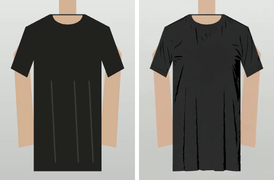

# 실사화 파이프라인: 프롬프트 템플릿·실행·대응 프레임 (D5)

작성 2026-11-23 · 관련 이슈 #10 #11 · 상태: 코드·테스트 완료. D4 실제 결과로 프레임 매칭 방식 확인. **새 프롬프트로 fal 호출은 하지 않았다**(유료, 5절)

D4 실사화 어댑터(`docs/realize.md`) 위에 세 가지를 더했다.

| 할 일 (계획서 D5) | 위치 |
|---|---|
| 프롬프트 템플릿(의류 색·원단, 얼굴 처리) | `fitting/adapters/fal_ltx/prompt.py` (`realize_prompt_v1`) |
| 파이프라인에서 실사화 실행·저장 | `run_fitting` 안의 `FalRealizer` 연동 테스트, 영상 경로 전부 실제 설정 `config/adapters/visual_real.yaml` |
| 대표 프레임 추출·대응 렌더 프레임 매칭(길이·fps 차이 보정) | 순수 계산 `fitting/verify/frame_match.py`, 파일 저장 `fitting/adapters/media/frames.py`, 검증 어댑터 프레임 부분 `fitting/adapters/media/validator.py`, 명령 `tools/match_frames.py` |

색·실루엣 판정과 통과 기준은 D6이다(`docs/visual-check.md`). D5에서는 검증 어댑터가 프레임만 저장하고 `quality_status`를 `UNVERIFIABLE`로 두었고, D6에서 같은 어댑터에 판정을 더했다(4절).

## 1. 프롬프트 템플릿 (`realize_prompt_v1`)

의류 정보로 영어 프롬프트를 만든다. 판 이름은 도구 버전(`tool_versions.prompt`)과 기록(`plan.json`의 `prompt`)에 남는다. 문장을 바꾸면 판을 올린다.

```text
A realistic photo of {대상} wearing a {옷}, standing still with arms slightly away from the body,
front view from the neck down, cropped below the chin, plain medium gray studio background,
soft even lighting, natural fabric folds. Keep the garment color, shape, length and fit exactly as in the render.
```

트리거 `3DREAL.`은 D1 코드(`with_trigger`)가 맨 앞에 붙인다.

| 부분 | 내용 | 근거 |
|---|---|---|
| 옷 | 색·원단 + 의류군 + 핏. 예: `plain navy cotton jersey short-sleeve crew-neck T-shirt with a regular fit` | 아래 표 |
| 자세 | `standing still with arms slightly away from the body` | 렌더(C5)는 A자세 45°의 정지 클립이다 |
| 얼굴 처리 | `front view from the neck down, cropped below the chin` | decisions.md 2절(턱 아래로 잘라 머리를 프레임 밖에 둔다). C5 렌더도 턱 아래로 자른다 |
| 배경·조명 | `plain medium gray studio background` | 렌더 배경이 중간 회색 #808080이다(`config/render/render_v1.json`). D1·D4 문장은 "light gray"였다 |
| 보존 | `Keep the garment color, shape, length and fit exactly as in the render.` | D6이 색·실루엣을 렌더와 비교한다 |

**옷 설명 만드는 법**

| 재료 | 규칙 |
|---|---|
| 색·원단 | `fabric.description_en`이 있으면 그대로 쓴다(AI Hub 변환은 `plain {색} {섬유} jersey`). 색 낱말이 없으면 앞에 붙인다. 원단 설명이 없고 섬유만 있으면 `plain {색} {섬유} jersey`(여러 섬유는 `cotton-polyester blend`). 둘 다 없으면 `plain {색} cotton jersey`(D4와 같은 가정). 색이 `unknown`이면 색 낱말을 뺀다 |
| 의류군 | `basic_short_sleeve_crew` → `short-sleeve crew-neck T-shirt` |
| 핏 | `style`의 `slim`·`regular`·`relaxed`·`oversized` → `with a … fit`. 그 밖(`unknown` 등)은 넣지 않는다 |

**시연 의류 2벌의 옷 설명**
- `tee_regular_m_navy_v1`: `plain navy cotton jersey short-sleeve crew-neck T-shirt with a regular fit`
- `tee_relaxed_l_black_v1`: `plain black cotton jersey short-sleeve crew-neck T-shirt with a relaxed fit`

**넣지 않은 것**
- **부정문**(`no face`, `no head`): 생성 모델은 부정을 잘 따르지 않아 그 낱말이 오히려 얼굴을 부를 수 있다. [제안]이고 비교 호출은 하지 않았다. 문장에 `face`·`head`·`hair`가 없는 것을 테스트로 확인한다.
- **`negative_prompt`**: 보내지 않는다. 보내면 fal 기본값을 통째로 덮어쓴다. 기본값은 색 왜곡·흐림·자막·손가락 수 같은 품질·해부 오류 목록이다(fal 모델 페이지, 2026-11-23 확인). `guidance_scale` 기본 1에서 이 값이 얼마나 듣는지는 페이지에 없다.
- **색 hex**(`#24324f`): 생성 모델이 hex 값을 색으로 잘 읽지 못한다. 색은 렌더 클립 자체가 전한다.

**대상(`subject`)** — 렌더 몸 재질과 함께 정할 항목이다(render.md "몸 재질: 결정 필요").

| 값 | 문구 | 비고 |
|---|---|---|
| `person` (기본) | `a person` | D1·D4 실제 호출과 같다. D1에서 `light`는 팔·배경을 거의 그대로 두었다 |
| `mannequin` | `a matte light gray mannequin` | 렌더의 회색 마네킹(`#9a9a9a`)을 그대로 두는 문구다 |

`RealizeOptions.subject` 또는 `python -m tools.realize_clip --subject mannequin`으로 고른다. 서버 설정에서 고르는 길은 아직 없다. 정해지면 기본값만 바꾼다.

**시험용 덮어쓰기**: `RealizeOptions.garment_text`(`--garment-text`)는 옷 설명 부분만 바꾼다. 빈 값이면 제출 전에 실패한다(`EXTERNAL_SUBMIT_UNKNOWN`, `retryable=false`, 기록 `stage: prepare`).

## 2. 파이프라인에서 실사화 실행·저장

영상 경로는 이미 렌더 → 실사화 → 검증 순서로 산출물 ID를 넘긴다(`fitting/services/fitting.py`). D5는 실제 `FalRealizer`가 그 안에서 돌고 파일이 이어지는지 확인했다.

| 단계 | 받는 파일 | 만드는 파일 (`artifacts_dir`) |
|---|---|---|
| 렌더 (C5) | 착장 결과 | `{job_id}_render_clip.mp4` |
| 실사화 (D4·D5) | `{job_id}_render_clip.mp4` | `{job_id}_video.mp4` |
| 검증 (D5 프레임) | 위 두 영상 | `{job_id}_frame.png`, `{job_id}_render_frame.png` |

**연동 테스트** (`tests/test_realize_in_pipeline.py`, 비용 없음): `run_fitting`에 다음을 넣고 돌린다.
- 몸·착장: 가짜
- 렌더: 실제 mp4를 쓰는 스텁
- 실사화: 실제 `FalRealizer`(가짜 fal 대기열)
- 검증: D5 프레임 어댑터

확인하는 것
- 렌더 단계가 쓴 클립을 올리고, D5 프롬프트로 요청하고, 계약 이름으로 저장한다.
- 상태에 `video_artifact_id`·`frame_artifact_id`·`render_frame_artifact_id`가 남는다.
- 실사화 대기 한도를 넘기면(`REALIZE_TIMEOUT`, 요청 ID 있음) 서비스(B5)가 같은 포트를 다시 부른다. 이때 어댑터는 **다시 제출하지 않고** 같은 요청 ID로 결과만 받는다(제출 1번, 실사화 `attempt_no` 2).
- 실사화에 동의하지 않으면 fal을 전혀 부르지 않는다.

**영상 경로 전부 실제로 돌리는 설정**: `config/adapters/visual_real.yaml`(몸 D3 · 착장 C4 · 렌더 C5 · 실사화 D4 · 검증 D5, D6에서 판정 추가). `default.yaml`은 바꾸지 않았다.

```powershell
$env:BLENDER_PATH = "C:\Program Files\Blender Foundation\Blender 5.2\blender.exe"
$env:SMPL_MODEL_DIR = "models\smpl"
# FAL_KEY는 .env 또는 환경변수 (값은 커밋하지 않는다)
python -m tools.run_fitting_once --adapters visual_real --consent --yes
```

- Blender·GarmentCode·SMPL 모델·FAL_KEY가 모두 있는 PC에서만 시작한다. 없으면 어느 포트가 왜 안 되는지 알리고 멈춘다(검증 어댑터는 OpenCV만 있으면 된다. 테스트로 확인).
- **이 PC에는 Blender가 없어 실제로 끝까지 돌리지 못했다.** C의 PC에서 확인해야 한다.
- D5 때는 검증 단계에서 늘 `VALIDATION_UNVERIFIABLE`로 끝났다(4절). D6부터는 색·실루엣 판정에 따라 PASS면 성공, 아니면 `VALIDATION_FAILED`·`VALIDATION_UNVERIFIABLE`로 끝난다. 어느 쪽이든 실사 영상과 두 프레임 파일은 남는다.

**C5 클립 기준 실사화 설정** (드라이런, 비용 없음): C5 사양(768×1024, 24fps, 121프레임 정지 클립)과 같은 클립으로 계획만 세웠다.
- 출력 121프레임(5.04초, 720p 상한 6초 안), 예상 크기 720×960
- 예상 비용(상한) **$0.2022**, 한도 $0.5 안
- D1의 3초 임시 클립($0.07)보다 비싸다. 프레임 수가 거의 2배이고 크기도 크기 때문이다.

## 3. 대표 프레임·대응 렌더 프레임 매칭

실사 영상은 렌더 클립과 길이·fps가 다를 수 있다.
- fal은 출력 프레임 수를 입력 길이 안의 8k + 1로 맞춘다(D1: 72 → 65프레임).
- 출력 fps(기본 24)도 렌더 fps와 다를 수 있다.

그래서 프레임 번호가 아니라 **시각**으로 맞춘다(`fitting/verify/frame_match.py`, 순수 계산).

| 방식 | 계산 | 가정 |
|---|---|---|
| `time` (기본) | 실사 프레임 i → 시각 i / fps_실사 → 렌더 프레임 round(시각 × fps_렌더) | 출력이 입력의 앞부분을 0초부터 같은 속도로 따른다 |
| `stretch` | 위치 비율 i / (n_실사 − 1) → 렌더 프레임 round(비율 × (n_렌더 − 1)) | 출력이 입력 전체를 늘이거나 줄여 담는다 |

- 반올림은 0.5를 올린다. 실사 시각이 렌더 길이를 넘으면 렌더 마지막 프레임으로 자르고 `clamped`로 남긴다.
- 자르지 않았으면 두 프레임의 시각 차이는 렌더 프레임 반 칸 이하다(테스트).

**`time`을 기본으로 둔 근거 (D4 실제 결과로 측정)**: fal 모델 페이지에는 출력 길이가 입력과 어떻게 대응하는지 적혀 있지 않다. 그래서 D4 실제 호출 결과로 쟀다(`artifacts/realize/d4_real_1`).
- 입력: 렌더 540×720, 24fps, 72프레임. 옷이 좌우로 ±8 px 흔들리는 임시 클립이다.
- 출력: 실사 576×768, 24fps, 65프레임.
- 방법: 프레임마다 옷(어두운 픽셀)의 가로 중심을 구하고, 렌더를 출력 크기로 맞춘 뒤 비교했다.

| 대응 방식 | 평균 오차 (px) | 최대 오차 (px) |
|---|---|---|
| `time` (같은 번호) | **0.25** | 0.68 |
| `stretch` (65 → 72로 늘림) | 1.67 | 5.62 |
| 번호 + 1 ~ + 8 (밀림) | 0.69 ~ 3.51 | |

출력은 입력의 앞부분 2.71초를 같은 속도로 따른다. 다만 확인은 이 1회뿐이다. fps가 다른 경우와 C5 실제 클립에서는 다시 확인한다.



**저장** (`save_frame_pair`)
- 실사 대표 프레임: D1 방식이다. 앞뒤 20 %를 뺀 구간에서 라플라시안 분산이 가장 큰 프레임이고, `middle`도 고를 수 있다.
- 대응 렌더 프레임: 위 시각으로 고른다. 위치 이동이 코덱에 따라 어긋날 수 있어 앞에서부터 차례로 읽는다.
- 두 프레임은 각 영상의 원래 크기 PNG로 쓴다. D6이 비교할 때 크기를 맞춘다. 가로세로 비율 차이(`aspect_gap`)는 기록에 남는다(D1 540×720 → 576×768은 0).
- 다 쓴 뒤에만 최종 이름으로 바꾼다(`.part` → `.png`).
- C5 클립은 정지 클립(모든 프레임 동일)이라 어느 시각을 골라도 같은 렌더 프레임이다. 매칭은 렌더가 움직이는 클립이 될 때를 위한 것이다.

**명령** (fal 호출 없음)

```powershell
python -m tools.match_frames --run artifacts/realize/<이름>          # tools.realize_clip 결과 폴더
python -m tools.match_frames --real <실사.mp4> --render <렌더.mp4> --mode stretch
```

결과: `frame.png`, `render_frame.png`, `compare.png`(왼쪽 렌더, 오른쪽 실사), `frames.json`. `tools.realize_clip --yes`도 이제 실사 대표 프레임과 같은 시각의 렌더 프레임(`frame_render_matched.png`, `frames.json`)을 남긴다.

## 4. 검증 어댑터 — 프레임 부분 (`fitting.adapters.media.factory:make_validator`)

> **D6 뒤 바뀐 점**: 이 절은 D5 때의 프레임 부분이다. D6에서 같은 어댑터(`VisualValidator`)가 명세서 7장대로 11프레임을 비교해 PASS·FAIL·UNVERIFIABLE을 낸다. 대표 프레임은 "가장 선명한 프레임" 대신 "통과 프레임 중 시간상 가운데"로 고르고, 기록은 `validate/validate.json`, 지표에는 `color_delta_e`·`silhouette_iou` 등 숫자가 들어간다. 지금 내용은 `docs/visual-check.md` 2·5절에 있다. 아래 표는 D5 기록으로 남긴다. `tools.match_frames`·`tools.realize_clip`의 대표 프레임(가장 선명한 프레임)은 그대로다.

| 항목 | 내용 |
|---|---|
| 입력 | `input_artifact_ids` = [렌더 클립, 실사 영상] → `artifacts_dir/{id}.mp4` |
| 출력 (`VALIDATE_OUTPUTS`) | `{job_id}_frame.png`(실사 대표), `{job_id}_render_frame.png`(대응 렌더) |
| 지표 | `quality_status`=`UNVERIFIABLE`, 문자열 `frame_method`·`frame_match_mode` |
| 기록 | `work_dir/{job_id}/validate/frames.json`: 두 영상 정보, 고른 프레임, 매칭, 길이 비교, 판정 보류 사유 |
| 실패 | 입력 ID가 모자람·파일 없음·영상을 못 읽음·프레임을 못 씀 → `VALIDATION_UNVERIFIABLE`, `retryable=false`, `safe_message`에 경로 없음 |
| 시간 | C5 크기 두 영상(768×1024·720×960, 121프레임)에서 2.5~2.9초(이 PC). 검증 단계 한도 120초 안 |

- **숫자 지표를 넣지 않은 이유**: 서비스는 숫자 지표를 모두 화면의 `quality_metrics`로 보낸다. 이 자리는 색 차이·실루엣 겹침 자리다. 그래서 프레임 번호 같은 값은 기록에만 둔다.
- **`UNVERIFIABLE`인 이유**: 판정 기준이 아직 없다(D6). 서비스는 PASS가 아니면 검증 단계를 실패로 끝낸다. 판정 없이 PASS를 돌려주면 실패가 성공처럼 보인다(docs/adapters.md "대체 결과를 성공으로 돌려주지 않습니다").
- D6은 이 어댑터에 색·실루엣 지표와 판정을 더하면 된다. 프레임 파일과 기록은 그대로 쓴다.

## 5. 확인한 것과 못 한 것

| 항목 | 결과 |
|---|---|
| 프롬프트 | 시연 의류 2벌의 문장·판·대상 전환을 테스트로 확인. 드라이런으로 보낼 값 확인(`artifacts/realize/d5_c5spec_dryrun/plan.json`) |
| 매칭 방식 | D4 실제 결과(72 → 65프레임)로 `time` 확인(3절) |
| 파이프라인 | `run_fitting` 연동 테스트(가짜 fal 대기열): 저장·상태 ID·같은 요청 ID 재조회·동의 안 함 |
| 검증 어댑터 | 임시 영상으로 출력·기록·실패 확인. C5 크기 시간 측정 |
| **못 한 것** | 새 프롬프트로 실제 fal 호출(유료 약 $0.2, C5 클립 필요). `visual_real` 끝까지 실행(Blender 필요, C의 PC) |

## 6. 같이 정할 것 · D6로 넘긴 것

- **대상 `person`과 `mannequin` (C·D)**: 렌더 몸 재질(회색 마네킹)과 같이 정한다. C5 실제 클립으로 두 문구를 한 번씩 비교하는 것을 제안한다(약 $0.2 × 2).
- **옷 마스크 (C·D, D6)**: C5의 `{job_id}_render_mask.png`는 계약 밖 산출물이다. 렌더 지표 `render_mask_artifact_id`로만 알려진다. 검증 어댑터는 렌더 클립·실사 영상 ID만 받으므로, D6 실루엣 비교는 `{job_id}_render_mask.png` 이름 규칙으로 찾아야 한다. 계약 출력으로 올릴지 정한다.
- **D6 (반영함)**: 색 차이·실루엣 겹침 지표, 통과 기준, 크기 맞춤(같은 비율로만)을 이 어댑터에 더했다(`docs/visual-check.md`). 옷 마스크는 이름 규칙으로 찾는다. 얼굴·머리는 자동으로 찾지 않고 사람 확인 표시로 남긴다(`docs/visual-check.md` 6절).
