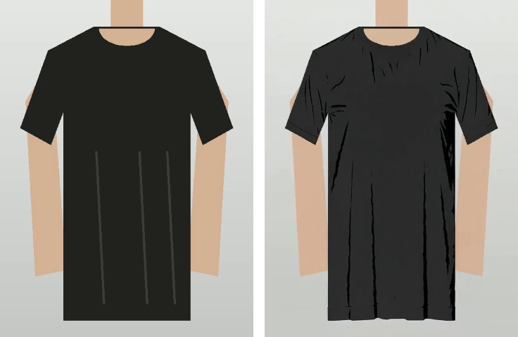

# fal 실사화 어댑터 (D4)

작성 2026-11-12 · 관련 이슈 #10 · 상태: 코드·가짜 클라이언트 테스트·드라이런 완료, **실제 fal 1회 호출로 실사 영상 저장 확인**(2026-11-12, $0.07)

렌더 클립을 fal / LTX-2.3 render-to-real로 실사 영상으로 바꾸는 `Realizer` 포트 구현이다. D1 스파이크(`docs/spikes/fal-ltx-render-to-real.md`)의 설정·가격·내려받기를 그대로 쓰고, 정식 어댑터에 필요한 재시도·재조회·타임아웃·비용 상한·기록을 더했다.

## 1. 구성

| 위치 | 하는 일 |
|---|---|
| `fitting/adapters/fal_ltx/realizer.py` | `FalRealizer`(`Realizer` 포트). 업로드 → 제출 → 상태 조회 → 결과 → 내려받기 |
| `fitting/adapters/fal_ltx/factory.py` | B4 팩토리 `make_realizer(settings)`. FAL_KEY가 없으면 `AdapterConfigError` |
| `tools/realize_clip.py` | 서버 없이 렌더 클립 하나를 실사화하는 명령(기본 드라이런, `--yes`일 때만 실제 호출) |

설정에 넣는 법: `realize: "fitting.adapters.fal_ltx.factory:make_realizer"`. **`default.yaml`의 `realize`는 아직 `fake`다.** 피팅 흐름 안에서는 C5 실제 렌더 클립이 있어야 실사화할 수 있기 때문이다(가짜 렌더는 파일을 만들지 않는다).

## 2. 흐름과 설정

| 단계 | 내용 |
|---|---|
| 입력 | `input_artifact_ids[0]`(렌더 클립)의 파일 `artifacts_dir/{id}.mp4` |
| 설정 | D1과 같다. `light`, 720p, 출력 24fps, 프레임 수는 입력 길이 안의 8k + 1(3초 → 65), **오디오 끔**, seed 42 |
| 길이 | 해상도별 상한(720p 약 6초)을 넘는 클립은 앞부분만(720p 24fps면 137프레임) |
| 프롬프트 | D1 문장에 의류 설명을 넣는다. 원단 설명(`fabric.description_en`)이 있으면 그것, 없으면 색. 얼굴 처리 문구 조정은 D5 |
| 비용 상한 | 제출 전 예상 비용(출력 크기 상한 기준)이 `max_cost_usd`(기본 $0.5)를 넘으면 `BUDGET_LIMIT` |
| 대기 | 2초마다 상태 조회. 한도는 `PortRequest.timeout_seconds`(서버 기본 600초) |
| 출력 | `artifacts_dir/{job_id}_video.mp4`. 다 받은 뒤에만 이 이름으로 바꾼다(`.part` → 산출물) |

## 3. 재시도·재조회·실패

**재시도 1회**: 업로드·제출·상태 조회·결과·내려받기마다 일시 오류(연결 실패·시간 초과, 429·5xx)면 한 번 더 시도한다.

**제출은 조심한다**: 제출을 다시 보내면 생성 비용이 두 번 나갈 수 있다. 그래서 요청이 fal에 닿지 않았다고 확실할 때만 다시 보낸다.
- 다시 보내는 경우: 연결 실패(`ConnectError`·`ConnectTimeout`), 서버가 429·5xx로 거절
- 보내지 않는 경우: 보냈는데 응답을 못 받음(`ReadTimeout` 등)
  - 접수 여부를 모르므로 `EXTERNAL_SUBMIT_UNKNOWN`(retryable false)으로 멈춘다.

**같은 요청 ID 재조회**: B1 `Realizer` 약속이다.
- 제출에 성공한 뒤 실패하면 `work_dir/{job_id}/realize/realize.json`에 요청 ID와 상태가 남는다.
- 같은 작업으로 다시 부르면 다시 제출하지 않는다. 그 ID로 상태·결과만 받는다.
- 생성은 끝났는데 내려받기만 실패했으면, 다시 부를 때 내려받기만 한다.
- 이미 성공한 작업을 다시 부르면 fal을 부르지 않고 같은 결과를 돌려준다.

| 상황 | 코드 | retryable | `external_request_id` |
|---|---|---|---|
| 렌더 클립이 없다 | `EXTERNAL_SUBMIT_UNKNOWN` | false | 없음 |
| 예상 비용이 상한 초과 | `BUDGET_LIMIT` | false | 없음 |
| 업로드·제출 거절이 두 번 | `EXTERNAL_SUBMIT_UNKNOWN` | true(아무것도 제출되지 않음) | 없음 |
| 제출 응답을 못 받음 | `EXTERNAL_SUBMIT_UNKNOWN` | false | 없음(모름) |
| 대기 한도 초과 | `REALIZE_TIMEOUT` | true(같은 ID 재조회) | 있음 |
| 접수 뒤 상태·결과·내려받기가 두 번 실패 | `EXTERNAL_SUBMIT_UNKNOWN` | true(같은 ID 재조회) | 있음 |
| fal이 생성 실패를 알림(`Completed.error`) | `EXTERNAL_SUBMIT_UNKNOWN` | false | 없음(기록에만) |

- 대기 한도를 넘어도 fal 요청은 취소하지 않는다. 나중에 같은 ID로 결과를 받을 수 있게 하려는 것이다.
- 마지막 줄은 계약에 "외부 생성 실패" 코드가 없어서 임시로 쓴 것이다.
  - 재조회하면 안 되므로 `PortError`에 요청 ID를 넣지 않고, ID는 기록에만 남긴다.
  - B에게 `REALIZE_FAILED` 추가를 제안한다.

## 4. 기록과 지표

`work_dir/{job_id}/realize/`

| 파일 | 내용 |
|---|---|
| `plan.json` | 입력 클립 정보, 보낼 설정 미리보기, 예상 비용 |
| `request.json` | 실제로 보낸 값(엔드포인트, arguments) |
| `response.json` | 받은 결과(영상 주소, seed, 프롬프트) |
| `error.json` | 실패한 단계, 오류 종류·메시지, HTTP 상태와 응답 본문(앞 2000자) |
| `realize.json` | 상태(`submitted`·`completed`·`succeeded`·`failed`·`timeout`·`unknown`), 요청 ID, 시간, 재시도 목록, 대기 순번, 로그, 예상·실제 비용, 출력 정보 |

FAL_KEY 값은 어디에도 쓰지 않는다. 테스트로 확인한다.

**지표** (`PortResult.metrics`)
- B1 계약 키: `external_request_id`, `cost_usd`(내려받은 영상 크기로 계산), `queue_s`, `processing_s`
- 더 넣은 키: `upload_s`, `download_s`, `estimated_cost_usd`, `retries`

## 5. 실행

```bash
pip install -e ".[dev,realize]"
python -m pytest tests/adapters/test_fal_realizer.py tests/adapters/test_realize_clip_tool.py   # 비용 없음

# 드라이런: 보낼 설정과 예상 비용만 (fal을 부르지 않음, FAL_KEY 불필요)
python -m tools.realize_clip --input artifacts/spikes/fal_ltx/real-1/input_test_clip.mp4 --name d4_try \
  --garment-text "plain black short-sleeve crew-neck cotton T-shirt"
# 실제 1회 호출 (비용 발생, FAL_KEY는 환경변수나 .env). 같은 이름이면 입력 클립을 다시 주지 않아도 된다
python -m tools.realize_clip --name d4_try --yes \
  --garment-text "plain black short-sleeve crew-neck cotton T-shirt"
# 끊긴 작업 이어 받기: 같은 --name으로 다시 실행하면 기록의 요청 ID로 이어 받는다(다시 제출하지 않음)
```

드라이런 결과(D1 시험 클립 540×720, 3초)는 다음과 같다.
- 설정: `light`, 720p, 65프레임, 오디오 끔
- 예상 비용(상한): $0.1083
- D1 실제 청구는 같은 클립에서 $0.07이었다. 출력이 입력 크기를 따라 576×768로 나왔기 때문이다.

결과는 `artifacts/realize/<이름>/`에 남는다(커밋 금지).
- 렌더 클립 사본과 실사 영상
- 위 기록 파일들
- 렌더·실사 대표 프레임

## 6. 실제 1회 호출 결과 (2026-11-12)

`python -m tools.realize_clip --input artifacts/spikes/fal_ltx/real-1/input_test_clip.mp4 --name d4_real_1 --garment-text "plain black short-sleeve crew-neck cotton T-shirt" --yes`

| 항목 | 값 |
|---|---|
| 입력 | D1 시험 클립(평면 마네킹, 검정 반팔) 540×720, 24fps, 72프레임(3.0초), 얼굴 없음 |
| 설정 | `light`, 720p, 65프레임 @ 24fps, 오디오 끔, seed 42 |
| request_id | `01a1cef3-8329-7b11-98d8-e401f4017f8c` |
| 출력 | `d4_real_1_video.mp4` 576×768, 24fps, 65프레임(2.71초). D1과 같은 크기 규칙(입력보다 키우지 않음) |
| 시간 | 업로드 4.1초 · 대기 0.2초 · 생성 92.3초 · 결과·내려받기 8.6초 (전체 약 106초) |
| 비용 | 출력 기준 29MP → **$0.0698** (예상 상한 $0.1083). D1과 같은 값 |
| 재시도 | 0회 |
| 기록 | `plan`·`request`·`response`·`realize`.json. 기록 파일에 FAL_KEY 값이 없는 것을 확인 |



- 옷 색(검정)과 모양·크기가 렌더와 같고, `light` 설정답게 주름과 밑단 박음질만 더해졌다(D1과 같은 관찰).
- 이번에는 대기열이 없었고(0.2초), 생성은 D1(43초)보다 오래 걸렸다(92초). 대기 한도(600초) 안이다.
- 입력이 평면 그림이라 사실적인 실사화 품질은 C5의 3D 렌더 클립으로 다시 본다.

## 7. 남은 것

- **C5 렌더 클립으로 확인:** 실제 3D 렌더 클립의 크기·fps에 따라 비용이 달라진다. `light`와 `strong-v2` 비교도 이때 한다(D1 열린 질문).
- **`default.yaml` 전환:** C5가 실제 렌더 클립을 만들고 팀원 PC에 FAL_KEY가 준비되면 `realize` 줄을 바꾼다.
- **오류 코드:** 외부 생성 실패용 코드(`REALIZE_FAILED` 제안)는 B가 계약에 넣을지 정한다.
