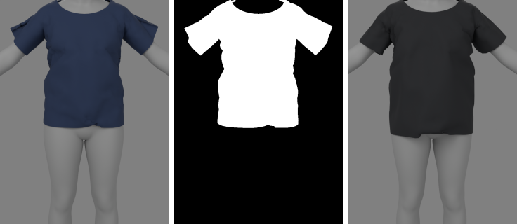

# 정면 렌더 클립·옷 마스크 (C5)

작성 2026-11-18 · 관련 이슈 #10 · 상태: 코드·가짜 실행기 테스트·실제 Blender 테스트 완료. 시연 티셔츠 2벌을 렌더해 D에게 넘김(6절)

착장 결과 `.blend`(C4)를 받아 옷 색을 입히고, 정면 고정 카메라로 **정지 클립**(MP4)과 같은 프레임의 **옷 마스크**(PNG)를 만든다. 클립은 실사화(D4)의 입력이고, 마스크는 검증(D6)에 쓴다. 명세서 6장 "렌더 항목"을 따른다. 설정 값은 모두 **[제안]**이다.

## 1. 구성

| 위치 | 하는 일 |
|---|---|
| `config/render/render_v1.json` | 렌더 설정 한 파일(클립·카메라·프레이밍·조명·배경·색 관리·재질·엔진·마스크·시간 제한). 각 블록 `_basis`에 근거 |
| `fitting/adapters/blender/blender_render.py` | Blender 안에서 도는 스크립트. 장면 설정 → 정지 프레임 → 옷 마스크 → MP4 → 기록 |
| `fitting/adapters/blender/render_framing.py` | 카메라 거리·렌즈 시프트 계산(numpy만, 테스트 가능) |
| `fitting/adapters/blender/render_color.py` | sRGB ↔ 선형, CIEDE2000(순수 파이썬) |
| `fitting/adapters/blender/renderer.py` | `Renderer` 포트 어댑터와 팩토리 `make_renderer` (`docs/adapters.md` "렌더 어댑터 (C5)") |
| `tools/render_clip.py` | 서버 없이 `.blend` 하나를 클립·마스크로 만드는 명령 |
| `config/adapters/drape_render_blender.yaml` | 착장·렌더만 실제, 나머지는 가짜 |

## 2. 흐름 (Blender 프로세스 1개)

1. 착장 결과 `.blend`를 연다(`--factory-startup`, 사용자 설정 영향 없음). 몸 `body`, 옷 `garment_welded`(용접 안 하면 `garment`)를 이름으로 찾는다. 없으면 `RENDER_FAILED`.
2. 옷은 저장된 프레임(C4 착장 끝 프레임)의 천 모디파이어 결과를 **고정 메시로 복사**해서 쓴다. 천 캐시가 렌더 중에 다시 계산되지 않게 하려는 것이다. 원래 옷 객체는 렌더에서 뺀다. 몸 메시의 머리는 지우지 않는다.
3. 재질·카메라·조명·배경·색 관리를 설정하고 **한 번 렌더**해 `render_still.png`를 만든다.
4. 같은 카메라로 마스크 패스를 한 번 더 그려 `garment_mask.png`를 만든다(4절).
5. 정지 프레임 한 장을 시퀀서에 121프레임 길이로 놓고 Blender 내장 FFmpeg로 `render_clip.mp4`(H264, 무음)를 쓴다. **정지 클립, 모든 프레임 동일**(원본 프레임이 같다. 디코딩하면 H264 압축 때문에 프레임끼리 평균 0.28/255 차이).
6. 만든 MP4를 Blender MovieClip으로 다시 열어 크기·fps·프레임 수를 기록하고, 머리 정점·옷 정점을 화면에 투영해 센다.
7. `render_metrics.json`(지표)과 `render_settings.json`(쓴 카메라 위치·렌즈·시프트, 조명 위치·세기, 재질 색(sRGB·선형), 엔진·샘플, 색 관리, FFmpeg 설정)을 쓴다.

## 3. 설정 값과 근거 (`render_v1` 1.1.0)

| 항목 | 값 | 근거 |
|---|---|---|
| 클립 | 768 × 1024, 24 fps, 121프레임(5.04초), MP4 H264, 무음 | 명세서 6장. 121 = 8 × 15 + 1(실사화 프레임 수 규칙), 720p 길이 상한(약 6초) 안 |
| 인코딩 | CRF `PERC_LOSSLESS`(17), 프리셋 GOOD, GOP 24, B프레임 없음 | 근거 없음. LOSSLESS는 4:4:4 프로필이라 호환이 불확실해 뺐다 |
| 정지 클립 | 한 번 렌더, 같은 프레임 121장 | 명세서 6장 "첫 버전은 몸과 카메라를 정지시킨 기준 클립" |
| 카메라 | 원근, 50 mm, 세로 센서 36 mm, 수평(+y 방향), 기울임 없음 | 50 mm는 C4 미리보기와 같은 값, 근거 없음. 세로선이 기울지 않게 위아래 맞춤은 렌즈 시프트로 |
| 카메라 높이·거리 | 높이 = 옷 경계 상자 가운데, 거리 = 아래 프레이밍을 만족하는 가장 가까운 거리 | 프레이밍 규칙(아래) |
| 프레이밍 위 | min(옷 맨 위 + 3 cm, 머리 정점 중 가장 낮게 투영되는 점 − 4 px) | docs/decisions.md 2(얼굴 처리). 여유 값은 근거 없음 |
| 머리 정점 | 몸 정점 중 z가 옷 맨 위보다 높은 것(`head_min_above_collar_cm` 0) | 명세 "옷 깃보다 위". 목도 머리로 센다(보수적) |
| 프레이밍 아래·좌우 | 밑단 − 5 cm, 소매 끝 ± 5 cm | 근거 없음 |
| 배경 | 카메라에 보이는 색 `#808080`(중립 회색, `medium_gray`). 옷 색과 가까우면(CIEDE2000 15 미만) 후보 `#d9d9d9`(`light_gray`)·`#3a3a3a`(`dark_gray`) 중 옷과 가장 먼 것 | 기본 색은 근거 없음. 바꾸는 규칙은 9절(1.1.0) |
| 조명 | 주변광 흰색 0.3 + 면광 3개(키 45 W·필 20 W·림 25 W, 옷 가운데 기준 상대 위치 고정) | 시연 티셔츠 1에서 마스크 안 색 중앙값이 `color_hex`와 CIEDE2000 3 안쪽이 되게 맞춤 |
| 색 관리 | 표시 sRGB, 보기 변환 `Standard`, Look 없음, 노출 0, 감마 1 | AgX·Filmic은 색을 바꿔 D6 색 비교가 어려워진다 |
| 옷 재질 | Principled BSDF, 기본 색 = `color_hex`(sRGB → 선형), 거칠기 0.85, Specular IOR Level 0.3, 무늬 없음 | 면 저지처럼 무광에 가깝게. 근거 없음 |
| 옷 색 고르기 | `color_hex` > `COLOR_HEX[color]`(`fitting/adapters/aihub/tables.py`) > `#808080` + 경고 | 지표 `garment_color_source`(color_hex·color_table·default) |
| 몸 재질 | 중립 회색 마네킹 `#9a9a9a`(`gray_mannequin`), 거칠기 0.6, 부드러운 음영(정점은 그대로). 옷 색과 가까우면(CIEDE2000 15 미만) `#d9d9d9`(`light_gray_mannequin`) | **결정 필요**: 실사화 프롬프트(D5)와 맞춰야 한다. 바꾸는 규칙은 9절(1.1.0) |
| 엔진 | Cycles CPU, 32샘플, 시드 0, 적응 샘플링 끔, OIDN 노이즈 제거, 반사 6회, 필터 1.5 px | 4절 |
| 마스크 비율 범위 | 0.05 ~ 0.6 | 근거 없음. 시연 티셔츠 실측 0.296·0.331의 앞뒤를 넉넉히 |
| 시간 제한 | 300초(`request.timeout_seconds`와 작은 값) | 명세서 12장 렌더 5분, `config/pipeline_v0.yaml` RENDER 300 |

## 4. 엔진 선택과 마스크 방식

이 PC: 노트북 i5-1135G7(4코어 8스레드), Intel Iris Xe 내장 그래픽, Blender 5.2.3. 같은 장면(시연 티셔츠 1), 768 × 1024, 정지 프레임 렌더 시간만 잰 값이다. 노트북 발열로 같은 설정도 2~3배 흔들렸다.

| 엔진 | 설정 | 정지 프레임 시간(초) | 같은 입력 두 번 |
|---|---|---|---|
| Cycles CPU | 64샘플 + OIDN | 34.6, 73.8 (조명 조정 전 첫 실행 111.8) | 픽셀 같음 |
| **Cycles CPU** | **32샘플 + OIDN** | **22.3, 24.8, 28.4, 30.6, 43.5** (티셔츠 2: 26.5, 27.1, 33.3) | **픽셀·파일 같음** |
| Cycles CPU | 16샘플 + OIDN | 17.0 | 확인 안 함 |
| Eevee (내장 GPU) | TAA 64 | 72.3, 37.1, 107.9 | 픽셀 같음 |

- **Cycles CPU 32샘플을 골랐다.** 두 엔진 모두 같은 입력에서 같은 픽셀이 나왔지만, Eevee는 GPU·드라이버에 따라 결과가 달라질 수 있고 이 PC에서 시간이 더 흔들렸다. 32샘플은 64샘플과 평균 0.11/255(99 % 픽셀이 1/255 이하) 차이라 시간 여유를 택했다.
- **마스크도 Cycles CPU로 그린다**: 옷 흰색 발광·몸과 배경 검정, 1샘플, 픽셀 필터 0.01 px(픽셀 가운데 한 점), 임계값 0.5 → 8비트 흑백 PNG(0/255). 몸에 가려진 옷은 빠진다. 처음에는 Workbench(GPU)로 그렸는데, 한 번 Blender가 모든 파일을 쓴 뒤 끝날 때 Intel 그래픽 드라이버(`ig12icd64.dll`)에서 비정상 종료했다(종료 코드가 0이 아니어서 어댑터가 실패로 판정). 그래서 GPU를 쓰지 않게 바꿨다. 마스크 패스는 약 1초다.
- PNG 메타데이터: Cycles가 렌더 시간을 PNG에 적어 파일 해시가 매번 달라졌다. 정지 프레임은 픽셀만 다시 저장한다(색 변환 없음).

## 5. 얼굴 처리(프레이밍)

- 개발용 몸 GarmentCode `mean_all`은 턱(z ≈ 1.48 m, 앞으로 나옴)이 옷 깃 맨 위(z 1.461 m, 뒤쪽 깃)와 거의 같은 높이다. "깃 맨 위 + 3 cm"만으로 자르면 턱이 화면에 들어온다.
- 그래서 위쪽 경계를 **min(깃 맨 위 + 3 cm, 머리 정점 중 가장 낮게 투영되는 점 − 4 px)**으로 둔다. 머리 정점은 옷 맨 위보다 높은 몸 정점(목 포함)이다. 시연 티셔츠 2벌 모두 머리 쪽이 경계를 정했다(`top_limited_by = head`).
- 결과: 화면 안 머리 정점 **0**(지표 `head_vertices_in_frame`, 0이 아니면 실패). 대신 뒤쪽 깃 위 끝이 화면 맨 위에 닿아 옷 정점 일부가 화면 밖이다(티셔츠 1: 2531개 중 4개, 티셔츠 2: 11개, 지표 `garment_vertices_out_of_frame`, 판정 안 함). 앞 목선은 보인다.
- 소매가 넓어 가로가 먼저 맞으므로 아래로는 밑단 아래 다리까지 보인다(위쪽 경계는 고정).

## 6. 실제 확인 (2026-11-18)

입력: 시연 티셔츠 1(`tee_regular_m_navy_v1`, 서버로 만든 착장 결과)과 시연 티셔츠 2(`tee_relaxed_l_black_v1`, `run_fitting_once --adapters drape_blender`로 착장), 몸은 둘 다 개발용 `mean_all`. `tools.render_clip`으로 각각 두 번 렌더했다.

| | 티셔츠 1 (navy) | 티셔츠 2 (black) |
|---|---|---|
| Blender 전체(어댑터 `render_seconds`) | 39.9 / 44.7초 | 48.2 / 39.3초 |
| 클립(cv2로 다시 읽음) | 768 × 1024, 24 fps, 121프레임 | 768 × 1024, 24 fps, 121프레임 |
| 마스크 비율 | 0.295859 | 0.331211 |
| 화면 안 머리 정점 / 화면 밖 옷 정점 | 0 / 4 | 0 / 11 |
| `color_hex` → 마스크 안(5 px 줄임) 중앙값 | `#24324f` → `#283248` | `#222326` → `#28282a` |
| CIEDE2000 (정지 프레임 / 클립 첫 프레임) | 2.63 / 2.50 | 1.83 / 1.72 |
| RGB 차이(0~255) | (+4, 0, −7) | (+6, +5, +4) |
| 재현성(같은 입력 두 번) | 정지 프레임·마스크·MP4 파일 해시 모두 같음 | 같음 |

**서버 1회** (`FIT_ADAPTERS=drape_render_blender`, 개발용 몸 `mean_all`, 웹 실제 모드 `VITE_USE_MOCK=false`, 시연 티셔츠 1, 실사화 동의 없음): 상태 `SUCCEEDED`, 몸(가짜) → 3D 착장 317.2초 → 정면 렌더 44.5초(정지 프레임 34.0초), 접수부터 끝까지 약 6분 6초. 화면은 "완료 (렌더까지)", 실사화·검증은 건너뜀. 새로 착장한 `.blend`(파일 해시는 다름)였지만 정지 프레임 픽셀·마스크가 `tools.render_clip` 결과와 같았다. 지금 결과 화면은 3D 착장 미리보기(C4 Workbench 이미지)만 보여 주고 렌더 클립은 보여 주지 않는다.

색 차이는 명세서 7장 대표색 기준(CIEDE2000 8 이하)의 기준점으로 쓰라고 남긴다. 조명이 들어간 렌더 색이므로 `color_hex`와 정확히 같지 않다.

## 7. 실사화 예상 비용 (이 클립 기준)

`docs/realize.md`·`fitting/adapters/fal_ltx/render_to_real.py` 계산식: 720p는 짧은 변을 720으로 → 720 × 960, 프레임 수는 입력 길이 안의 8k + 1 → 121.

- 720 × 960 × 121 = 83.6 MP → 올림 84 MP × $0.0024075 = **$0.2022** (어댑터 기본 상한 $0.5 안)
- 참고: 480p면 480 × 640 × 121 → 38 MP → $0.0915. D1 3초 클립은 $0.07이었다.

## 8. 남은 것 / 결정 필요

- **몸 재질**: 회색 마네킹(피부색 없음)과 실사화 프롬프트(D5) 문구를 맞춘다.
- **마스크를 계약 출력에 넣을지**: 지금은 `RENDER_OUTPUTS`를 바꾸지 않고 지표 `render_mask_artifact_id`로 알린다. D6가 서버 안에서 마스크를 쓰려면 `RENDER_OUTPUTS`에 `render_mask`를 더하는 계약 변경(B·D 합의)을 제안한다.
- **시간 제한 300초**: 이 PC 실측 Blender 전체 39~62초라 여유가 있다. 다른 팀원 PC(특히 더 느린 CPU)에서 한 번 재 보고 정한다.
- 깊이 맵(명세서 6장 "깊이")은 이번 범위에 없다.
- 그 밖의 [제안] 값: 렌즈 50 mm, 여백(위 3 cm·아래 5 cm·좌우 5 cm·머리 4 px), 조명 세기·위치, 배경 `#808080`과 바꾸는 기준 15·후보 2개(9절), 재질 거칠기, 32샘플, CRF 17, 마스크 비율 범위 0.05~0.6.
- **실사화 프롬프트 배경(D5)**: 렌더 배경이 바뀌면 실사화 프롬프트의 `plain medium gray studio background`도 같은 배경으로 바꿔야 한다. 렌더 지표 `background_name`·`background_srgb_hex`를 실사화 어댑터가 읽는 방법을 D와 정한다(9절).

## 9. 옷 색에 따른 배경·마네킹 색 (`render_v1` 1.1.0, 2026-11-25)

**왜:** D6(#36) 자기 비교에서 회색 옷이 검증 불가(UNVERIFIABLE)였다. 렌더 배경 `#808080`·마네킹 `#9a9a9a`·실사화 프롬프트 배경이 모두 회색이라, 실사 쪽 옷 영역(`color_seed_v1`)이 옷과 바깥을 가르지 못했다.

**규칙 [제안]** (`world.background_rule`·`body_material.contrast_rule`, `renderer.choose_background`·`choose_body_color`)
- 옷 색과 기본 색의 CIEDE2000이 `min_delta_e00`(15)보다 작으면, 후보 중 옷 색과 가장 먼 색을 쓴다. 같으면 앞의 후보.
  - 배경 후보: `#d9d9d9`(`light_gray`), `#3a3a3a`(`dark_gray`)
  - 마네킹 후보: `#d9d9d9`(`light_gray_mannequin`). 실사화 프롬프트 `mannequin` 문구 "light gray"와 맞는다.
- 규칙이 없으면 기본 색 그대로다(1.0.0과 같다).
- 쓴 색은 지표 `background_srgb_hex`·`background_name`·`background_delta_e00`·`body_srgb_hex`·`body_color_name`에 남는다. 기록 `render_record.json`의 `background`·`body_color`(기본 색과의 차이, 바뀌었는지), `render_settings.json`의 `used_*`에도 남는다.

**의류 색 표(`COLOR_HEX`)와 후보 색의 CIEDE2000**

| 색 | hex | 배경 `#808080` | 마네킹 `#9a9a9a` | `#d9d9d9` | `#3a3a3a` | 바뀌는 것 |
|---|---|---|---|---|---|---|
| black | #222326 | 32.3 | 43.1 | 73.0 | 7.6 | 없음 |
| white | #f4f4f2 | 31.1 | 22.6 | 5.9 | 62.8 | 없음 |
| **gray** | #8d9096 | **6.6** | **4.7** | 20.4 | 32.2 | **배경 → 어두운, 마네킹 → 밝은** |
| red | #c0392b | 28.2 | 32.3 | 43.5 | 31.5 | 없음 |
| orange | #e67e22 | 28.8 | 27.4 | 32.3 | 45.3 | 없음 |
| pink | #f2a7bb | 28.7 | 23.9 | 23.0 | 56.1 | 없음 |
| yellow | #f1d24a | 36.3 | 31.1 | 27.0 | 63.4 | 없음 |
| brown | #7b5539 | 22.1 | 29.5 | 43.4 | 21.2 | 없음 |
| green | #3f7d4e | 23.5 | 27.3 | 38.8 | 29.6 | 없음 |
| blue | #2f5fa7 | 25.7 | 31.9 | 44.6 | 25.7 | 없음 |
| purple | #6c4a9e | 28.4 | 34.8 | 47.4 | 27.0 | 없음 |
| beige | #d9c8a9 | 25.5 | 18.4 | 13.2 | 57.0 | 없음 |
| navy | #24324f | 31.0 | 41.2 | 65.0 | 14.2 | 없음 |

- 기준 15는 근거 없음: 지금 색 표에서 gray만 걸리고, 다음으로 가까운 색(배경 brown 22.1, 마네킹 beige 18.4)은 걸리지 않게 골랐다.
- 배경 하나로 바꾸지 않는 이유: 밝은 배경은 white(5.9)를, 어두운 배경은 black(7.6)을 깬다.

**실제 확인 (2026-11-25, 시연 티셔츠 1 착장 결과, drape_v1)**
- 회색 옷은 시연 티셔츠 1의 색만 `#8d9096`으로 바꿔 렌더했다(AI Hub 아님).
- D6 `tools.check_visual`로 렌더 클립을 720 × 960으로 줄여 "실사" 자리에 넣고 자기 비교했다. 같은 그림이라 PASS여야 정상이다.

| 렌더 | 배경 / 마네킹 | 정지 프레임 해시 | 옷 마스크 | D6 자기 비교 |
|---|---|---|---|---|
| navy, 1.0.0 | #808080 / #9a9a9a | `328b9a8b6cfd…` | 0.2959 | — |
| navy, 1.1.0 | 그대로 | **같음** | 같음 | PASS 11/11 (IoU 0.993, 색 0.77) |
| gray, 1.0.0 | #808080 / #9a9a9a | — | 같음 | UNVERIFIABLE (실사 옷 면적 0) |
| gray, 배경만 바꿈(실험) | #3a3a3a / #9a9a9a | — | 같음 | UNVERIFIABLE (옷 영역이 마네킹까지 번짐, 면적비 1.63) |
| gray, 1.1.0 | #3a3a3a / #d9d9d9 | — | 같음 | **PASS** 11/11 (IoU 0.971, 색 0.84, 폭 2.4 %) |

- 옷 마스크는 Blender 객체로 만들어 네 렌더 모두 파일이 같았다(배경·마네킹 색과 무관).
- 회색 옷의 렌더 색은 `color_hex`와 CIEDE2000 6.54였다(navy 2.63). 조명은 navy에 맞춘 값이라 회색은 조금 어둡게 나온다. 배경·마네킹을 바꿔도 같은 값이었다.

**남은 것 (D와 정함):** 실사화 프롬프트 배경 문구가 렌더 배경을 따라가야 한다. 예: `dark_gray` → `plain dark charcoal gray studio background`. 렌더 지표 `background_name`을 실사화 어댑터가 읽는 방법을 제안한다(계약 변경 없음, 지표 키만). `person`으로 실사화하면 마네킹 색은 사람 피부로 바뀐다.
