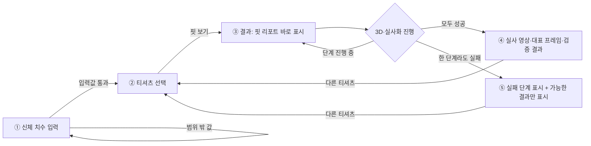

# 화면 와이어프레임과 사용자 흐름 (A1)

작성 2026-11-10 · 관련 이슈 #9 · 상태: 초안 (팀 밖 2명 종이 시안 확인 전)

이 문서는 피팅 웹의 화면 구성과 이동 순서를 정한다. 화면 속 숫자와 문구는 예시다. 치수 입력 범위와 판정 기준은 팀 결정(#1·#2)에 따라 바뀐다.

## 1. 사용자 흐름



흐름에서 지키는 규칙은 세 가지다.

1. 핏 리포트는 3D 착장이나 실사화를 기다리지 않고 결과 화면에 바로 나온다(활동지 1-1).
2. 실사화는 렌더 클립이 외부 서버(fal)로 전송된다는 안내를 읽고 동의한 경우에만 한다.
3. 어느 단계가 실패해도 핏 리포트는 그대로 보인다. 3D 미리보기를 대신 보여 줄 때는 '대체 결과'라고 표시하고 실사화 성공으로 다루지 않는다(#12).

## 2. 화면별 와이어프레임

`[ ]`는 입력칸이나 버튼, `( )`는 하나만 고르는 선택지, `(?)`는 눌러서 펼치는 도움말이다.

### ① 신체 치수 입력

```text
Fit Ruler                              ①입력 > ②선택 > ③결과
----------------------------------------------------------------
내 치수 입력
줄자로 잰 값을 cm로 넣어 주세요.

키         [ 175 ] cm   (?) 재는 법
가슴둘레   [  96 ] cm   (?) 재는 법
허리둘레   [  82 ] cm   (?) 재는 법
어깨너비   [  45 ] cm   (?) 재는 법
           ! 어깨너비는 30~60cm 사이로 넣어 주세요.
팔길이     [  60 ] cm   (?) 재는 법

                                      [ 다음: 티셔츠 고르기 ]
```

- 오류 문구는 그 칸 바로 아래에 나온다. 모든 칸이 맞아야 다음 버튼이 동작한다.
- `(?)`를 누르면 그 부위를 재는 위치와 자세가 펼쳐진다.
- 입력 범위는 임시값이며, #1에서 정한 값으로 바꾼다.

### ② 티셔츠 선택

```text
Fit Ruler                              ①입력 > ②선택 > ③결과
----------------------------------------------------------------
티셔츠 고르기
내 치수: 키 175 · 가슴 96 · 허리 82 · 어깨 45 · 팔 60 cm   [수정]

( ) ■ 베이직 반팔 티    흰색 · 면 100%    가슴단면 52 · 총장 70 · 어깨 46
(•) ■ 오버핏 반팔 티    검정 · 면 혼방    가슴단면 58 · 총장 74 · 어깨 52
( ) ■ 슬림 반팔 티      회색 · 면 스판    가슴단면 48 · 총장 66 · 어깨 43

[ ] 실사 착장 영상도 만들기
    신체 치수가 반영된 렌더 클립이 외부 서버(fal)로 전송되어 처리됩니다.
    체크하지 않으면 핏 리포트와 3D 미리보기까지만 만듭니다.

                                                    [ 핏 보기 ]
```

- 실제 화면에서는 티셔츠를 카드 격자로 보여 준다. 카드에는 색 견본, 이름, 상품 구분(정핏·오버핏), 원단, 주요 치수가 들어간다.
- 상품 구분은 옷의 형태 이름이고, 사용자에게 맞는 정도는 결과 화면의 핏 리포트에서 따로 판정한다.

### ③ 결과 · 진행 중

```text
Fit Ruler                              ①입력 > ②선택 > ③결과
----------------------------------------------------------------
오버핏 반팔 티 · 검정                         [ 다른 티셔츠 고르기 ]

핏 리포트
  가슴    [오버핏]   +20 cm   가슴둘레보다 20cm 넉넉해 크게 떨어집니다.
  어깨    [오버핏]   +7 cm    어깨선이 어깨보다 7cm 넓어 많이 내려옵니다.
  허리    [여유]     +18 cm   허리둘레보다 18cm 넉넉해 여유 있게 맞습니다.
  총장    [여유]     +4 cm    키로 추정한 기준보다 4cm 깁니다.  (추정)
  판정 기준: 임시 기준표

3D·실사 착장 진행
  몸 생성 완료 > 3D 착장 완료 > 정면 렌더 진행 중 > 실사화 대기 > 검증 대기

[ 3D 착장 미리보기 ]            [ 실사 착장 영상 ]
  (착장 이미지)                   렌더가 끝나면 실사화를 시작합니다.
```

### ④ 결과 · 모두 완료

```text
핏 리포트                       (③과 같음)

3D·실사 착장 진행
  몸 생성 완료 > 3D 착장 완료 > 정면 렌더 완료 > 실사화 완료 > 검증 완료

[ 실사 착장 영상 ▶ ]
[ 대표 프레임 ]   [ 같은 시점의 렌더 프레임 ]
검증: 통과   색 차이 3.2 · 실루엣 겹침 0.91
```

### ⑤ 결과 · 실패 또는 건너뜀

```text
핏 리포트                       (③과 같음, 그대로 표시)

3D·실사 착장 진행
  몸 생성 완료 > 3D 착장 완료 > 정면 렌더 완료 > 실사화 실패 > 검증 건너뜀
  ! 실사화에 실패했습니다(시간 초과). 3D 미리보기를 대체 결과로 보여 드립니다.

[ 3D 착장 미리보기 · 대체 결과 ]
```

- 동의하지 않았을 때는 실사화를 '건너뜀(동의 안 함)'으로 표시하고 3D 미리보기를 결과로 보여 준다.
- 검증만 실패했을 때는 실사 영상을 보여 주되 '검증 실패'를 함께 표시해 정상 결과와 구분한다.

## 3. 결과 화면 상태 정리

| 상황 | 진행 표시 | 보여 주는 결과 |
|---|---|---|
| 진행 중 | 진행 중인 단계 강조, 뒤 단계는 대기 | 핏 리포트, 끝난 단계의 결과 |
| 모두 성공 | 모든 단계 완료 | 핏 리포트, 3D 미리보기, 실사 영상·대표 프레임, 검증 통과 |
| 실사화 동의 안 함 | 실사화·검증 건너뜀 | 핏 리포트, 3D 미리보기 |
| 렌더·실사화 실패 | 실패 단계와 원인, 뒤 단계 건너뜀 | 핏 리포트, 3D 미리보기(대체 결과) |
| 몸 생성·착장 실패 | 실패 단계와 원인, 뒤 단계 건너뜀 | 핏 리포트만 |
| 검증 실패 | 검증 실패와 수치 | 핏 리포트, 실사 영상(검증 실패 표시) |

## 4. 팀 밖 2명 종이 시안 확인

이 문서의 ①~⑤를 인쇄해 한 장씩 보여 주며 진행한다. 한 사람에 10분 안팎이 걸린다.

**과제**

1. 자기 치수를 넣는다고 생각하고 ①의 칸을 손가락으로 채워 보기
2. ②에서 티셔츠 하나를 골라 핏 보기 누르기
3. ③에서 "가슴은 어떻게 맞는지" 말로 설명해 보기
4. ⑤를 보고 무슨 일이 일어났는지, 다음에 무엇을 하면 되는지 말해 보기

**물어볼 것**

- 재는 법 안내만 보고 치수를 잴 수 있을 것 같은가?
- 타이트·정핏·여유·오버핏이라는 말이 바로 이해되는가?
- 외부 전송 안내를 읽고 동의할지 판단할 수 있는가?
- 결과 화면에서 지금 무엇을 기다리고 있는지 알 수 있는가?

**기록**

| 참가자 | 막힌 곳 | 그때 한 말 | 고칠 점 |
|---|---|---|---|
| 1 |  |  |  |
| 2 |  |  |  |

확인 결과는 이 표에 적고, 고칠 점은 A2와 2주차 화면 작업에 반영한다.

## 5. 웹 뼈대와의 연결

| 화면 | 주소 | 데이터 |
|---|---|---|
| ① 신체 치수 입력 | `/` | 입력값을 다음 화면으로 넘김 |
| ② 티셔츠 선택 | `/garments` | `GET /api/garments`, `POST /api/fittings` |
| ③~⑤ 결과 | `/fittings/:jobId` | `GET /api/fittings/{jobId}`를 1초마다 확인 |

API 형식은 B의 계약이 나오기 전까지 쓰는 임시 형식이다. 자세한 내용은 `web/README.md`에 있다.
