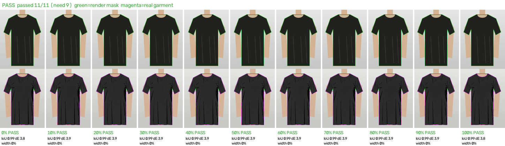
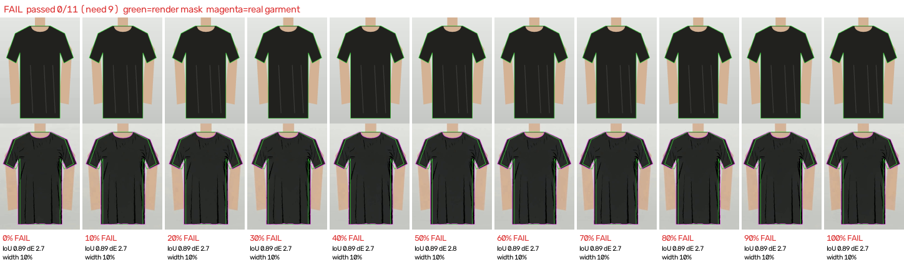

# 실사화 결과 색·실루엣 검증 (D6)

실사 영상이 원본 렌더의 옷 색·실루엣을 지켰는지 자동으로 판정한다(#11). 기준은 명세서 7장
"실사화와 대표 프레임 검증"의 초기 기준을 그대로 쓴다. 이 판정은 **원본 렌더의 외형 보존 검사**다.
실제 몸·실제 옷의 핏이나 착용감이 맞다는 증거가 아니다(명세서 7장).

| 파일 | 하는 일 |
|---|---|
| `config/validate/visual_check_v1.json` | 기준값(명세서 값)과 실사 옷 영역 찾기 설정([D 제안]), 각 값의 근거(`_basis`) |
| `fitting/verify/visual_check.py` | 순수 판정: Lab 변환, CIEDE2000, IoU, 가슴·밑단 폭, 프레임·영상 판정, 대표 프레임 (numpy만) |
| `fitting/adapters/media/visual_measure.py` | OpenCV 측정: 11프레임 읽기, 실사 옷 영역 찾기, 프레임별 측정, 접촉 시트 |
| `fitting/adapters/media/validator.py` | `Validator` 포트(D5 프레임 + D6 판정). 팩토리 `factory.py:make_validator` |
| `tools/check_visual.py` | 이미 있는 실사 영상·렌더 클립으로 판정만 해 보는 명령(fal 호출 없음) |

## 1. 기준 (명세서 7장 초기 기준)

| 검사 | 기준 | 어기면 |
|---|---|---|
| 프레임 고르기 | 실사 영상 길이의 0, 10, …, 100 % 11프레임. 대응 렌더 프레임은 시각으로 찾는다(`time`, D5) | 두 영상 길이 차이 0.5초 초과면 검증 불가 |
| 실루엣 겹침 | 같은 크기 프레임에서 두 옷 마스크의 IoU ≥ 0.85 | 그 프레임 실패 |
| 가슴·밑단 폭 | 원본 옷 상자 위에서 45 %·90 % 높이, 주변 5행 가로폭 중앙값. 원본 대비 각각 5 % 이내 | 하나라도 넘으면 그 프레임 실패 |
| 대표색 | 두 마스크를 안쪽으로 5 px 줄인 공통 영역의 Lab 중앙값끼리 CIEDE2000 ≤ 8 | 그 프레임 실패. 공통 영역이 원본 마스크의 20 % 미만이면 색은 측정 불가 |
| 면적 | 실사 옷 면적이 원본의 0.5~1.5배 | 밖이면 그 프레임 측정 불가 |
| 영상 | 11프레임 중 9프레임 이상이 모든 기준 통과 | 측정 불가 프레임은 통과로 세지 않는다 |

영상 판정
- **PASS**: 통과 프레임 9개 이상
- **FAIL**: 측정된 위반만으로 9개를 채울 수 없게 됨(실패 프레임 3개 이상)
- **UNVERIFIABLE**: 그 밖에 통과 프레임이 모자람(측정 불가 때문). 또는 프레임을 비교할 수 없음:
  길이 차이 0.5초 초과, 화면비 차이 10 % 초과(그 안의 차이는 늘리지 않고 같은 비율로 맞춘 뒤 가운데를 자른다, 2026-11-25 수정, docs/realize-fitroom.md 3.2절), 렌더 옷 마스크가 없거나 크기가 다름, 렌더 클립이 정지 클립이 아님

"측정된 위반만으로"를 나눈 것은 명세서의 "FAIL은 측정된 기준 위반이며, UNVERIFIABLE은 마스크나 구조 판단이
불충분한 경우"를 영상 단위로 옮긴 [D 제안]이다.

**판정에 쓰는 값**: 기록에 남기는 반올림 값(IoU·폭 변화 소수 셋째 자리, 색 차이 둘째 자리)으로 판정한다.
화면에 0.85가 보이는데 실패하는 일이 없게 하기 위해서다.

## 2. 방법

### 2.1 렌더 쪽 옷 마스크

C5 렌더 어댑터가 쓰는 `artifacts/{job_id}_render_mask.png`(Blender 발광 패스, 무손실 흑백 PNG)를 그대로 쓴다.
계약 출력이 아니어서 검증 어댑터는 이름 규칙으로 찾는다. 마스크가 한 장이므로 고른 렌더 프레임이 서로
같은지(평균 차이 2/255 이하) 확인한다. 다르면 정지 클립이 아니라서 검증 불가로 둔다.

### 2.2 실사 쪽 옷 영역 [D 제안]

명세서는 SAM 2 이미지 예측기를 적었지만, 활동지 2장은 "분할 모델은 선택지이며 필수 기술로 확정하지 않는다"고
한다. 모델·체크포인트 없이 OpenCV로 도는 **색 기반 방법**(`color_seed_v1`)을 썼다.

1. 실사 프레임을 같은 비율로 렌더 크기(예: 720×960 → 768×1024)에 맞춘다. 늘리거나 돌리지 않는다.
2. 렌더 옷 마스크를 프레임 높이의 3 %만큼 안쪽으로 줄인 영역에서 실사 옷 색(Lab 중앙값)을 잡는다.
3. 렌더 마스크를 프레임 높이의 8 %만큼 넓힌 바깥에서 대표색 3개(k-평균: 배경·피부·바지 등)를 잡는다.
   옷 색과 Lab 거리 10보다 가까운 것은 뺀다.
4. 옷 색과의 Lab 거리가 40 이하이고 바깥 대표색보다 옷 색에 더 가까운 픽셀을 옷 후보로 둔다.
5. 작은 점을 지우고(열기) 주름 틈을 메운 뒤(닫기), 면적의 절반 이상이 렌더 마스크와 겹치는 연결 영역만 남기고
   안쪽 구멍을 메운다. 명세서의 "분할 후보 중 원본 의류 위치와 가장 일치하는 영역을 선택"에 해당한다.

### 2.3 대표 프레임과 지표

- **대표 프레임**: PASS면 통과 프레임 중 시간상 가운데(50 %)에 가장 가까운 프레임(같으면 이른 것, 명세서 7장).
  PASS가 아니면 사람이 볼 수 있게 가운데 프레임을 저장하고, 통과 프레임이 아니라고 기록한다.
- **화면 지표**(`quality_metrics`): `color_delta_e`·`silhouette_iou`·`width_change_ratio`(가슴·밑단 중 큰 쪽
  폭 변화 비율)는 측정된 프레임 값의 **중앙값**이고, `frames_passed`는 통과 프레임 수다. 9개 이상 통과하면
  중앙값도 기준 안이다.
- **사람 확인 표시**: 중대한 변형(신체 부위 추가, 소매·넥라인 소실)과 얼굴·머리는 자동으로 찾지 않는다.
  명세서대로 PASS에도 기록에 `human_review_required: true`, `deformation_check: "not_automated"`를 남긴다.
- **길이 변화**: 명세서 기준에 없어 판정에 쓰지 않고 프레임마다 `length_change`(옷 상자 높이 변화)를 기록만 한다.

### 2.4 기록

`work_dir/{job_id}/validate/`
- `validate.json`: 설정 이름·버전·해시, 기준, 프레임별 측정값(시각·번호·면적·IoU·폭·색·Lab·길이)과 판정 이유,
  대표 프레임, 분할 정보, `human_review_required`
- `contact_sheet.png`: 11프레임 접촉 시트(위 렌더, 아래 실사, 초록 = 렌더 마스크, 자주 = 찾은 실사 옷)
- `masks/real_000.png` … `real_100.png`: 프레임별 실사 옷 영역(명세서 "프레임별 마스크를 함께 남긴다")

## 3. 실제 결과로 확인한 것 (비용 없음)

지금 가진 실제 fal 출력은 **사실상 1개**다. D1(`real-1`)과 D4(`d4_real_1`)는 같은 임시 클립·같은 프롬프트·
같은 시드(42)여서 결과가 같았다(두 판정 값이 모두 같음). 임시 클립은 C5 렌더가 아니다(밝은 배경, 피부색 팔,
검정 옷, 좌우로 ±8 px 흔들림). 그래서 렌더 마스크 파일 대신 `--render-mask-dark 80`(렌더 프레임마다
R·G·B ≤ 80 = 옷)으로 프레임별 마스크를 만들었다.

```bash
python -m tools.check_visual --real artifacts/spikes/fal_ltx/real-1/output.mp4 \
    --render artifacts/spikes/fal_ltx/real-1/input_test_clip.mp4 --render-mask-dark 80
```

| 영상 | 판정 | 통과 | IoU | 가슴·밑단 폭 변화 | 색 차이(CIEDE2000) | 시간 |
|---|---|---|---|---|---|---|
| D1 실제 출력(렌더 540×720·72프레임 → 실사 576×768·65프레임) | **PASS** | 11/11 | 0.988~0.991 | 0~0.4 % | 3.84~3.89 | 3.9초 |



**같은 출력을 일부러 바꾼 영상** (기준이 실제 질감에서도 위반을 잡는지 확인, 비용 없음): 프레임을 가로로
늘리거나 줄이고, 어두운 옷 픽셀에 색을 더해 다시 인코딩했다(다시 인코딩하면서 색 차이 기준점이 2.7로 바뀜).

| 바꾼 것 | 판정 | IoU(중앙값) | 폭 변화 | 색 차이 | 걸린 기준 |
|---|---|---|---|---|---|
| 가로 6 % 넓힘 | FAIL | 0.928 | 6.3 % | 2.73 | 가슴·밑단 폭 |
| 가로 10 % 넓힘 | FAIL | 0.890 | 10.0 % | 2.73 | 가슴·밑단 폭 |
| 가로 6 % 좁힘 | FAIL | 0.923 | 6.3 % | 2.72 | 가슴·밑단 폭 |
| 세로 8 % 늘림(위 기준, 옷이 길어짐) | **PASS** | 0.907 | 0.4 % | 2.72 | 없음 |
| 옷에 남색 더함 | FAIL | 0.991 | 0 % | 18.0 | 대표색 |
| 옷을 회색으로 밝힘 | FAIL | 0.991 | 0 % | 15.85 | 대표색 |
| 옷에 빨강 더함 | FAIL | 0.990 | 0 % | 19.68 | 대표색 |



- 폭 기준(5 %)은 6 % 변화부터 잡는다. IoU만으로는 10 % 넓혀도 0.89라 통과한다.
- **옷이 8 % 길어진 것은 명세서 기준으로는 통과한다**(IoU 0.907 ≥ 0.85, 가슴·밑단 폭은 그대로). 핏 서비스에서
  총장은 중요한 값이라 길이 기준을 더할지 정해야 한다(6절). 지금은 `length_change`를 기록만 한다.
- C5 크기(렌더 768×1024·실사 720×960, 121프레임) 합성 영상에서 14.6~14.9초였다(이 PC, 검증 단계 한도 120초 안).

## 4. 통과·실패 기준 사례 (테스트, `tests/adapters/visual_clips.py`)

C5처럼 회색 배경(#808080)·회색 마네킹(#9a9a9a)에 시연 티셔츠 1(navy #24324f)을 입힌 정지 렌더 클립(192×256,
25프레임)과 옷 마스크, 그것을 흉내 낸 "실사" 영상(180×240, 피부색 팔, 어두운 회색 바지, 배경 밝기 차이, 주름
음영, 흐림·잡음)을 만든다.

| 사례 | 기대 | 결과 |
|---|---|---|
| 같은 옷 | PASS | 11/11, IoU 0.983, 색 0.32, 폭 0.6 % |
| 옷이 빨강 | FAIL | 대표색 40.0 |
| 옷 폭 12 % 넓음 | FAIL | 가슴·밑단 폭 12.3 % |
| 11프레임 중 2프레임만 빨강 | PASS | 9/11 |
| 11프레임 중 4프레임 빨강 | FAIL | 7/11, 실패 4 |
| 실사가 0.67초 더 김 / 화면비 다름 / 렌더가 움직임 / 마스크 크기 다름·빔 | UNVERIFIABLE | 비교 전 차단 |
| 렌더 옷 마스크 파일 없음 | UNVERIFIABLE | 가운데 프레임만 저장 |

파이프라인 연동(`tests/test_realize_in_pipeline.py`): 같은 옷이면 작업의 영상 경로가 `SUCCEEDED`·`PASS`이고,
색이 바뀌면 `VALIDATION_FAILED`·`FAIL`이면서 실사 영상·두 프레임 ID와 핏 리포트는 남는다.

## 5. 어댑터와 명령

| 항목 | 내용 |
|---|---|
| 입력 | `input_artifact_ids` = [렌더 클립, 실사 영상] → `artifacts_dir/{id}.mp4`, 렌더 옷 마스크 `artifacts_dir/{job_id}_render_mask.png` |
| 출력 (`VALIDATE_OUTPUTS`) | `{job_id}_frame.png`(대표 프레임), `{job_id}_render_frame.png`(대응 렌더 프레임), 각 영상의 원래 크기 |
| 지표 | `quality_status`(PASS·FAIL·UNVERIFIABLE), `color_delta_e`, `silhouette_iou`, `width_change_ratio`, `frames_passed` |
| 판정이 PASS가 아닐 때 | 결과는 그대로 돌려준다. 서비스가 프레임 ID를 남기고 검증 단계를 `VALIDATION_FAILED`·`VALIDATION_UNVERIFIABLE`로 끝낸다 |
| 실패(`PortFailure`) | 입력 ID가 모자람·파일 없음·영상을 못 읽음·그림을 못 씀 → `VALIDATION_UNVERIFIABLE`, `retryable=false`, 기록 `validate/validate.json` |
| 필요한 것 | OpenCV(`pip install -e ".[realize]"`). 모델 파일·GPU 없음 |

```bash
python -m tools.check_visual --run artifacts/realize/<이름>                 # realize_clip 결과 폴더(마스크 있으면)
python -m tools.check_visual --real video.mp4 --render render.mp4 --mask render_mask.png
```

결과 폴더(`artifacts/visual_check/<시각>/`)에 접촉 시트·두 프레임·`check.json`·프레임별 마스크가 남는다.

## 6. 한계와 같이 정할 것

- **허용치 확정 (D·C)**: 3주 계획은 "실제 출력 3개 이상을 보고 정함"이다. 지금 근거는 명세서 초기값과 실제 출력
  1개(C5가 아닌 임시 클립)뿐이다. C5 실제 클립 3개 이상으로 fal을 불러(C5 클립 기준 1회 약 $0.2) 값을 확인할 것을
  제안한다. 같은 호출로 프롬프트 대상 `person`·`mannequin`도 비교할 수 있다.
- **길이 기준 (전원)**: 옷이 8 % 길어져도 통과한다(3절). [제안] 옷 상자 높이 변화(`length_change`) 5 % 이내를
  기준에 더한다. 명세서에 없는 기준이라 팀이 정한다.
- **얼굴·중대한 변형 (B·A·D)**: 자동으로 찾지 않는다. OpenCV 5 휠에는 얼굴 검출 모델 파일이 없고, 모델을 따로 들이는
  것은 의존성이 늘어난다. 렌더 쪽은 C5가 머리 정점이 화면 밖인지(`head_vertices_in_frame = 0`) 검사하고, 실사화가
  구도를 바꿔 머리가 들어오면 옷 면적·IoU가 함께 무너진다. 명세서는 "사람 검수 대기 결과는 검증 완료로 표시하지
  않는다"고 하는데 계약(`quality_status`)에는 사람 확인 대기 값이 없다. 지금은 PASS + 기록의
  `human_review_required`다. 계약에 더할지 정한다(decisions.md 2절 "검증(D6)" 항목).
- **실사 옷 찾기의 한계**: 옷과 비슷한 색의 바지·배경이 옷과 붙어 있으면 가르지 못한다(실루엣이 커져 IoU·폭에서
  실패하거나 면적 배율로 측정 불가). 회색 계열 옷은 회색 배경과 밝기로만 갈린다. SAM 2 같은 분할 모델로 바꾸려면
  `segmentation.method`만 새로 더하면 된다.
- **옷 마스크 계약 (B·C·D)**: 렌더 마스크를 이름 규칙(`{job_id}_render_mask.png`)으로 찾는다. 계약 출력으로 올릴지
  정한다.
- **`default.yaml` 전환 (전원)**: 판정이 생겨서 `validate`를 실제 어댑터로 바꿀 수 있다. `realize`(fal 비용)와 같이
  바꿀 시점을 정한다. 지금은 `visual_real.yaml`에서만 쓴다.
